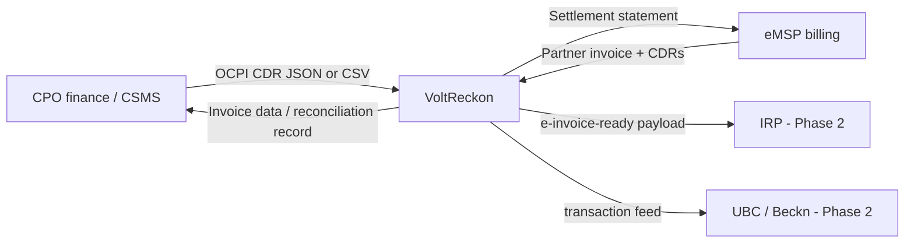
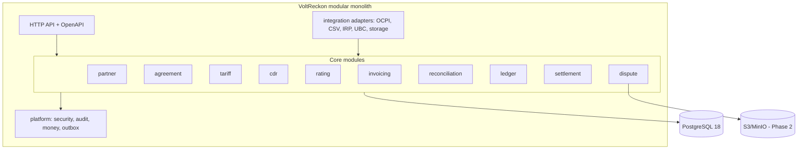
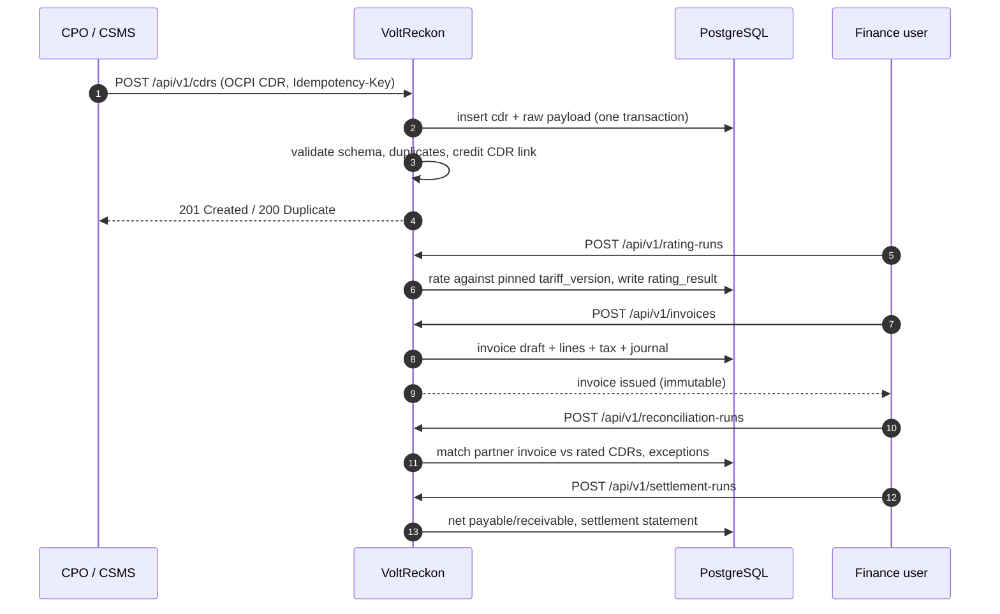
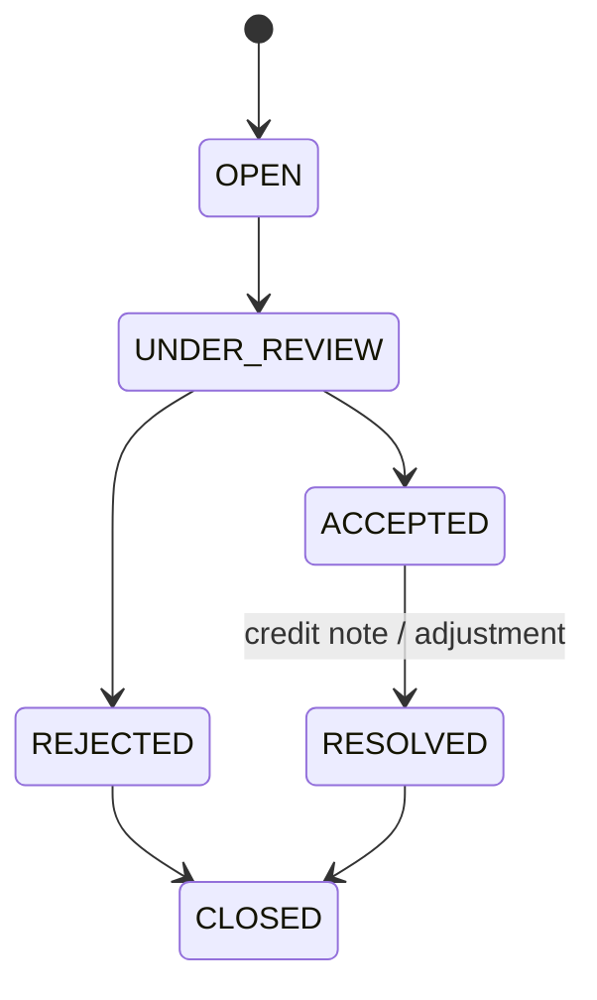

# VoltReckon

**Open back-office infrastructure for EV charging settlement and reconciliation.**

VoltReckon is a research-and-engineering blueprint for a Java/Spring Boot platform that helps Charge Point Operators (CPOs), e-Mobility Service Providers (eMSPs), and their finance teams reconcile roaming charging records, re-rate them against versioned tariffs, produce GST-aware invoice data, keep a double-entry ledger, manage disputes, and settle partner balances.

> **Status: blueprint v0.1 (documentation only).**
> There is no application code in this repository yet. Every feature below is labelled **Planned** unless it is a repository/documentation file. Nothing in this README claims a working integration, customer, benchmark, or certification.

---

## Table of contents

1. [What VoltReckon is](#1-what-voltreckon-is)
2. [What VoltReckon is not](#2-what-voltreckon-is-not)
3. [Problem statement](#3-problem-statement)
4. [Industry context](#4-industry-context)
5. [Why this project matters](#5-why-this-project-matters)
6. [Target users](#6-target-users)
7. [Core use cases](#7-core-use-cases)
8. [Features and status](#8-features-and-status)
9. [MVP scope](#9-mvp-scope)
10. [Architecture overview](#10-architecture-overview)
11. [Technology stack](#11-technology-stack)
12. [Repository structure](#12-repository-structure)
13. [Database overview](#13-database-overview)
14. [Main business workflows](#14-main-business-workflows)
15. [Security considerations](#15-security-considerations)
16. [Local development setup](#16-local-development-setup)
17. [Docker setup](#17-docker-setup)
18. [Configuration](#18-configuration)
19. [API documentation](#19-api-documentation)
20. [Testing](#20-testing)
21. [Contributing](#21-contributing)
22. [Roadmap](#22-roadmap)
23. [Known limitations](#23-known-limitations)
24. [Research references](#24-research-references)
25. [Acknowledgements](#25-acknowledgements)
26. [License](#26-license)

---

## 1. What VoltReckon is

VoltReckon is a **B2B settlement and reconciliation workbench** for the EV charging back office. Its core loop is:

```
CDR in  ->  validate & de-duplicate  ->  re-rate against a pinned tariff  ->  invoice data
        ->  reconcile partner invoice  ->  dispute / credit note            ->  double-entry ledger
        ->  net settlement statement
```

The platform is designed around the parts of the value chain that are expensive to get right and easy to get wrong:

- **Charge Detail Record (CDR) integrity** — OCPI CDRs are billing records; once sent they cannot be edited, only credited.
- **Tariff versioning** — a session must be rated against the tariff version that was effective for that session, not today's price list.
- **Invoice reconciliation** — OCPI 2.3.0 edition 2 (June 2026) added an `Invoice Reconciliation` module specifically because CPOs and eMSPs need a shared way to check invoices against exchanged CDRs.
- **Financial correctness** — append-only double-entry journals, explicit rounding, credit notes, and no floating-point money.
- **Indian tax reality** — GST on EV charging is a service (practically 18%), e-invoicing is mandatory above the notified turnover threshold, and classification is contested. These are configurable rules, not hard-coded assumptions.

VoltReckon is **complementary** to public discovery/payment rails such as India's Unified Bharat e-Charge (UBC) and to roaming hubs such as Hubject and Gireve. It does not replace them.

## 2. What VoltReckon is not

| Not this | Why |
|---|---|
| A consumer EV charging app | UBC/BHIM, OEM apps, and CPO apps already own discovery and payment. |
| A Charge Point Management System (CSMS) | CSMS platforms own OCPP device control, live sessions, and charger operations. |
| A roaming hub | Hubject, Gireve, and UBC/Beckn are the network layer. Building another hub is out of scope. |
| A payment processor or wallet | VoltReckon records settlement obligations; it does not hold customer funds. |
| A tax filing product | It produces GST-aware invoice data and e-invoice-ready payloads; filing and legal interpretation remain with the taxpayer and their advisors. |
| A general ledger replacement | It maintains a focused subledger for EV charging settlement, exportable to accounting systems. |
| An AI product | Financial postings and approvals stay deterministic. AI is deferred and, if added, advisory only. |

## 3. Problem statement

Cross-network EV charging creates a data and money trail between organisations that do not share a database:

1. A driver buys charging service from an eMSP.
2. The driver charges on a CPO's station.
3. The CPO sends a CDR to the eMSP (typically over OCPI).
4. The eMSP invoices the driver and owes the CPO a wholesale amount.
5. Both sides must agree on energy, time, tariff version, tax, and totals before money moves.

The failure modes are mundane and expensive:

- The same CDR arrives twice, or a correction arrives without the original being credited.
- The CPO re-rated the session after a tariff change; the eMSP used the old tariff.
- Timestamps cross a month boundary, so the session lands in different invoice periods.
- Energy differs slightly between the charger meter, the CSMS, and the CDR.
- A tax component is applied to energy but not to time, or at a different rate.
- A partner invoice total does not match the sum of the CDRs the partner actually received.
- A dispute has screenshots but no immutable evidence chain.
- The ledger says the books balance, but the settlement statement says otherwise.

These are **reconciliation and evidence problems**, not charger-hardware problems. That is the gap VoltReckon targets.

Evidence for this problem is documented in [docs/research/industry-analysis.md](docs/research/industry-analysis.md). The strongest primary signal is that the OCPI specification itself added an Invoice Reconciliation module in 2026, and the CDR module explicitly requires Credit CDRs instead of edits.

## 4. Industry context

### India

- The Ministry of Power's **Guidelines for Installation and Operation of EV Charging Infrastructure 2024** (17 September 2024) de-licensed charging-station operation and encouraged open protocols: OCPP, OCPI, UEI, and OpenADR.
- BEE reported **25,202 public charging stations** as of 28 November 2024 in a Rajya Sabha answer. Later secondary reporting puts the count around **27,700 by March 2026**; official counts vary by definition and should be re-checked before quoting.
- India has dozens of charging networks. Industry reporting in 2025 described nine CPOs roaming across more than 13,500 charge points through a single app, and multiple CPMS vendors offering OCPI integration.
- **Unified Energy Interface (UEI)** was an earlier Beckn-based open network for energy transactions, promoted in 2024.
- **Unified Bharat e-Charge (UBC)** was unveiled on 12 May 2026 by the Ministry of Heavy Industries, with BHEL as project implementation agency and NPCI BHIM Services for design and development. It is Beckn-based digital public infrastructure, initially usable through the BHIM app, and reported to pilot in Maharashtra, Karnataka, Delhi-NCR, Haryana, and Rajasthan.

**Implication:** consumer discovery and UPI payment interoperability are being solved by public infrastructure. The remaining hard problem is the **B2B back office**: CDR validation, re-rating, invoice reconciliation, tax, disputes, ledger, and net settlement.

### Standards

- **OCPP** is the charger-to-CSMS protocol. OCPP 2.0.1 edition 4 and OCPP 2.1 edition 2 were published by the Open Charge Alliance in December 2025.
- **OCPI** is the network-to-network protocol between CPOs and eMSPs. OCPI 2.3.0 (February 2025) is current; **OCPI 2.3.0 edition 2 (18 June 2026)** added the **Invoice Reconciliation** module.
- **OCPI 3.0** is in draft and not a dependency.
- **UBC** uses the Beckn protocol; it is not OCPI. A production adapter must treat both as separate integration contracts.

VoltReckon's target contract is **OCPI 2.3.0 CDRs + Invoice Reconciliation**, with OCPI 2.2.1 compatibility for partners that have not upgraded.

## 5. Why this project matters

The project is worth building for three reasons:

1. **The hard part is under-served.** Most public attention goes to chargers, apps, and roaming coverage. The financial control layer — immutable records, tariff pinning, reconciliation evidence, and balanced journals — is where trust is won or lost.
2. **Standards now exist.** OCPI 2.3.0 edition 2 gives the industry a shared invoice-reconciliation vocabulary. Implementing it rigorously is a concrete, testable engineering goal.
3. **India is a real, evolving market.** UBC is creating a national transaction layer while GST/e-invoicing creates a compliance layer. A small CPO/eMSP needs a back office that speaks both, without buying an enterprise CPMS.

The honest caveat: large CPOs and CPMS vendors already build parts of this. VoltReckon's near-term value is as a **rigorous reference implementation and a tool for small/mid-sized operators**, not as a proven replacement for enterprise suites. See [docs/00-executive-assessment.md](docs/00-executive-assessment.md).

## 6. Target users

| User | Need |
|---|---|
| Finance/ops lead at a mid-sized CPO | Prove what partners owe, why, and with evidence. |
| Billing analyst at an eMSP | Reconcile partner invoices against received CDRs and tariffs. |
| Roaming manager | Onboard partners, pin agreements, manage tariff versions and exceptions. |
| Dispute handler | Assemble evidence and resolve cases without spreadsheet archaeology. |
| Engineer/auditor | Trace every financial posting to an immutable source record. |

## 7. Core use cases

1. **Onboard a roaming partner** and record the commercial agreement, currencies, settlement cycle, and tax profile.
2. **Publish a versioned tariff** and rate historical sessions against the version effective at session time.
3. **Ingest OCPI CDRs** (JSON or CSV export), detect duplicates and credit CDRs, and quarantine invalid records.
4. **Re-rate and compare** expected charges against the CDR's declared totals; surface variances.
5. **Generate invoice data** with GST split and invoice numbering, then issue an immutable invoice.
6. **Reconcile a partner invoice** line by line against received CDRs and the applicable tariff.
7. **Open and resolve a dispute** with an evidence chain and a credit note or adjustment.
8. **Post double-entry journals** for invoices, credit notes, and settlements; prove the trial balance.
9. **Run a settlement cycle** that nets payables and receivables and produces a partner statement.
10. **Export** an audit-ready package for accountants and partners.

## 8. Features and status

Status legend: **Planned** = designed, not built. **Phase 2/3** = deliberately deferred. **Done** = documentation exists in this repository.

| Capability | Status | Doc |
|---|---|---|
| Industry and competitor research | Done | [research](docs/research/) |
| Architecture and ADRs | Done | [architecture](docs/architecture/) |
| Database DDL and financial model | Done | [database](docs/database/) |
| OpenAPI 3.1 MVP contract | Done | [openapi.yaml](docs/api/openapi.yaml) |
| Partner and agreement registry | Planned | [modules](docs/architecture/module-boundaries.md) |
| Versioned tariffs and rating | Planned | [modules](docs/architecture/module-boundaries.md) |
| OCPI CDR ingestion and validation | Planned | [API design](docs/api/01-api-design.md) |
| Invoice generation and credit notes | Planned | [financial model](docs/database/02-financial-model.md) |
| Invoice reconciliation and exceptions | Planned | [modules](docs/architecture/module-boundaries.md) |
| Double-entry ledger and trial balance | Planned | [financial model](docs/database/02-financial-model.md) |
| Dispute and evidence management | Planned | [modules](docs/architecture/module-boundaries.md) |
| Settlement netting and statements | Planned | [modules](docs/architecture/module-boundaries.md) |
| Reporting and audit export | Planned | [roadmap](docs/roadmap/01-implementation-roadmap.md) |
| Full OCPI 2.3.0 endpoint suite | Phase 2 | [integration strategy](docs/architecture/module-boundaries.md) |
| IRP e-invoice integration | Phase 2 | [standards research](docs/research/standards-research.md) |
| UBC/Beckn transaction adapter | Phase 2 | [standards research](docs/research/standards-research.md) |
| Anomaly detection / AI assistance | Phase 3 | [AI assessment](docs/00-executive-assessment.md) |
| Payments or wallet | Out of scope | [scope](docs/00-executive-assessment.md) |

## 9. MVP scope

**In scope (one deployable, one PostgreSQL database):**

- Partner organisations, users, roles, GSTINs, and partner-scoped isolation.
- Roaming agreements with effective dates, settlement cycle, and currency.
- Immutable tariff versions with OCPI-style elements (energy, time, parking, fixed) and restrictions.
- CDR ingestion via authenticated REST and CSV; idempotency; duplicate and credit-CDR handling.
- Deterministic rating and variance detection.
- Invoice drafts, GST split (configurable rate), issue, credit note, and immutable numbering.
- Partner-invoice reconciliation with an exception queue.
- Double-entry ledger, trial balance, and period summary.
- Dispute case workflow with evidence metadata and object storage adapter.
- Settlement run with netting, advisory locking, and statement export.
- Append-only audit log, structured logs, metrics, and a Docker Compose developer environment.

**Explicitly out of scope for the MVP:**

- OCPP/CSMS device control, live charger state, or remote start/stop.
- Consumer app, UPI collection, wallet, or stored value.
- Being a roaming hub or a Beckn gateway.
- Automatic money movement or payout execution.
- GST return filing, legal tax advice, or IRP production integration.
- Kafka, Kubernetes, Redis, microservices, event sourcing, or blockchain.
- AI/ML in any financial decision path.

## 10. Architecture overview

**Decision: modular monolith.** One Spring Boot deployable, one PostgreSQL database, module boundaries enforced by Spring Modulith and ArchUnit. Domain modules communicate through application services and transactional events; no module reads another module's JPA entities.





Full diagrams: [docs/architecture/diagrams.md](docs/architecture/diagrams.md). System boundary: [docs/architecture/system-context.md](docs/architecture/system-context.md). Architecture decisions: [docs/architecture/decisions.md](docs/architecture/decisions.md).

## 11. Technology stack

Versions are the **research baseline (November 2026)** and must be pinned in the build. Nothing here is claimed to be already wired up.

| Layer | Choice | Why | Deliberately not used |
|---|---|---|---|
| Language | Java 25 LTS | Modern LTS supported by Spring Boot 4.1; records, sealed types, pattern matching, virtual threads if needed. | Java 17 (older LTS; fine but no reason to start there) |
| Framework | Spring Boot 4.1.x (4.1.2 baseline) | Current supported line (OSS support to July 2027), Spring Framework 7. | Boot 3.x (OSS support ended June 2026) |
| Modularity | Spring Modulith 2.1.x | Verifies module boundaries; event publication registry acts as an outbox. | Microservices |
| Persistence | Spring Data JPA + Hibernate ORM 7.x | Mature transactional mapping; explicit boundaries. | Event sourcing |
| Database | PostgreSQL 18.x (18.6 baseline) | Transactions, constraints, partitioning, JSONB, strong SQL; supported to 2030. | MongoDB for financial records |
| Migrations | Flyway | Versioned, repeatable SQL migrations. | Hibernate auto-DDL |
| Security | Spring Security 7.x, OAuth2/JWT | Standard authn/authz, method security, partner scopes. | Custom auth |
| API docs | OpenAPI 3.1 + springdoc | Contract-first for partners; generated client/server later. | Hand-written Swagger annotations only |
| Events | Transactional outbox (Spring Modulith) | At-least-once delivery without operating a broker at MVP volume. | Kafka, RabbitMQ |
| Caching / locks | PostgreSQL | Sufficient for MVP; advisory locks for settlement runs. | Redis |
| Batch | Scheduled paged jobs | Simple, restartable, observable. | Spring Batch (revisit at high volume) |
| Testing | JUnit 5, AssertJ, Mockito, Testcontainers, WireMock, ArchUnit, jqwik, REST Assured | Unit, integration, contract, architecture, property-based. | Selenium-first (no UI) |
| Observability | Micrometer, OpenTelemetry, Prometheus, Grafana | Traces, metrics, dashboards; Loki optional. | Proprietary APM |
| Containers | Docker + Compose | Reproducible local stack. | Kubernetes in MVP |
| CI | GitHub Actions | Build, test, CodeQL, dependency review, Docker build. | Jenkins |

## 12. Repository structure

```
VoltReckon/
├── README.md
├── LICENSE                        # MIT, Copyright (c) 2026 Kartik Sharma
├── CONTRIBUTING.md
├── CODE_OF_CONDUCT.md
├── SECURITY.md
├── CHANGELOG.md
├── Makefile
├── compose.yaml                   # PostgreSQL 18 for local development
├── .env.example
├── .editorconfig
├── .gitignore
├── .github/
│   ├── CODEOWNERS
│   ├── PULL_REQUEST_TEMPLATE.md
│   ├── ISSUE_TEMPLATE/
│   └── workflows/
├── docs/
│   ├── README.md                  # documentation index
│   ├── 00-executive-assessment.md
│   ├── research/
│   │   ├── industry-analysis.md
│   │   ├── india-ev-ecosystem.md
│   │   ├── competitor-analysis.md
│   │   ├── standards-research.md
│   │   └── resource-library.md
│   ├── architecture/
│   │   ├── system-context.md
│   │   ├── architecture-overview.md
│   │   ├── module-boundaries.md
│   │   ├── database-design.md
│   │   ├── security-architecture.md
│   │   ├── deployment-architecture.md
│   │   ├── reliability.md
│   │   ├── decisions.md
│   │   └── diagrams.md
│   ├── database/
│   │   ├── schema.sql
│   │   └── 02-financial-model.md
│   ├── api/                       # API guide + openapi.yaml
│   ├── testing/                   # strategy and quality gates
│   ├── roadmap/                   # milestones, issues, definition of done
│   ├── operations/                # runbook
│   ├── adr/                       # 0001-0008
│   └── reviews/                   # principal-engineer review
└── backend/                       # (planned) Spring Boot application
    ├── pom.xml
    └── src/{main,test}/...
```

The `backend/` tree is intentionally not created yet. Creating empty packages would fake progress. It is created in Milestone 1 as a vertical slice.

## 13. Database overview

Core tables (full DDL in [docs/database/schema.sql](docs/database/schema.sql)):

| Area | Tables |
|---|---|
| Identity/tenancy | `partner`, `app_user`, `app_user_role` |
| Agreements | `partner_agreement`, `agreement_tariff_link` |
| Tariffs | `tariff`, `tariff_version`, `tariff_price_component`, `tariff_restriction`, `tax_rate` |
| CDRs | `cdr`, `cdr_dimension`, `cdr_validation_issue` |
| Rating | `rating_run`, `rating_result`, `rating_line`, `rating_variance` |
| Invoicing | `invoice`, `invoice_line`, `invoice_tax_line`, `credit_note` |
| Reconciliation | `reconciliation_run`, `reconciliation_item`, `reconciliation_exception` |
| Ledger | `ledger_account`, `journal_entry`, `journal_line`, `accounting_period` |
| Settlement | `settlement_run`, `settlement_item`, `settlement_statement` |
| Disputes | `dispute`, `dispute_evidence`, `dispute_event` |
| Platform | `audit_log`, `outbox_event`, `idempotency_key`, `sequence_number` |

Financial invariants:

- Every `journal_entry` has at least two `journal_line` rows and `sum(debit_minor) = sum(credit_minor)`.
- Money is stored as `BIGINT` minor units plus ISO-4217 currency. No `FLOAT`, `REAL`, or `DOUBLE`.
- Issued invoices and posted journals are append-only. Corrections use credit notes and reversing entries.
- A rating result pins the exact `tariff_version_id` and input hash used.

## 14. Main business workflows

**CDR to settlement:**



**Dispute:**



## 15. Security considerations

- OAuth2/OIDC for human users; OAuth2 client credentials for partner systems; JWT with `partner_id` and scopes.
- Every query and command is partner-scoped. Cross-partner access is a test failure, not a code-review hope.
- `Idempotency-Key` on all mutating POSTs; HMAC + timestamp + nonce on inbound webhooks; 5-minute replay window.
- Secrets come from environment/secret manager. No secrets in the repository.
- TLS in transit, encryption at rest at the infrastructure layer, evidence files in private object storage.
- PII minimisation: store token UIDs and session references, not driver names or phone numbers.
- Append-only audit log for financial actions; before/after hashes for mutable aggregates.
- Target OWASP ASVS Level 2 for the MVP.
- Rate limiting and mTLS are Phase 2; they are not pretended to exist.

Details: [docs/architecture/security-architecture.md](docs/architecture/security-architecture.md).

## 16. Local development setup

### Prerequisites

| Tool | Version | Notes |
|---|---|---|
| JDK | 25 (Temurin recommended) | Only needed from Milestone 1 onward. |
| Maven | 3.9+ | Or use the Maven wrapper once added. |
| Docker Desktop | Current | For PostgreSQL. |
| Git | Current | |
| `make` | Optional | PowerShell commands are provided as well. |

### Start the database (works today)

```powershell
Copy-Item .env.example .env
docker compose up -d postgres
docker compose ps
```

Connect:

```powershell
docker compose exec postgres psql -U voltreckon -d voltreckon
```

Stop:

```powershell
docker compose down
```

Remove the volume (destructive):

```powershell
docker compose down -v
```

### Run the application (after Milestone 1)

These commands are the target contract for Milestone 1. They will work once `backend/pom.xml` exists.

```powershell
cd backend
mvn spring-boot:run
```

```powershell
curl.exe http://localhost:8080/actuator/health
```

### Documentation checks (works today)

```powershell
Get-ChildItem docs -Recurse -Filter *.md | Select-String -Pattern 'TODO:|TBD:'
```

Link checking and OpenAPI linting are defined in `.github/workflows/ci.yml`; the Java build is skipped until `backend/pom.xml` exists.

## 17. Docker setup

`compose.yaml` defines:

- `postgres` — PostgreSQL 18 with a named volume, health check, and port `${POSTGRES_PORT:-5432}`.
- No Redis, no Kafka, no app container yet. This is deliberate: the MVP does not need them, and the application does not exist yet.

When Milestone 1 lands, a `backend` service and multi-stage `Dockerfile` will be added. Production deployment guidance (single container + managed PostgreSQL; Kubernetes optional) is in [docs/architecture/deployment-architecture.md](docs/architecture/deployment-architecture.md).

## 18. Configuration

Copy `.env.example` to `.env` and change the password for anything beyond local use.

| Variable | Default | Purpose |
|---|---|---|
| `POSTGRES_DB` | `voltreckon` | Database name |
| `POSTGRES_USER` | `voltreckon` | Database user |
| `POSTGRES_PASSWORD` | `voltreckon_local_only` | Local-only password |
| `POSTGRES_PORT` | `5432` | Host port |

Application configuration (JWT issuer, partner scopes, tax defaults, object storage) will be added as typed `@ConfigurationProperties` in Milestone 1. Secrets will not have defaults in production profiles.

## 19. API documentation

- Design guide: [docs/api/01-api-design.md](docs/api/01-api-design.md)
- OpenAPI 3.1 MVP contract: [docs/api/openapi.yaml](docs/api/openapi.yaml)

API conventions:

- Base path `/api/v1`.
- JSON only; RFC 3339 UTC timestamps; ISO-4217 currencies; money as `{ "amountMinor": 12345, "currency": "INR" }`.
- `Idempotency-Key` required on POST endpoints that create financial records.
- Errors use RFC 9457-style problem details with a stable `code`.
- Pagination uses `limit` + `cursor`, not offsets, for CDR and audit listings.

The OpenAPI file is a design contract. It does not imply an implemented server.

## 20. Testing

Target strategy (full detail in [docs/testing/01-strategy.md](docs/testing/01-strategy.md)):

- **Unit**: money arithmetic, tariff selection, rating, tax rounding, state machines.
- **Property-based**: invoice line sums equal totals; journal debits equal credits; rating is monotonic in energy at a fixed tariff.
- **Integration**: Testcontainers PostgreSQL + Flyway; repository and service tests; concurrency tests.
- **Contract**: OpenAPI validation; WireMock for IRP/UBC/partner adapters.
- **Architecture**: ArchUnit rules for module boundaries and forbidden types (`float`, `double` in domain).
- **End-to-end**: REST Assured full CDR → invoice → ledger → settlement flow.
- **Load/failure**: Gatling or k6 for ingestion; Toxiproxy for network failures; outbox replay tests.

Quality goals are invariants, not vanity coverage: zero unbalanced journal postings, every monetary value through the `Money` type, every financial mutation audited, and deterministic reproduction of every reconciliation exception.

## 21. Contributing

Read [CONTRIBUTING.md](CONTRIBUTING.md). In short:

- One vertical slice per pull request.
- New architectural decision → new ADR in `docs/adr/`.
- Financial changes require tests for rounding, balancing, and idempotency.
- No secrets, no generated code dumps, no "enterprise" folder trees without working behaviour.

## 22. Roadmap

| Milestone | Outcome |
|---|---|
| 0 | Research, architecture, schema, API contract (this repository) |
| 1 | Walking skeleton: one CDR → rating → invoice draft → balanced journal → trial balance |
| 2 | Partner onboarding, agreements, versioned tariffs |
| 3 | Robust CDR ingestion: idempotency, quarantine, credit CDRs, CSV |
| 4 | Invoice issue, GST split, credit notes, numbering |
| 5 | Partner invoice reconciliation and exception queue |
| 6 | Disputes and evidence |
| 7 | Settlement netting, statements, period locks |
| 8 | Reporting, audit export, operational dashboards |
| 9 | OCPI 2.3.0 endpoint suite and partner sandbox |
| 10 | IRP e-invoice integration and UBC/Beckn adapter |
| 11 | Production hardening, load tests, DR runbook |

Full milestone definitions, definitions of done, and issue breakdown: [docs/roadmap/](docs/roadmap/).

## 23. Known limitations

- **No code yet.** This is a blueprint. The README's feature table is the source of truth for status.
- **No customer validation.** The problem is evidenced by standards and industry reporting, not by interviews with design partners.
- **UBC specifications and onboarding details are not fully public.** The adapter is Phase 2 and will be built only against official material.
- **GST treatment of EV charging is contested.** VoltReckon models tax as configurable rules; it does not provide legal advice.
- **OCPI 2.3.0 adoption in India is uneven.** OCPI 2.2.1 compatibility is required in practice.
- **The MVP is not a CSMS.** It cannot start a charging session or read a charger directly.
- **No money movement.** Settlement statements are records; payment execution is out of scope.
- **One developer.** The roadmap is sequenced for a single developer and deliberately avoids distributed-systems overhead.

## 24. Research references

Primary sources used in this blueprint (full annotated library in [docs/research/resource-library.md](docs/research/resource-library.md)):

- Ministry of Power, *Guidelines for Installation and Operation of EV Charging Infrastructure 2024* — [BEE copy](https://www.beeindia.gov.in/WriteReadData/L45218/2841453721548450.pdf)
- Rajya Sabha Unstarred Question No. 1587 (9 December 2024) — [sansad.in](https://www.sansad.in/getFile/annex/266/AU1587_y7ofyg.pdf?source=pqars)
- NITI Aayog, *Handbook of Electric Vehicle Charging Infrastructure Implementation* — [niti.gov.in](https://www.niti.gov.in/sites/default/files/2023-02/EV_Handbook_Final_14Oct.pdf)
- OCPI specification, version 2.3.0 — [github.com/ocpi/ocpi](https://github.com/ocpi/ocpi)
- OCPI CDRs module (Credit CDRs) — [mod_cdrs.asciidoc](https://github.com/ocpi/ocpi/blob/2.3.0/release/core/mod_cdrs.asciidoc)
- OCPI Invoice Reconciliation module — [mod_invoice_reconciliation.asciidoc](https://github.com/ocpi/ocpi/blob/2.3.0/release/core/mod_invoice_reconciliation.asciidoc)
- Open Charge Alliance, OCPP 2.0.1/2.1 editions — [openchargealliance.org](https://openchargealliance.org/new-editions-of-the-ocpp-2-1-and-2-0-1-now-available)
- GST Council, 36th meeting press note (EV chargers 5%) — [gstcouncil.gov.in](https://gstcouncil.gov.in/sites/default/files/2024-10/36_gst_press_information_bureau.pdf)
- GST e-invoice portal and FAQs — [einvoice.gst.gov.in](https://einvoice.gst.gov.in/einvoice/dashboard)
- DPDP Rules, 2025 (Gazette) — [egazette.gov.in](https://egazette.gov.in/WriteReadData/2025/267650.pdf)
- UBC launch reporting — [The Hindu BusinessLine](https://www.thehindubusinessline.com/economy/india-gets-its-upi-for-ev-charging-as-kumaraswamy-unveils-unified-bharat-e-charge/article70970320.ece)

## 25. Acknowledgements

- The OCPI community and EVRoaming Foundation for an open, well-documented roaming protocol.
- The Open Charge Alliance for OCPP specifications and test material.
- Indian public agencies (Ministry of Power, BEE, NITI Aayog, GST Council) for publishing the regulatory baseline.
- The maintainers of Spring Boot, Spring Modulith, PostgreSQL, Testcontainers, Flyway, and the other open-source tools this blueprint depends on.

## 26. License

MIT License. Copyright (c) 2026 Kartik Sharma. See [LICENSE](LICENSE).
