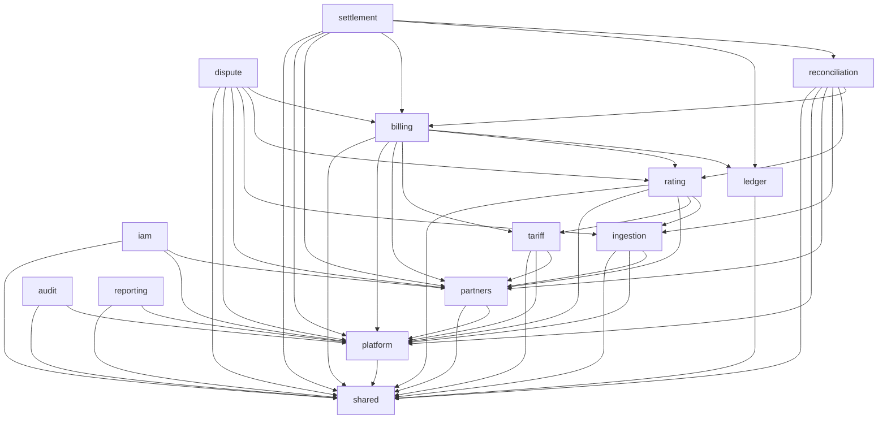

# 03 — Architecture

- **Status:** Draft
- **Owner:** VoltReckon maintainer
- **Last verified:** 2026-11-13
- **Applies to phases:** 0–10

## 1. Goals and constraints

VoltReckon is a modular monolith: one Spring Boot deployable, one PostgreSQL 18 database,
and hard module boundaries inside the JVM. The architecture optimises for a single
maintainer, deterministic financial behaviour, and tests that run against real PostgreSQL.
It does not optimise for independent deployment, polyglot storage, or horizontal scaling.

The style is recorded in [ADR-0001](adr/0001-modular-monolith.md); the runtime is
[ADR-0002](adr/0002-java-and-runtime.md); dependencies are
[ADR-0007](adr/0007-module-set-and-dependencies.md).

**ARCH-001** VoltReckon T1 MUST be one deployable application and one PostgreSQL database.
*Check:* `13-build-and-operations` command list; `ArchitectureTests` asserts one application
module graph; no remote module calls exist in the dependency set.

**ARCH-002** All application tables MUST live in the single schema `voltreckon`.
*Check:* `04-data-model` migration map; Flyway integration test asserts the schema.

**ARCH-003** A module's public API MUST be the types in `com.voltreckon.<module>` and its
`events` subpackage. *Check:* `ArchitectureTests` rejects cross-module imports outside those
packages.

**ARCH-004** Implementation types MUST live under `com.voltreckon.<module>.internal` and MUST
NOT be imported by another module. *Check:* ArchUnit rule `noClasses().that().resideOutsideOfPackage(...)`.

## 2. Module map

| Module | Public package | Owns | First phase |
|---|---|---|---|
| `shared` | `com.voltreckon.shared` | Money, currency, pagination, base errors, event envelope types | 1 |
| `platform` | `com.voltreckon.platform` | Clock, ID generator, JPA/Flyway support, outbox adapter, web problem mapping | 1 |
| `iam` | `com.voltreckon.iam` | Users, roles, partner-scoped authentication and authorization | 2 |
| `partners` | `com.voltreckon.partners` | Partner registry, roles, GST profile, agreements | 1 |
| `ingestion` | `com.voltreckon.ingestion` | CDR intake, validation, dedupe, quarantine, credit handling | 1 |
| `tariff` | `com.voltreckon.tariff` | Tariffs, versions, components, restrictions, effective selection | 2 |
| `ledger` | `com.voltreckon.ledger` | Chart of accounts, journals, postings, periods, trial balance | 4 |
| `rating` | `com.voltreckon.rating` | Rating runs, results, lines, variance | 3 |
| `billing` | `com.voltreckon.billing` | Invoices, tax lines, credit notes, numbering | 5 |
| `dispute` | `com.voltreckon.dispute` | Cases, state machine, evidence metadata, timeline | 7 |
| `reconciliation` | `com.voltreckon.reconciliation` | Statement import, matching, exceptions | 6 |
| `settlement` | `com.voltreckon.settlement` | Netting, settlement runs, statements, locks | 8 |
| `audit` | `com.voltreckon.audit` | Append-only audit chain and verification | 9 |
| `reporting` | `com.voltreckon.reporting` | Read-only query APIs and `rpt_*` views | 9 |

`shared` and `platform` are documented together in
[modules/shared-platform.md](modules/shared-platform.md). `rating` is a new module; the
Phase 0 scaffold has no package for it yet.

## 3. Dependency graph

Arrows point from consumer to provider. The graph is acyclic and is the only legal
cross-module direction. [ADR-0013](adr/0013-iam-partner-and-billing-tariff-dependencies.md)
adds the `iam -> partners` and `billing -> tariff` edges.



`audit` additionally depends on the **public event types** of every domain module. `reporting`
additionally depends on the **public query APIs** of every domain module and on `audit`.
Those edges are omitted from the diagram to keep it readable; they do not create cycles
because no domain module imports `audit` or `reporting`.

**ARCH-005** A module MUST depend only on modules above it in this order:
`shared`, `platform`, `partners`, `iam`, `tariff`, `ingestion`, `ledger`, `rating`,
`billing`, `dispute`, `reconciliation`, `settlement`, `audit`, `reporting`.
*Check:* `ArchitectureTests` encodes the table; `ApplicationModules.verify()` rejects cycles.

**ARCH-006** `ledger` MUST depend on no domain module and MUST NOT know partner, invoice, or
CDR types. *Check:* ArchUnit rule plus `ledger` public API review.

**ARCH-007** `audit` and `reporting` MUST be sinks: no module may depend on them.
*Check:* ArchUnit rule.

**ARCH-008** A new module dependency MUST be introduced by a superseding ADR, not by an
import. *Check:* review of `pom.xml` and `module-info`-style package imports; ADR index.

**ARCH-009** `rating`, `audit`, and `reporting` MUST be created as real Modulith modules
before Phase 3 or Phase 9 code lands, with the same public/internal split.
*Check:* `ApplicationModules.verify()` and `ArchitectureTests` in the phase that introduces
them.

## 4. Layering inside a module

Every module has three layers; the names are conventions, not package names.

| Layer | Contains | May depend on |
|---|---|---|
| Domain | Records, value objects, state machines, policy, pure calculations | Java standard library, `shared` value types |
| Application | Use cases, command/query handlers, transaction boundaries, port interfaces | Domain, module public API, `platform` technical ports |
| Adapter | REST controllers, JPA repositories, event handlers, external clients | Application, Domain, `platform` |

**ARCH-010** Domain code MUST NOT import Spring, JPA, Jackson, Servlet, or a module's
`internal` package. *Check:* ArchUnit rule `noClasses().that().resideInAPackage("..domain..")`
and dependency review.

**ARCH-011** Public API records MUST NOT carry JPA or Jackson annotations. *Check:* ArchUnit
annotation rule on `com.voltreckon.<module>` and `..events..`.

**ARCH-012** A module's public API MUST expose commands, queries, results, events, and
enums only; it MUST NOT expose repositories or entities. *Check:* API review; ArchUnit
rejects public classes ending in `Repository` or `Entity` in the root package.

## 5. Data ownership and transactions

**ARCH-013** Each table has exactly one owning module. The owner is the only module allowed
to write it. Ownership is recorded in [04-data-model.md](04-data-model.md) and in the
migration filename comment. *Check:* migration review; SQL review; repository package
location.

**ARCH-014** A module MUST NOT read another module's tables directly. Cross-module reads use
the owner's public query API. The single exception is `reporting`, which owns read-only
`rpt_*` views over domain tables in V016. *Check:* repository package review; `reporting`
queries only views; ArchUnit cannot inspect SQL, so review is mandatory.

**ARCH-015** A synchronous cross-module command MUST call the provider's public command
interface and MUST run in the caller's transaction. The provider MUST NOT start a new
transaction or commit independently. *Check:* application-service review; integration test
that rolls back the caller and observes no provider row.

**ARCH-016** Financial posting MUST be synchronous inside the document's transaction when
the posting and the document must be atomic. Events are notifications after commit, not the
mechanism that creates the journal. *Check:* `billing` and `settlement` integration tests;
`JournalBalanceIT`.

**ARCH-017** A module MUST NOT open a distributed transaction, call another service, or
write another module's outbox. *Check:* dependency set; ArchUnit; review.

**ARCH-018** An asynchronous event handler MUST run in its own transaction and MUST be
idempotent by event ID. *Check:* `processed_event` unique constraint; handler integration
test that delivers the same event twice.

## 6. Events and outbox

Events are the only asynchronous cross-module contract. The transactional outbox is
[ADR-0004](adr/0004-transactional-outbox.md); event rules are `EVENT-001`–`EVENT-012`.

**Event envelope**

```text
eventId        UUIDv4, unique forever
eventType      <module>.<entity>.<action>.v<major>
occurredAt     UTC instant
aggregateId    UUID of the changed aggregate
partnerId      UUID of the owning partner, or null for platform events
version        payload schema major version, integer
traceId        correlation identifier
payload        JSON object, no personal data
```

**EVENT-001** An event type MUST use the form `<module>.<entity>.<action>.v<major>`, for
example `billing.invoice.issued.v1`. *Check:* event catalog review; contract test.

**EVENT-002** The envelope fields above MUST be present on every event. *Check:* shared
`EventEnvelope` contract test.

**EVENT-003** An event payload MUST be immutable and MUST contain only data needed by its
consumers. *Check:* review; no mutable collections; no entity references.

**EVENT-004** The state change and its outbox row MUST commit in the same database
transaction. *Check:* `platform` outbox test; integration test forcing a rollback.

**EVENT-005** Delivery is at least once. A consumer MUST tolerate duplicate delivery.
*Check:* handler test with duplicate event ID; `processed_event` unique key.

**EVENT-006** A consumer MUST record `processed_event(event_id, consumer, processed_at)`
before committing its own state change. *Check:* migration and handler integration test.

**EVENT-007** A failed handler MUST retry with bounded backoff and MUST NOT block unrelated
events. After the configured attempt limit it MUST move to a dead-letter state with the
error. *Check:* outbox retry test; dead-letter query.

**EVENT-008** A handler MUST NOT call a remote system inside the transaction that records
`processed_event`. Remote effects happen after commit or in a separate job. *Check:*
handler review; no HTTP client in event handlers.

**EVENT-009** Events MUST NOT contain names, phone numbers, raw tokens, card data, or bank
credentials. *Check:* payload review; log redaction test.

**EVENT-010** A breaking payload change MUST publish a new major event type; the old type
stays for at least one phase. *Check:* event catalog diff; ADR for removal.

**EVENT-011** Only the events in the catalog below may be consumed across modules. A new
event requires a catalog update and, if it creates a new dependency, an ADR.
*Check:* catalog review; `ArchitectureTests` event package imports.

**EVENT-012** Financial journals MUST NOT be created by an asynchronous consumer when the
source document must be atomic with the journal. Use the synchronous command in `ARCH-016`.
*Check:* billing/settlement integration tests.

| Event | Producer | Consumers | Payload summary |
|---|---|---|---|
| `partners.partner.created.v1` | partners | audit, reporting | partner id, roles, country |
| `partners.partner.updated.v1` | partners | audit, reporting | partner id, changed fields |
| `partners.agreement.activated.v1` | partners | audit, reporting | agreement id, parties, currency |
| `tariff.tariff.published.v1` | tariff | rating, audit, reporting | tariff id, version, effective window |
| `ingestion.cdr.ingested.v1` | ingestion | rating, audit, reporting | cdr id, partner id, session id, external tariff reference |
| `ingestion.cdr.quarantined.v1` | ingestion | audit, reporting | cdr id, reason code |
| `rating.rating.completed.v1` | rating | billing, audit, reporting | rating id, cdr id, totals |
| `rating.rating.failed.v1` | rating | audit, reporting | rating id, cdr id, reason code |
| `billing.invoice.issued.v1` | billing | audit, reporting | invoice id, partner id, total, currency |
| `billing.credit_note.issued.v1` | billing | audit, reporting | credit note id, invoice id, total |
| `reconciliation.exception.raised.v1` | reconciliation | audit, reporting | exception id, partner id, kind |
| `dispute.dispute.opened.v1` | dispute | audit, reporting | dispute id, subject type, subject id |
| `dispute.dispute.resolved.v1` | dispute | audit, reporting | dispute id, outcome |
| `settlement.settlement.completed.v1` | settlement | audit, reporting | run id, partner pair, period, hash |
| `iam.user.role_changed.v1` | iam | audit, reporting | user id, roles, actor id |

## 7. Errors, APIs, and versions

**ARCH-019** HTTP errors MUST use RFC 9457 `application/problem+json` with a stable `code`
field [ref-23]. *Check:* `08-api-standards` contract tests; MockMvc/WebTestClient tests.

**ARCH-020** Public HTTP APIs MUST be versioned under `/api/v1`; a breaking change requires
a new path version. *Check:* OpenAPI review; controller mapping test.

**ARCH-021** The OpenAPI file at
`backend/voltreckon-app/src/main/resources/openapi/openapi.yaml` is the HTTP contract
[ADR-0010](adr/0010-openapi-contract.md). *Check:* contract test compares implemented paths
and schemas to the file.

**ARCH-022** A request that creates or changes money MUST accept an idempotency key and
MUST return the original result on replay. *Check:* per-module idempotency integration
test; unique key `(partner_id, endpoint, key)`.

## 8. Identity, time, money, and configuration

**ARCH-023** Externally visible entity identifiers MUST be UUIDv4. Internal append-only
ordering MAY use `bigserial`; it MUST NOT appear as an API identifier. *Check:* schema
review; public API review.

**ARCH-024** Instants MUST be stored as `timestamptz` and handled as UTC. Business dates
MUST be `date` in Asia/Kolkata. *Check:* schema review; `Clock` injection test.

**ARCH-025** Code MUST obtain the current time from an injected `Clock`, never from
`System.currentTimeMillis`, `Instant.now`, or `LocalDate.now`. *Check:* ArchUnit rule and
review.

**ARCH-026** Money MUST be an integer count of minor units plus an ISO 4217 currency
[ref-25]. `float` and `double` MUST NOT appear in money paths. *Check:* ArchUnit field/type
rule; `05-financial-model` tests.

**ARCH-027** Business configuration MUST use the `voltreckon.*` namespace and MUST be
effective-dated where it affects money or tax. *Check:* configuration key review; no
hard-coded rates in Java.

**ARCH-028** Secrets MUST come from environment variables or a secret store; no secret
MUST have a repository default. *Check:* `git grep` for known patterns; review.

**ARCH-029** Only `/actuator/health` and its liveness/readiness groups are exposed by
default [ADR-0011](adr/0011-actuator-exposure.md). *Check:* `application.yml` and
`OPS` test.

**ARCH-030** Logs MUST be structured, MUST include `traceId`, and MUST NOT contain tokens,
secrets, or personal data. *Check:* logback configuration review; redaction test.

## 9. Evolution rules

- New table or column: update [04-data-model.md](04-data-model.md), the owning module spec,
  and the phase in [14-roadmap.md](14-roadmap.md); the Flyway migration is the SQL source of
  truth.
- New endpoint: update [08-api-standards.md](08-api-standards.md), the module spec, and the
  OpenAPI file in the build tree.
- New event: update the catalog above, the producer and consumer specs, and add a contract
  test.
- New dependency or module split: add an ADR first. The maintainer reviews money, tax,
  security, and boundary changes before code.
- Remove a public type or event: deprecate for one phase, then remove with an ADR and a
  migration note.
- No speculative abstraction: add a port only when a second adapter or a test requires it.

## 10. What this architecture deliberately excludes

No microservices, no message broker in T1, no Redis, no Spring Batch, no event sourcing, no
CQRS framework, no Kubernetes, and no separate read database. T2 triggers and their
conditions are in [01-product-scope.md](01-product-scope.md) and
[ADR-0008](adr/0008-scope-tiers.md).
