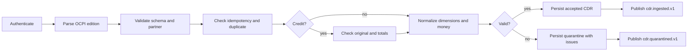

# 06 — OCPI integration

- **Status:** Draft
- **Owner:** VoltReckon maintainer
- **Last verified:** 2026-11-13
- **Applies to phases:** 0–10

VoltReckon implements the OCPI CDR receiver as the compatibility path for OCPI 2.2.1 and the
target path for OCPI 2.3.0 [ref-1][ref-2]. Invoice Reconciliation is a 2.3.0-ed2 capability
and starts in Phase 10 [ref-3][ref-4]. The internal domain uses VoltReckon names; mapping
happens at the edge.

## 1. Edition policy

**OCPI-001** The receiver MUST accept OCPI 2.2.1 CDRs, including the fields that exist in
2.2.1: `cdr_token`, `cdr_location`, `credit`, `credit_reference_id`, and
`home_charging_compensation`. *Check:* 2.2.1 fixture suite [ref-1].

**OCPI-002** OCPI 2.3.0 is the target edition for new fields and fixtures; its differences
MUST be handled in the mapping layer, not in `rating` or `ledger`. *Check:* edition matrix
contract test [ref-2].

**OCPI-003** OCPI 2.3.0-ed2 Invoice Reconciliation MUST remain a Phase 10 feature. It MUST
NOT change issued invoices or the Phase 1 CDR model. *Check:* phase review; no V017 table
before Phase 10 [ref-4].

**OCPI-004** Unknown OCPI fields MUST be ignored for domain behaviour and MAY be retained
only inside the bounded raw payload. *Check:* unknown-field fixture test.

**OCPI-005** UBC/Beckn MUST NOT be implemented as an OCPI edition. It is a separate adapter
at the edge if it ever lands. *Check:* dependency review [ref-27].

## 2. Receiver endpoints

The OCPI receiver is separate from the internal `/api/v1` contract. It uses the OCPI
response envelope, not RFC 9457.

| Method | Path | Purpose |
|---|---|---|
| `POST` | `/ocpi/2.2.1/cdrs` | Receive one CDR from a CPO |
| `GET` | `/ocpi/2.2.1/cdrs` | List CDRs visible to the authenticated partner |
| `GET` | `/ocpi/2.2.1/cdrs/{id}` | Read one CDR by external ID |
| `POST` | `/ocpi/2.3.0/cdrs` | 2.3.0 receiver, Phase 10 |
| `GET` | `/ocpi/2.3.0/invoicereconciliation/{id}` | Invoice Reconciliation read, Phase 10 |
| `PUT` | `/ocpi/2.3.0/invoicereconciliation/{id}` | Create or replace, Phase 10 |
| `DELETE` | `/ocpi/2.3.0/invoicereconciliation/{id}` | Delete, Phase 10 |

The success envelope is `{ "status_code": 1000, "status_message": "Success", "timestamp":
"<RFC 3339>", "data": <object> }` [ref-1]. A client error uses the edition's client-error
status code and a stable message. HTTP status is `200` for an OCPI-level result; `401`,
`403`, `404`, and `413` remain transport errors.

**OCPI-006** The authenticated client MUST identify the sending partner. `country_code` and
`party_id` in the body MUST match that partner; a mismatch is rejected with
`PARTNER_MISMATCH`. *Check:* token/body mismatch IT.

**OCPI-007** The receiver MUST enforce a request body limit of 256 KiB and a CDR raw payload
limit of 64 KiB. *Check:* oversized request IT [ref-1].

**OCPI-008** The receiver MUST require `Idempotency-Key` on `POST`; if absent, it MUST derive
a key from the partner, CDR ID, and payload hash. *Check:* replay IT.

**OCPI-009** The receiver MUST return the stored CDR for a replay of the same partner, CDR
ID, and payload hash; it MUST NOT create a second row. *Check:* duplicate IT.

**OCPI-010** The receiver MUST reject a reused CDR ID with a different payload hash as
`CDR_CONFLICT`; it MUST NOT overwrite the accepted CDR. *Check:* conflict IT.

## 3. Field mapping

The mapping is one-way into the internal `cdr` command. Every field is validated before
persistence. `cdr.id` is not reused as an internal UUID; the internal UUID is generated and
the external ID is stored separately.

| OCPI field | Internal field | Transformation |
|---|---|---|
| `id` | `cdr_external_id` | Trim; max 36; required; unique per partner pair |
| `session_id` | `session_external_id` | Max 36 |
| `cdr_token.uid` | `token_uid` | Pseudonymous; never a driver name |
| `cdr_token.type` | `token_type` | OCPI token type |
| `cdr_token.contract_id` | `contract_id` | Max 36 |
| `auth_method` | `auth_method` | OCPI enum |
| `authorization_reference` | `authorization_reference` | Max 36 |
| `cdr_location.id` | `location_external_id` | Max 36 |
| `cdr_location.evse_uid` | `evse_external_id` | Max 36 |
| `cdr_location.connector_id` | `connector_external_id` | Max 36 |
| `meter_id` | `meter_id` | Optional |
| `start_date_time`, `end_date_time` | same | RFC 3339 to UTC instant |
| `currency` | `currency` | ISO 4217 uppercase |
| `total_cost` | `total_cost_minor` | Decimal to minor units with the currency exponent |
| `total_energy` | `total_energy_wh` | kWh to Wh, HALF_UP |
| `total_time` | `total_time_seconds` | Hours to seconds, HALF_UP |
| `total_parking_time` | `total_parking_time_seconds` | Hours to seconds, HALF_UP |
| `total_reservation_time` | `total_reservation_time_seconds` | Hours to seconds, HALF_UP |
| `tariffs` / `tariff_id` | `tariff_ref` | Store the external reference; do not trust its prices |
| `charging_periods[].dimensions[]` | `cdr_dimension` rows | Type, volume, unit, period |
| `credit` | `credit` | Boolean |
| `credit_reference_id` | `credit_reference_external_id` | Resolve to `credit_reference_cdr_id` |
| `home_charging_compensation` | `home_charging_compensation` | Boolean |
| `last_updated` | `source_last_updated` | UTC instant; not the ingest time |

**OCPI-011** `total_cost` MUST be parsed as a decimal and converted once to minor units using
the currency exponent and HALF_UP. Excess fractional digits MUST produce a
`DECLARED_PRECISION` warning, not a different currency. *Check:* money-mapping test.

**OCPI-012** `total_energy` MUST be converted from kWh to Wh and `total_time`,
`total_parking_time`, and `total_reservation_time` from hours to seconds. The conversion MUST
use `BigDecimal`, not floating point. *Check:* unit-conversion test.

**OCPI-013** A negative total MUST be accepted only when `credit=true`; a non-credit CDR with
a negative cost, energy, or time MUST be quarantined. *Check:* negative-value IT.

**OCPI-014** A missing `charging_periods` MAY be accepted if totals are present; rating
synthesizes one period. If neither dimensions nor usable totals exist, the CDR is
quarantined with `MISSING_DIMENSIONS`. *Check:* minimal-CDR IT.

**OCPI-015** The raw payload, if retained, MUST be the bounded source object, not a
concatenation of unrelated requests. It MUST pass the 64 KiB check and the PII scan.
*Check:* payload-size and PII tests.

## 4. Dimensions and units

Supported dimension types are `ENERGY`, `TIME`, `PARKING_TIME`, `FLAT`, `RESERVATION`,
`MAX_CURRENT`, `MAX_POWER`, `MIN_CURRENT`, and `MIN_POWER`. Supported units are `kWh`, `Wh`,
`min`, `hour`, `second`, `A`, `W`, and the OCPI flat unit. An unsupported unit is a warning
if the dimension is not used for pricing; it is an error if it is the only pricing source.

**OCPI-016** An unknown dimension type or unit MUST NOT be silently coerced. It MUST be
recorded as `UNSUPPORTED_UNIT` or `UNSUPPORTED_DIMENSION`; the CDR is quarantined if no
priced dimension remains. *Check:* unit matrix test.

## 5. Validation catalogue

| Code | Severity | Meaning |
|---|---|---|
| `SCHEMA_INVALID` | ERROR | Body is not a valid OCPI CDR object |
| `MISSING_ID` | ERROR | `id` is empty or too long |
| `PARTNER_MISMATCH` | ERROR | Body party does not match the authenticated partner |
| `PARTNER_UNKNOWN` | ERROR | Partner is not registered or is suspended |
| `INVALID_CURRENCY` | ERROR | Not a known ISO 4217 code |
| `INVALID_TIME_RANGE` | ERROR | End is before start |
| `NEGATIVE_VALUE` | ERROR | Non-credit negative cost, energy, or time |
| `DECLARED_PRECISION` | WARNING | More fractional digits than the currency supports |
| `MISSING_DIMENSIONS` | ERROR | No dimension and no usable total |
| `UNSUPPORTED_UNIT` | WARNING/ERROR | Unit cannot be priced |
| `UNSUPPORTED_DIMENSION` | WARNING/ERROR | Dimension type is unknown |
| `DUPLICATE_CDR` | INFO | Same ID and hash; replay |
| `CDR_CONFLICT` | ERROR | Same ID, different hash |
| `UNKNOWN_CREDIT_REFERENCE` | ERROR | Credit points to an unknown original |
| `DUPLICATE_CREDIT` | ERROR | Original already has an accepted credit |
| `CREDIT_REFERENCE_MISMATCH` | ERROR | Credit data differs from the original |
| `CREDIT_TOTAL_MISMATCH` | ERROR | Credit totals are not the exact negation |
| `PII_REJECTED` | ERROR | Forbidden personal data is present |
| `PAYLOAD_TOO_LARGE` | ERROR | Raw payload exceeds 64 KiB |

A quarantined CDR is stored with `ingest_status = QUARANTINED` and has no rating or financial
effect. Revalidation is an explicit command; it never overwrites an accepted CDR.

## 6. Credit CDRs

**OCPI-017** A credit CDR MUST have a new `id`, `credit=true`, and `credit_reference_id`
equal to the original CDR's external ID. It MUST carry the original session data and negate
only the total fields. *Check:* credit fixture test.

**OCPI-018** The receiver MUST resolve the original within the same partner pair. An unknown
original is quarantined; a second credit for the same original is quarantined with
`DUPLICATE_CREDIT`. *Check:* credit lookup and duplicate tests.

**OCPI-019** The receiver MUST compare the credit's non-total fields with the original
(session, token, location, times, currency). A mismatch is quarantined. *Check:* mismatch
test.

**OCPI-020** A valid credit MUST create a new immutable CDR and MUST NOT edit or delete the
original. Rating negates the original rating lines and tax. *Check:* credit rating and
database immutability tests.

## 7. OCPI 2.3.0 and Invoice Reconciliation

OCPI 2.3.0 adds extensibility and changes around parking, EVSE, and North American taxes
[ref-2]. The mapping layer selects the edition by path and normalizes to the same internal
command. No edition-specific field is stored in the rating or ledger domain.

`v2.3.0-ed2` adds the Invoice Reconciliation module [ref-3][ref-4]:

- Module identifier: `invoicereconciliation`.
- Data owner: CPO or MSP (the party that owns the invoice).
- Object: `country_code`, `party_id`, `id`, `invoice_id` (max 255), `cdrs` (list of CDR IDs,
  max 36 each), `last_updated`.
- The object is mutable and error-correctable; `PUT` creates or replaces and `DELETE`
  removes it. This is different from the append-only invoice and CDR rules.
- VoltReckon uses it in Phase 10 to publish or consume the invoice-to-CDR link. It MUST NOT
  change an issued invoice, a rating result, or a journal.

## 8. Ingestion flow



**OCPI-021** Ingestion MUST be atomic: the CDR, dimensions, validation issues, outbox row,
and idempotency record commit together. *Check:* rollback IT.

**OCPI-022** Ingestion MUST NOT require an agreement or tariff to accept a CDR; those are
rating inputs. A missing agreement or tariff fails rating with a stable code, not ingestion.
*Check:* ingest-before-tariff IT.

## 9. Acceptance scenarios

```gherkin
Scenario: A valid 2.2.1 CDR is accepted
  Given an authenticated CPO for OCPI 2.2.1
  And a CDR with a session, token, location, energy, time, and currency
  When the CDR is posted with an idempotency key
  Then the response status code is 1000
  And one accepted CDR and its dimensions exist
  And cdr.ingested.v1 is in the outbox

Scenario: Duplicate CDR is a replay
  Given an accepted CDR
  When the same CDR ID and payload are posted again
  Then the stored CDR is returned
  And no second row exists

Scenario: Conflicting duplicate is rejected
  Given an accepted CDR
  When the same CDR ID arrives with a different total
  Then the request is rejected with CDR_CONFLICT
  And the original CDR is unchanged

Scenario: Duplicate credit is quarantined
  Given an original CDR with one accepted credit
  When a second credit for the same original arrives
  Then it is quarantined with DUPLICATE_CREDIT
  And no journal exists for it

Scenario: Driver PII is not stored
  Given a CDR containing a driver name or phone number
  When it is ingested
  Then the forbidden fields are rejected or dropped
  And the stored CDR contains no name or phone number
```
