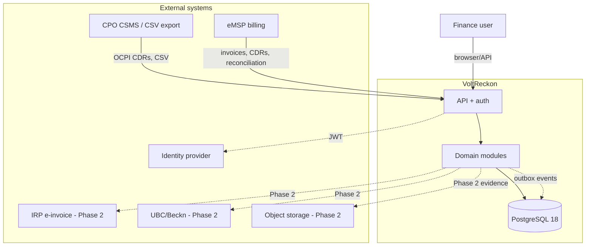
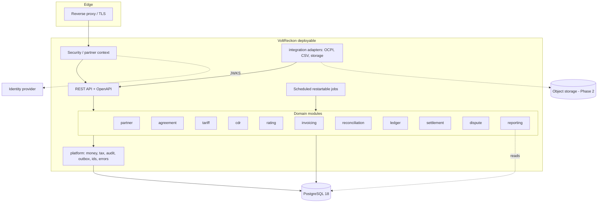
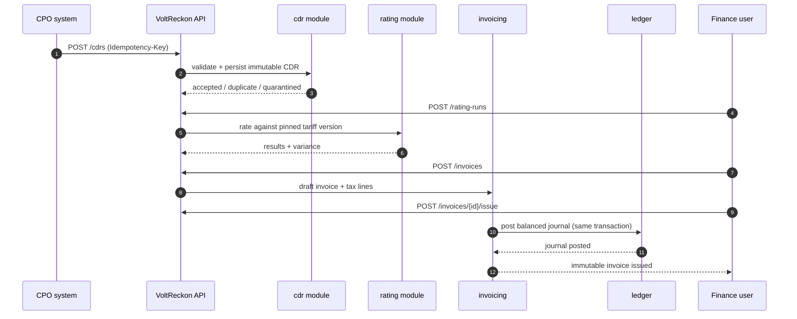

# Architecture overview

**Scope:** the structural decisions for the VoltReckon MVP (Milestones 1–8) and the extension points for Phase 2/3.

**Status:** design. No application code exists yet.

---

## 1. Goals and quality attributes

| Priority | Attribute | Concrete target |
|---|---|---|
| 1 | **Financial correctness** | No unbalanced journal can be committed; issued invoices are immutable; every posting traces to a source record. |
| 2 | **Auditability** | Every financial mutation produces an audit event with actor, timestamp, correlation ID, and before/after hash. |
| 3 | **Data integrity** | Idempotent ingestion; duplicates visible, not silently dropped; credit CDRs linked and single-use. |
| 4 | **Tenant isolation** | No partner can read or mutate another partner's data; enforced in code and verified by tests. |
| 5 | **Operability** | One deployable, one database, one local command; health, metrics, logs, and runbook. |
| 6 | **Evolvability** | Modules can be extracted later without rewriting domain logic. |
| 7 | **Performance** | MVP targets are modest: ingest 100k CDRs/day, rate 100k/day, reconcile 10k invoice lines per run under a minute on a small instance. |

Non-goals: sub-second consumer latency, millions of concurrent sessions, multi-region active-active, real-time charger control.

---

## 2. System context



Actors and data crossing the boundary:

| Actor | Sends | Receives |
|---|---|---|
| CPO system | CDRs, tariff definitions, partner invoices | Invoice data, reconciliation results, settlement statements |
| eMSP system | Partner invoices, CDRs it received, disputes | Reconciliation records, credit notes, settlement statements |
| Finance user | Commands via API/UI | Invoices, ledgers, reports, exception queues |
| Identity provider | Signed JWT | — |
| IRP / UBC | (Phase 2) acknowledgements | Payloads |

---

## 3. Architectural style

**Modular monolith** with **hexagonal boundaries per module**.

```
┌─────────────────────────────────────────────────────────────┐
│  Adapters (in): REST controllers, CSV importers, schedulers │
├─────────────────────────────────────────────────────────────┤
│  Application services (use cases, transactions, idempotency)│
├─────────────────────────────────────────────────────────────┤
│  Domain (entities, value objects, policies, invariants)     │
├─────────────────────────────────────────────────────────────┤
│  Adapters (out): JPA repositories, outbox, storage, clients │
└─────────────────────────────────────────────────────────────┘
```

Why:

- **Strong invariants need local transactions.** Invoice lines + tax lines + journals must commit atomically. Microservices would force sagas for no benefit.
- **One developer.** Operational surface must stay tiny.
- **Extractable later.** Module boundaries and events mean a module can become a service if a real scaling or team boundary appears.
- **Spring Modulith verifies the boundary.** Violations fail the build, not just code review.

Rejected alternatives: microservices (premature), event sourcing (audit is achieved with an append-only ledger + audit log; event sourcing adds replay and versioning cost), layered monolith without modules (erodes into a ball of mud), serverless (poor fit for long transactions and relational integrity).

---

## 4. Module map

```
voltreckon
├── partner        organisations, users, roles, GSTINs
├── agreement      commercial agreements, settlement terms
├── tariff         immutable tariff versions, components, restrictions
├── cdr            ingestion, validation, dedupe, credit linkage
├── rating         rating runs, results, lines, variance
├── invoicing      drafts, issue, tax lines, credit notes
├── reconciliation partner-invoice matching, exceptions
├── ledger         chart of accounts, journals, periods, trial balance
├── settlement     netting runs, statements
├── dispute        cases, evidence metadata, timeline
├── reporting      read models, exports, dashboards (queries, no writes)
├── platform       security, money, audit, outbox, ids, config, errors
└── integration    OCPI/CSV/IRP/UBC/storage adapters (anti-corruption)
```

### 4.1 Dependency rules

| Module | May depend on | Must not depend on |
|---|---|---|
| `partner` | `platform` | everything else |
| `agreement` | `partner`, `platform` | `rating`, `invoicing`, `ledger` |
| `tariff` | `partner`, `platform` | `rating`, `invoicing` |
| `cdr` | `partner`, `platform` | `invoicing`, `ledger` |
| `rating` | `cdr`, `tariff`, `agreement`, `platform` | `invoicing`, `ledger` |
| `invoicing` | `rating`, `agreement`, `partner`, `ledger`, `platform` | `reconciliation`, `settlement` |
| `reconciliation` | `cdr`, `rating`, `invoicing`, `platform` | `settlement` |
| `ledger` | `platform` | all domain modules (it is a leaf) |
| `settlement` | `ledger`, `invoicing`, `agreement`, `platform` | `dispute` |
| `dispute` | `cdr`, `rating`, `invoicing`, `reconciliation`, `platform` | `settlement` |
| `reporting` | read-only access to all modules via published query interfaces | must not write |
| `integration` | adapters depend on application ports; domain must not depend on `integration` | — |

Circular dependencies are forbidden. Cross-module side effects use events.

### 4.2 Cross-module communication

1. **Synchronous** when a command needs an immediate answer and the caller can accept the callee's failure (for example, `invoicing` asks `agreement` for settlement terms).
2. **Asynchronous** when a side effect can be eventual (for example, `invoicing` emits `InvoiceIssued`; `ledger` posts a journal in a separate transaction via the outbox).

Every async event must be idempotent on the consumer side and persisted in the outbox in the same transaction as the state change.

### 4.3 Component view



### 4.4 Primary workflow



The sequence shows the intended flow. No endpoint is implemented yet.

---

## 5. Transaction boundaries

| Transaction | Included | Excluded |
|---|---|---|
| Ingest CDR | insert `cdr`, validation issues, idempotency record, outbox event | rating |
| Run rating | insert `rating_run`/`result`/`lines`, variance, outbox event | invoice creation |
| Draft invoice | insert invoice + lines + tax lines, reserve number | ledger posting |
| Issue invoice | mark issued, assign final number, insert journal + lines, outbox event | reconciliation, settlement |
| Reconcile | insert reconciliation run/items/exceptions, outbox event | ledger (unless adjustments are posted) |
| Settle | lock period/partner, insert settlement items/statement, journal entries, outbox event | money movement |

Rules:

- One aggregate root mutated per transaction.
- No transaction spans an external HTTP call. Call out, then commit, or commit then call with idempotency.
- Long operations (bulk rating, reconciliation) are chunked and restartable, with a run record.

---

## 6. Events and outbox

Spring Modulith's event publication registry is used as the transactional outbox:

1. Domain action writes state + an event row in the same DB transaction.
2. A relay (in-process listener with persistence) delivers to module listeners.
3. Failed deliveries are retried; incomplete publications are visible and alertable.
4. Consumers are idempotent via a processed-event table or a natural unique key.

Event naming: `<Aggregate><PastTenseVerb>` — `CdrIngested`, `CdrCredited`, `RatingCompleted`, `InvoiceIssued`, `InvoiceCredited`, `ReconciliationCompleted`, `SettlementCompleted`, `DisputeOpened`.

Events are internal. External integration uses explicit adapters, not raw event publication.

---

## 7. Data ownership

| Data | Owner | Notes |
|---|---|---|
| Partner, user, GSTIN | `partner` | Other modules reference `partner_id` only |
| Agreement terms | `agreement` | Versioned where terms affect money |
| Tariff definitions | `tariff` | Immutable versions |
| Raw CDR payload | `cdr` | Stored once, immutable |
| Rating outcome | `rating` | References CDR + tariff version |
| Invoice | `invoicing` | Immutable after issue |
| Journal | `ledger` | Append-only |
| Reconciliation | `reconciliation` | References invoice + CDRs |
| Settlement | `settlement` | References ledger items |
| Dispute | `dispute` | References other aggregates by ID |

No module reads another module's tables directly. Query interfaces or published read models are used instead. `reporting` uses dedicated views/read models, not JPA entities from other modules.

---

## 8. Package structure (planned)

```
com.voltreckon
├── partner
│   ├── domain          # Partner, Gstin, Role; policies
│   ├── application     # PartnerService, commands, ports
│   ├── adapter.in.web  # controllers, DTOs
│   ├── adapter.out.jpa # entities, repositories
│   └── adapter.out.event
├── agreement
├── tariff
├── cdr
├── rating
├── invoicing
├── reconciliation
├── ledger
├── settlement
├── dispute
├── reporting
├── platform
│   ├── money           # Money, Currency, Rounding
│   ├── security        # SecurityConfig, Jwt, PartnerContext
│   ├── audit
│   ├── outbox
│   ├── ids             # ULID/sequence
│   ├── error           # ProblemDetail mapping
│   └── config
└── integration
    ├── ocpi
    ├── csv
    ├── irp
    ├── ubc
    └── storage
```

Package-by-feature, then by layer inside the feature. ArchUnit rules:

- No domain class imports `org.springframework.web`, `jakarta.persistence`, or Jackson.
- No module imports another module's `adapter` or `adapter.out.jpa` packages.
- No `float`/`double` in domain or money packages.
- `ledger` does not import domain modules.
- Controllers depend only on application services and DTOs.

---

## 9. Configuration and secrets

- Typed `@ConfigurationProperties` records per concern (security, tax defaults, ingestion, storage).
- Profiles: `local`, `test`, `prod`. No secret defaults in `prod`.
- Secrets from environment or a secret manager; never committed.
- Time zone: UTC internally; IST only for presentation and statutory documents.
- Feature flags for Phase 2 adapters (`integration.irp.enabled`, `integration.ubc.enabled`), default off.

---

## 10. Observability

| Signal | Implementation |
|---|---|
| Health | Spring Boot Actuator `/actuator/health` (liveness/readiness) |
| Metrics | Micrometer → Prometheus; ingest, rating, reconciliation, outbox lag, DB pool |
| Traces | OpenTelemetry (Phase 2); correlation ID from day one |
| Logs | Structured JSON; partner ID, run ID, correlation ID; no PII or secrets |
| Dashboards | Grafana (Phase 2); MVP exposes Prometheus metrics |
| Alerts | Outbox lag, ingest failure rate, reconciliation backlog, settlement failures |

---

## 11. Deployment

```
┌─────────────┐      ┌──────────────────┐
│ Load balancer│─────▶│ VoltReckon (app) │───┐
└─────────────┘      └──────────────────┘   │
                                             ▼
                                    ┌─────────────────┐
                                    │ Managed Postgres│
                                    │  (primary + HA) │
                                    └─────────────────┘
```

- One container image (multi-stage build).
- Stateless app; sessions in JWT; no sticky sessions.
- Database is the only stateful dependency in the MVP.
- Schema migrations run as a release step (Flyway), not on app startup in production.
- Backups: daily full + PITR (WAL) with tested restore.
- Kubernetes optional; a single VM with a managed database is sufficient for the MVP.

---

## 12. Evolution triggers

Extract a module into a service only if one of these is true and measured:

- Independent scaling need (for example, CDR ingestion 100× the rest).
- A separate team owns it and needs independent deploys.
- A regulatory boundary requires separate data residency.
- Transactional coupling has been eliminated by events and proven stable.

Adopt Kafka only if outbox throughput or multi-consumer needs exceed what PostgreSQL can serve. Adopt Redis only if measured contention or latency justifies a second data store. Adopt Spring Batch only if paged scheduled jobs become unmanageable.
