# Database design

**Target:** PostgreSQL 18
**DDL:** [schema.sql](../database/schema.sql)
**Status:** design. The DDL has not been executed against a live PostgreSQL instance. The Docker Linux engine is unavailable on the development machine used for this blueprint.

This guide explains why the schema looks the way it does. It is not a replacement for reading the DDL.

---

## 0. Database selection

**Decision:** PostgreSQL 18 is the only system of record for the MVP.

| Requirement | Why PostgreSQL fits |
|---|---|
| Financial invariants | Deferred constraint triggers, exclusion constraints, partial unique indexes, and transactional DDL. |
| Multi-step transactions | Invoice + lines + tax + journal can commit atomically without a saga. |
| Idempotency | Unique constraints and `ON CONFLICT` are sufficient; no Redis or broker needed. |
| JSON payloads | `jsonb` preserves raw OCPI payloads while relational columns carry queryable facts. |
| Reporting | Window functions, CTEs, and read-only roles support trial balance and audit exports. |
| Operations | Mature backup/PITR, managed offerings, and a small operational surface for one developer. |
| Future scale | Partitioning is available for CDR, audit, and journal growth. |

Rejected alternatives:

- **MongoDB / document store:** weak multi-document invariants for invoices, journals, and settlement.
- **Separate ledger database:** a second consistency model and backup/restore procedure for no MVP benefit.
- **Event store as the system of record:** replay and projection complexity; the append-only ledger + audit log already provide the required trail.
- **MySQL:** viable, but weaker support for exclusion constraints and deferred constraint triggers, which this design uses for financial invariants.
- **SQLite:** unsuitable for concurrent production workloads and multi-instance deployment.

The schema is intentionally one database and one schema (`voltreckon`). Module ownership is enforced by package boundaries and table-prefix discipline, not by separate schemas.

---

## 0.1 Entity-relationship overview

```mermaid
erDiagram
  PARTNER ||--o{ PARTNER_ROLE : has
  PARTNER ||--o{ PARTNER_GSTIN : has
  PARTNER ||--o{ APP_USER : employs
  APP_USER ||--o{ APP_USER_ROLE : has
  PARTNER ||--o{ PARTNER_AGREEMENT : cpo
  PARTNER ||--o{ PARTNER_AGREEMENT : emsp
  PARTNER_AGREEMENT }o--o{ TARIFF_VERSION : links
  TARIFF ||--o{ TARIFF_VERSION : versions
  TARIFF_VERSION ||--o{ TARIFF_PRICE_COMPONENT : contains
  TARIFF_VERSION ||--o{ TARIFF_RESTRICTION : restricts
  TAX_RATE ||--o{ TARIFF_PRICE_COMPONENT : taxes
  PARTNER ||--o{ CDR : sends
  PARTNER ||--o{ CDR : receives
  CDR ||--o{ CDR_VALIDATION_ISSUE : has
  CDR ||--o{ RATING_RESULT : rated_by
  CDR ||--o| CDR : credits
  RATING_RUN ||--o{ RATING_RESULT : produces
  RATING_RESULT ||--o{ RATING_LINE : contains
  RATING_RESULT ||--o{ RATING_VARIANCE : compares
  INVOICE ||--o{ INVOICE_LINE : contains
  INVOICE ||--o{ INVOICE_TAX_LINE : contains
  INVOICE_LINE ||--|| RATING_RESULT : bills
  INVOICE ||--o{ CREDIT_NOTE : corrected_by
  INVOICE ||--o{ RECONCILIATION_ITEM : matched
  RECONCILIATION_RUN ||--o{ RECONCILIATION_ITEM : contains
  RECONCILIATION_ITEM ||--o{ RECONCILIATION_EXCEPTION : raises
  LEDGER_ACCOUNT ||--o{ JOURNAL_LINE : posted_to
  JOURNAL_ENTRY ||--o{ JOURNAL_LINE : contains
  ACCOUNTING_PERIOD ||--o{ JOURNAL_ENTRY : contains
  PARTNER ||--o{ JOURNAL_ENTRY : entity_books
  JOURNAL_LINE ||--o| SETTLEMENT_ITEM : settled_by
  SETTLEMENT_RUN ||--o{ SETTLEMENT_ITEM : contains
  SETTLEMENT_RUN ||--o| SETTLEMENT_STATEMENT : issues
  DISPUTE ||--o{ DISPUTE_EVIDENCE : has
  DISPUTE ||--o{ DISPUTE_EVENT : logs
  CDR ||--o{ DISPUTE : references
  INVOICE ||--o{ DISPUTE : references
```



The diagram is a design aid, not a complete column-level model. Read `schema.sql` for keys, checks, indexes, and triggers.

---

## 0.2 Proposed versus implemented

| Item | Status |
|---|---|
| Logical schema and invariants | Designed |
| `schema.sql` DDL | Written and manually reviewed |
| DDL executed on PostgreSQL 18 | **Not done** — Docker engine unavailable |
| Flyway baseline migration | Not created |
| Repository/integration tests | Not started |
| Production database | Not provisioned |

Do not claim the schema is "validated" until the DDL has run cleanly on a real PostgreSQL 18 instance and the trigger tests pass.

## 1. Conventions

| Topic | Rule |
|---|---|
| Schema | One schema, `voltreckon`. Tables are prefixed by module only when ambiguous (`cdr_*`, `rating_*`, `journal_*`). |
| Primary keys | `uuid` from `gen_random_uuid()` for domain aggregates; `bigserial` for high-volume append-only child rows (journal lines, audit-adjacent rows). |
| Money | `bigint` minor units, plus `varchar(3)` ISO-4217 currency validated by regex. No `numeric` money columns; no floating point. |
| Time | `timestamptz`, stored in UTC. Statutory dates use `date`. |
| Booleans | Explicit `boolean` with defaults; no nullable booleans for tri-state logic. |
| Status | `text` + `CHECK` constraint rather than PostgreSQL enums, to keep migrations simple. |
| Soft delete | Not used for financial records. Partner/organisation records use `status`. |
| Audit | `audit_log`, plus `created_at`/`updated_at` on mutable aggregates. |
| Optimistic locking | `version bigint` on `partner`, `partner_agreement`, `dispute`. |

**Why UUIDs:** IDs are exposed in APIs and cross-partner references; UUIDs avoid guessable sequential leakage. ULIDs are a future option if sortable IDs are needed; the domain should not care.

**Why not `numeric` for money:** the application `Money` type uses integer minor units. Storing integer units prevents accidental scale drift and makes sums exact in SQL. `numeric(18,4)` is used only for non-monetary quantities (energy, current multipliers).

---

## 2. Table groups

### 2.1 Partner and identity

**`partner`** — the tenant and organisation record. An organisation can hold roles `CPO`, `EMSP`, or both via `partner_role`.

- `status` gates writes; a `SUSPENDED` partner cannot ingest, invoice, or settle.
- `version` supports optimistic concurrency for profile edits.

**`partner_gstin`** — one partner may have multiple GSTINs (states, business verticals).

- Format check enforces the 15-character GSTIN structure.
- Partial unique index `partner_gstin_one_primary` allows at most one primary GSTIN per partner.
- `valid_from`/`valid_to` allow historical GSTINs without deleting records.

**`app_user` / `app_user_role`** — human users bound to a partner and an IdP subject. No passwords are stored. `subject` is globally unique because IdP subjects are issuer-scoped; if multiple IdPs are supported later, change to `(issuer, subject)`.

### 2.2 Tariffs and tax

**`tariff` / `tariff_version`** — a tariff is a stable identity; a version is an immutable price list with an effective range.

- `status` is `DRAFT`, `PUBLISHED`, `SUPERSEDED`.
- The exclusion constraint prevents overlapping **published** ranges for the same tariff.
- `content_hash` supports idempotent import and audit (hash of canonical tariff JSON).
- Rating pins `tariff_version_id`, so history is reproducible.

**`tariff_price_component`** — one row per price component per element.

- `element_order` groups components that belong to the same tariff element.
- `step_size` captures OCPI-style stepped pricing (for example, per 1 kWh or per minute).
- `tax_rate_id` is optional: a component may be taxed by the agreement's default rule.

**`tariff_restriction`** — nullable columns form a conjunction; all non-null predicates must match for the element to apply.

- One row per element in the MVP. Multiple rows are an extension point for OR semantics.
- Empty row = always applies.
- Validation checks ensure min ≤ max.

**`tax_rate`** — versioned rules keyed by jurisdiction, service code, tax kind, and effective date.

- `rate_bp` is basis points (1800 = 18.00%), avoiding decimal rates in code.
- Rows are never updated; a rate change inserts a new effective-dated row.
- Invoice tax lines copy `tax_rate_id` and `rate_bp` so history survives rule changes.

### 2.3 Agreements

**`partner_agreement`** — directional commercial relationship between a CPO and an eMSP.

- Direction matters: `cpo_partner_id` is the seller, `emsp_partner_id` is the buyer.
- Overlap is prevented for `ACTIVE` agreements on the same pair and date range (GiST exclusion).
- `billing_period_basis` decides which timestamp assigns a session to an accounting period.
- Currency is the settlement currency; linked tariffs must match in the application.

**`agreement_tariff_link`** — which tariff versions apply under the agreement. Additional selection rules (time-of-day, connector type) are Phase 2.

### 2.4 CDRs

**`cdr`** — immutable billing record.

- Unique `(cpo_partner_id, emsp_partner_id, cdr_external_id)` reflects OCPI's partner-scoped IDs.
- `raw_payload` preserves the original document; `payload_hash` supports integrity checks.
- `credit` plus `credit_reference_cdr_id` implements Credit CDRs.
- Partial unique index `cdr_one_credit_per_original` prevents double crediting.
- Check constraints: end ≥ start; non-credit totals are non-negative; credit requires a reference.
- Trigger `cdr_credit_validation` enforces same partner pair and currency, and rejects credit-of-credit.
- Trigger `cdr_immutable` blocks changes to financial fields and blocks deletes; `ingest_status` may change for quarantine revalidation.

**`cdr_dimension`** — optional dimensional detail (connector, location, meter values). Kept out of the hot table to avoid wide nullable rows.

**`cdr_validation_issue`** — typed issues for quarantine. Ratings only consider `ACCEPTED` CDRs.

### 2.5 Rating

**`rating_run`** — job record with cursor, counts, and status. Restartable.

**`rating_result`** — one active result per CDR (partial unique index).

- Pins `agreement_id`, `tariff_version_id`, and `input_hash`.
- Stores `subtotal`, `tax`, `total`, `declared_total`, and `variance` with check constraints tying them together.
- Credit CDRs produce negative amounts; the constraint is `subtotal + tax = total`, not “non-negative”.

**`rating_line`** — component-level breakdown. `quantity` is `numeric(18,4)` (energy, minutes); money is minor units.

**`rating_variance`** — typed comparison to the declared CDR total. A `NONE` variance is still recorded for a complete trail.

### 2.6 Invoicing

**`invoice`** — draft until issued, immutable afterward.

- `invoice_no` is nullable until issue; unique per `(issuer, financial_year, invoice_no)`.
- Totals are checked: `subtotal + tax = total`.
- Trigger `invoice_immutable` freezes financial fields after draft and blocks deletes.
- `gstin_issuer`, `gstin_recipient`, `place_of_supply_state`, `financial_year` are copied at issue for historical accuracy.

**`invoice_line`** — one per rating result; `UNIQUE (rating_result_id)` prevents billing the same rating twice.

**`invoice_tax_line`** — the tax split (CGST/SGST/IGST/CESS). The split is computed at invoice time from place of supply and the tax rule; the rule ID and rate are copied.

**`credit_note`** — adjustments to an issued invoice. No updates to the original.

### 2.7 Ledger

**`ledger_account`** — chart of accounts. `partner_id` optional for partner-specific receivable/payable accounts; `currency` optional where an account can hold multiple currencies (the journal line still carries the entry currency).

**`accounting_period`** — monthly period with `OPEN`, `CLOSED`, `LOCKED`. The application checks status and locks the row when closing.

**`journal_entry`** — header with the **entity whose books are being kept** (`entity_partner_id`), source (`INVOICE`, `CREDIT_NOTE`, `SETTLEMENT`, `ADJUSTMENT`), currency, period, and optional reversal link.

- `entity_partner_id` is essential in a multi-tenant platform where both the CPO and the eMSP may be onboarded; the same source document can produce one journal in each entity's books, and a trial balance must be per entity.
- `UNIQUE (entity_partner_id, source_type, source_id, entry_type)` makes posting idempotent per set of books.
- `entry_no` is a monotonically increasing identity for reference.

**`journal_line`** — debit or credit, never both, never zero on both sides.

- `CHECK` enforces exactly one non-zero side.
- Deferred constraint trigger `journal_line_balanced` checks at commit that debits = credits and there are at least two lines.
- Triggers block `UPDATE` and `DELETE`; corrections are reversing entries.

### 2.8 Reconciliation

**`reconciliation_run`** — one partner invoice checked in one period. Counts support progress and reporting.

**`reconciliation_item`** — one partner invoice line with optional links to `cdr` and internal `invoice_line`, declared amount, rated amount, and status.

**`reconciliation_exception`** — typed problem with a resolution lifecycle. A non-`OPEN` exception requires a resolution code, actor, and timestamp.

### 2.9 Settlement

**`settlement_run`** — netting run per partner pair/period/currency. A partial unique index prevents two completed runs for the same key.

**`settlement_item`** — links a journal line to a run. `UNIQUE (journal_line_id)` ensures a financial item is settled once.

**`settlement_statement`** — immutable output with a content hash and statement number.

### 2.10 Disputes

**`dispute`** — case with optional links to CDR, rating, invoice, and reconciliation item.

**`dispute_evidence`** — metadata only in the MVP; `storage_key` is Phase 2. `content_hash` is mandatory so integrity can be verified when files exist.

**`dispute_event`** — append-only transition log. The application must write this in the same transaction as the status change.

### 2.11 Platform tables

**`audit_log`** — append-only; updates and deletes blocked. Indexed by partner/time and entity. Partition by month when volume grows.

**`outbox_event`** — domain outbox. If Spring Modulith's registry is used, the app maps to its `event_publication` table; the fields here document the contract.

**`idempotency_key`** — scoped to partner + route + key, with request/response hashes and expiry.

**`processed_event`** — consumer idempotency for at-least-once delivery.

**`sequence_number`** — legally significant sequences (invoice numbers). `next_sequence()` locks the row and returns the allocated value; the caller formats it with the financial year.

---

## 3. Invariants enforced by the database

| Invariant | Mechanism |
|---|---|
| CDR IDs unique per partner pair | `UNIQUE (cpo, emsp, cdr_external_id)` |
| One credit per original CDR | Partial unique index |
| Credit references a valid original of the same pair/currency | Trigger |
| CDR financial fields immutable | Trigger |
| Tariff versions do not overlap when published | GiST exclusion |
| Active agreements do not overlap per pair | GiST exclusion |
| One active rating per CDR | Partial unique index |
| Rating totals add up | `CHECK` |
| One invoice line per rating result | `UNIQUE (rating_result_id)` |
| Invoice totals add up | `CHECK` |
| Issued invoices immutable | Trigger |
| Journal line has exactly one side | `CHECK` |
| Journal entry balances and has ≥ 2 lines | Deferred constraint trigger |
| Journal entries/lines immutable | Triggers |
| One journal per entity, source, and type | `UNIQUE (entity_partner_id, source_type, source_id, entry_type)` |
| Exception resolution requires actor/code/time | `CHECK` |
| One settlement per journal line | `UNIQUE (journal_line_id)` |
| One completed settlement per pair/period | Partial unique index |

Some invariants remain application-level because they depend on multiple tables or business rules:

- Currency consistency between agreement and tariff.
- Tax split correctness by place of supply.
- Sum of invoice lines equals invoice header (checked on write in the service).
- Settlement eligibility rules.

These need tests, not just constraints.

---

## 4. Indexing strategy

| Query | Index |
|---|---|
| CDR by partner and time | `cdr_pair_time_idx` |
| CDR ingestion monitoring | `cdr_ingested_idx` |
| Active rating per CDR | partial unique index |
| Rating by partner and time | `rating_result_pair_idx` |
| Invoice by issuer/recipient and status | `invoice_*_status_idx` |
| Invoice lines by invoice | `invoice_line_invoice_idx` |
| Tax lines by invoice | `invoice_tax_line_invoice_idx` |
| Journal lines by entry/account/partner | `journal_line_*` |
| Open exceptions | `reconciliation_exception_status_idx` + `v_open_exceptions` |
| Outbox pending | partial index on `PENDING` |
| Audit by partner/time | `audit_log_partner_time_idx` |

Rules: measure before adding more. Avoid indexing `raw_payload`. Use `EXPLAIN (ANALYZE, BUFFERS)` on realistic data before shipping a query.

---

## 5. Concurrency

| Situation | Approach |
|---|---|
| Duplicate CDR ingest | Insert; on unique violation, load and return the existing record |
| Invoice numbering | `next_sequence('invoice_number')` inside the issue transaction; row lock serializes allocation |
| Period close | `SELECT ... FOR UPDATE` on `accounting_period`; then set status |
| Settlement run | `pg_advisory_xact_lock(hashtextextended(pair || period, 0))` |
| Rating/reconciliation overlap | Advisory lock per partner/period, or a unique partial index on active runs |
| Mutable aggregates | Optimistic `version` check (`UPDATE ... WHERE id = ? AND version = ?`) |
| Reporting export | `REPEATABLE READ` snapshot for a consistent view |

Isolation level: `READ COMMITTED` default. Use `REPEATABLE READ` for multi-query reconciliation reads and exports. Avoid `SERIALIZABLE` unless a specific invariant cannot be expressed otherwise.

---

## 6. Partitioning and growth

MVP: no partitioning. Revisit when a table exceeds roughly 10–20 million rows or when retention deletes become expensive.

Candidate tables and strategy:

| Table | Strategy |
|---|---|
| `cdr` | Range partition by `start_date_time` (monthly), or by `ingested_at` if billing periods are unpredictable |
| `audit_log` | Monthly range partitions; detach and archive |
| `outbox_event` | Purge `COMPLETED` older than 30 days; partition only if needed |
| `journal_line` | Usually grows slower than CDR; consider partition by period if > 20M |
| `rating_result` / `invoice_line` | Partition by period if needed |

Partitioning requires changes to unique indexes (partition key must be included). Plan the key before growth, not after.

---

## 7. Migration policy

- Flyway, versioned SQL migrations (`V001__init.sql`, ...).
- Migrations are forward-only in production; destructive changes use expand/contract:
  1. Add new column/table, dual-write, backfill.
  2. Switch reads.
  3. Remove old column/table in a later release.
- No `Hibernate auto-ddl` in any shared environment.
- Every migration is reviewed for locks (`ALTER TABLE ... ADD COLUMN ... DEFAULT` behaviour, index creation `CONCURRENTLY` outside a transaction where needed).
- Seed data (chart of accounts, sequences) is idempotent.
- The blueprint's `schema.sql` is the reference design; the first Flyway migration will be generated from it and kept in sync.

---

## 8. Row-level security (optional)

The MVP enforces tenancy in the application. RLS is a Phase 2 defence-in-depth option:

```sql
ALTER TABLE cdr ENABLE ROW LEVEL SECURITY;
CREATE POLICY cdr_partner_isolation ON cdr
  USING (cpo_partner_id = current_setting('app.partner_id')::uuid
      OR emsp_partner_id = current_setting('app.partner_id')::uuid);
```

Requirements before enabling:

- Set `app.partner_id` per transaction/connection.
- Ensure the application role is not the table owner and does not have `BYPASSRLS`.
- Verify reporting and admin paths explicitly.
- Test every query under RLS; a missing setting fails closed.

Do not enable RLS without these tests; a misconfigured policy can leak or hide data.

---

## 9. Backup and retention

- Backups and PITR: see [reliability](reliability.md) and the [runbook](../operations/01-runbook.md).
- Financial records: retain per statutory requirements and the operator's policy; do not delete issued invoices, journals, or audit entries.
- Operational data (quarantined payloads, processed events, idempotency keys) can expire.
- `idempotency_key.expires_at` drives cleanup.
- `outbox_event` completed rows can be archived after a retention window, but keep the aggregate reference for audit if it affects financial state.
