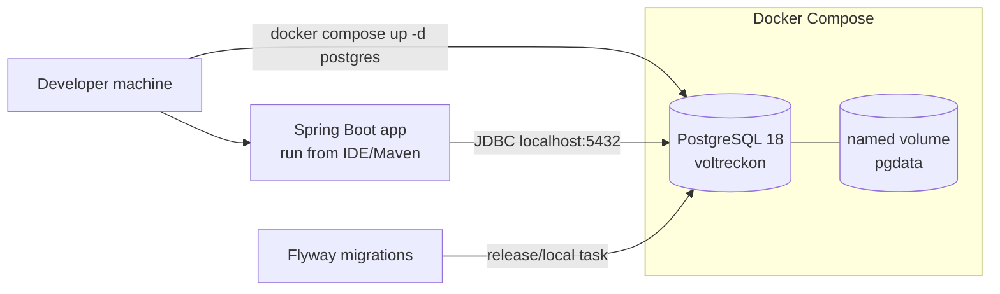
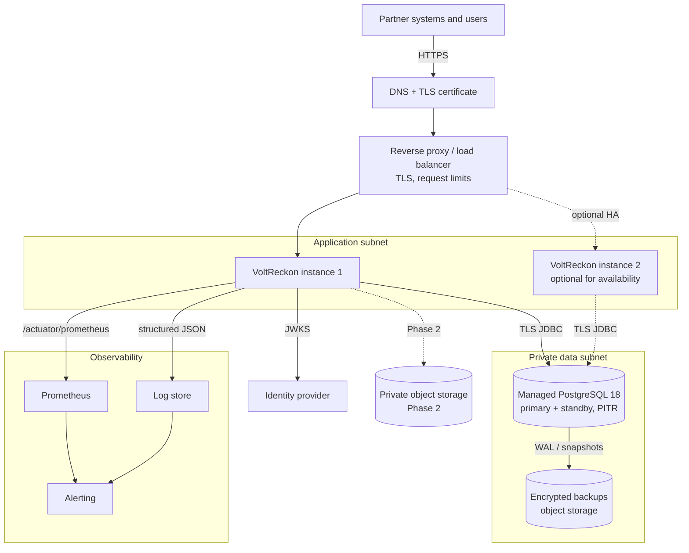
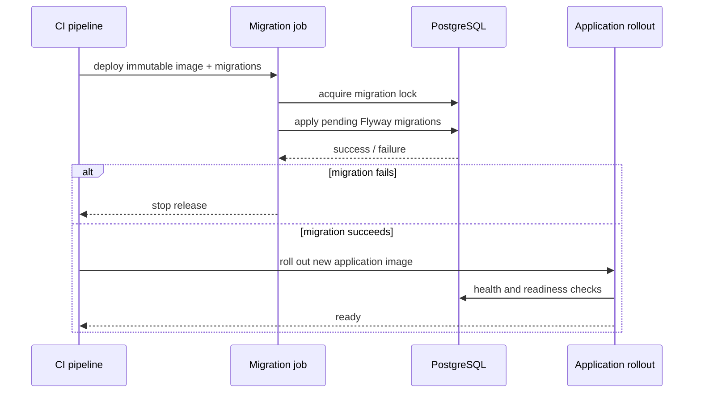

# Deployment architecture

**Status:** design. Only documentation exists in this repository today; the runtime topology below is the target for Milestone 1 onward.

**Baseline:** one Spring Boot deployable, one PostgreSQL database, Docker for local development, and a single production region. Kubernetes is deliberately not required.

---

## 1. Deployment goals

| Goal | Target |
|---|---|
| Reproducibility | The same container image runs locally and in production; configuration comes from the environment. |
| Simplicity | One application process and one stateful dependency in the MVP. |
| Financial safety | Migrations are controlled, backups are tested, and no deployment step bypasses database constraints. |
| Observability | Health, metrics, structured logs, correlation IDs, and outbox lag are visible from the first release. |
| Recoverability | Documented RPO/RTO with a tested restore procedure. |
| Least privilege | Separate database roles for application, migrations, and read-only reporting. |

Non-goals for the MVP: active-active multi-region, autoscaling clusters, service mesh, blue/green with zero-downtime schema changes, or a separate ledger database.

---

## 2. Environments

| Environment | Purpose | Data | Database | Application |
|---|---|---|---|---|
| Local | Development and schema work | Synthetic fixtures only | PostgreSQL 18 in Docker | Run from IDE or Maven |
| CI | Build, tests, static analysis | Ephemeral Testcontainers | PostgreSQL 18 container | Test process only |
| Staging | Release rehearsal and partner sandbox | Synthetic or anonymised | Managed PostgreSQL, separate instance | Same image as production |
| Production | Live financial records | Real | Managed PostgreSQL with PITR | One or more stateless instances |

No environment other than local and CI should use default credentials. `.env.example` contains local-only values.

---

## 3. Local development topology



Planned `compose.yaml`:

- One `postgres` service using `postgres:18`.
- Named volume `pgdata`.
- Health check using `pg_isready`.
- Port `${POSTGRES_PORT:-5432}`.
- No Redis, Kafka, RabbitMQ, or application container in the MVP.
- The application is added as a service only after `backend/pom.xml` exists.

Typical commands (PowerShell):

```powershell
Copy-Item .env.example .env
docker compose up -d postgres
docker compose ps
docker compose exec postgres psql -U voltreckon -d voltreckon
docker compose down
```

**Current environment note:** Docker Desktop's Linux engine is unavailable on the development machine used for this blueprint. The Compose file is planned but has not been executed, and `docs/database/schema.sql` has not been run against a live PostgreSQL instance.

---

## 4. Production topology (MVP)



### Component responsibilities

| Component | Responsibility | Stateful | MVP |
|---|---|---|---|
| Reverse proxy / load balancer | TLS termination, HTTP limits, health routing, security headers | No | Yes |
| VoltReckon application | API, domain logic, outbox relay, scheduled jobs | No (JWT sessions) | Yes |
| PostgreSQL | System of record, outbox, idempotency, ledger | Yes | Yes |
| Managed backup storage | Encrypted backups and WAL/PITR | Yes | Yes |
| Identity provider | Human and machine authentication | External | Yes |
| Prometheus-compatible metrics | Metrics scraping and alert rules | Yes | Yes |
| Log store | Structured logs and retention | Yes | Yes |
| Object storage | Evidence files and export archives | Yes | Phase 2 |
| IRP / UBC adapters | E-invoice and Beckn integration | External | Phase 2 |

The application is stateless. Any instance can serve any request because sessions are JWT-based and all durable state is in PostgreSQL.

---

## 5. Application packaging

Target image:

- Multi-stage Dockerfile: Maven/JDK 25 build stage, minimal JRE 25 runtime stage.
- Non-root runtime user.
- Read-only root filesystem where practical; writable `/tmp` only.
- JVM container awareness enabled; memory limits set from the deployment environment.
- Health endpoints exposed on the management port.
- No secrets baked into the image; environment variables or mounted secrets only.
- Image tagged with the Git SHA and an immutable version; `latest` is not deployed.

Proposed ports:

| Port | Purpose | Exposure |
|---|---|---|
| `8080` | Public API | Through reverse proxy only |
| `8081` | Actuator health/metrics | Private network only |

If a single port is used initially, Actuator endpoints must still be protected and restricted by network policy.

---

## 6. Configuration

Configuration is typed and environment-specific:

| Concern | Source | Production rule |
|---|---|---|
| Database URL and credentials | Environment or secret manager | No defaults; TLS required where supported |
| OIDC issuer, audience, JWKS URI | Environment | Must match the production IdP |
| Token scopes and role mapping | Configuration | Reviewed change; not user-editable at runtime |
| Tax defaults | Database `tax_rate` rows | Effective-dated; no hard-coded rates |
| Object storage | Environment (Phase 2) | Private bucket, least-privilege credentials |
| Log level | Environment | `INFO` by default; no PII at any level |
| Feature flags | Environment / config | IRP and UBC default off |

Profiles: `local`, `test`, `staging`, `prod`. Production fails fast on missing mandatory configuration.

---

## 7. Database deployment and migrations

- PostgreSQL 18 managed service preferred; self-hosted only with an explicit operations owner.
- Application, migration, and read-only roles are separate.
- The application role cannot run DDL.
- Flyway migrations run as a **release step**, not on application startup in production.
- Migrations are forward-only in production; destructive changes use expand/contract.
- Index creation that could lock a large table is reviewed and run concurrently where supported.
- The first migration will be derived from `docs/database/schema.sql`; the blueprint DDL itself is not a migration.

Migration sequence:



Backward-compatible schema changes are required so the previous application version can still run during a rolling restart.

---

## 8. CI/CD pipeline

```mermaid
flowchart LR
  PR[Pull request] --> BUILD[Build + unit tests]
  BUILD --> ARCH[ArchUnit + Modulith verification]
  ARCH --> IT[Testcontainers integration tests]
  IT --> LINT[OpenAPI lint + docs link check]
  LINT --> SEC[CodeQL + dependency review]
  SEC --> IMG[Build container image]
  IMG --> STG[Deploy to staging]
  STG --> SMOKE[Migration + smoke tests]
  SMOKE --> PROD[Manual approval -> production]
  PROD --> VERIFY[Health, metrics, outbox checks]
```



Until `backend/pom.xml` exists, Java workflows are skipped with `if: hashFiles('backend/pom.xml') != ''`. Documentation and link checks can run immediately.

Release gates:

1. All tests pass, including database-backed tests.
2. No unbalanced-journal, cross-tenant, or idempotency test failures.
3. OpenAPI change reviewed.
4. Migration reviewed for locks and rollback/expand-contract plan.
5. Image vulnerability scan has no unresolved critical findings.
6. Staging smoke test covers health, one CDR ingestion, one invoice draft, and trial balance.

---

## 9. Observability and operations

| Signal | MVP implementation | Alert / action |
|---|---|---|
| Liveness/readiness | Actuator health groups | Restart unhealthy instance; page on sustained failure |
| HTTP metrics | Micrometer + Prometheus | Error rate and latency thresholds |
| Ingest failures | Counters by reason | Alert on spike or sustained failure |
| Outbox lag | Pending/oldest event age | Alert when lag exceeds threshold |
| Job runs | Run records and duration metrics | Alert on repeated failure or stalled cursor |
| Database | Connection pool, slow queries, replication lag | Alert on saturation or lag |
| Logs | Structured JSON with correlation ID | Central search; no PII |
| Audit | Append-only table and export | Integrity checks and retention |

Log fields: timestamp, level, service, environment, correlation ID, partner ID (pseudonymous), run ID, event code. Never log tokens, secrets, full CDR payloads, or personal data.

### Health checks

- Liveness: process and internal state only. Do not include the database, to avoid restart loops during a database blip.
- Readiness: database connectivity and migration compatibility.
- Startup: fail fast if configuration is invalid.

---

## 10. Backup, restore, and disaster recovery

| Objective | MVP target |
|---|---|
| RPO | ≤ 15 minutes using continuous WAL archiving / PITR |
| RTO | ≤ 4 hours for a single-region restore |
| Backup retention | Daily full backups plus WAL; retain per operator policy and statutory requirements |
| Restore testing | At least quarterly and before major releases; recorded in the runbook |

Procedure:

1. Provision a new PostgreSQL instance at the same major version.
2. Restore the latest base backup and replay WAL to the chosen point.
3. Validate row counts, ledger balance, invoice sequence continuity, and outbox state.
4. Point a staging application instance at the restored database.
5. Run integrity queries and a smoke flow.
6. Only then switch production traffic.

Never restore over the live database in place. A restore that has not been tested is not a backup.

---

## 11. Security controls at deployment

- TLS 1.2+ at the edge and for database connections where supported.
- Private networking for the database and management endpoints.
- Reverse proxy request-size limits and timeouts.
- No public Actuator endpoints; metrics scraped privately.
- Containers run as non-root, with a read-only filesystem and dropped capabilities.
- Secrets injected at runtime; never in images, Compose files, or Git.
- Separate database roles with least privilege.
- Audit and financial tables protected by triggers and grants.
- Dependency and image scanning in CI.
- Administrative access through the identity provider with MFA; no shared accounts.

See [Security architecture](security-architecture.md) for the threat model and application controls.

---

## 12. Scaling and evolution

| Symptom | First response | Not the first response |
|---|---|---|
| CDR ingestion CPU-bound | Add application instances; batch/chunk imports | Introduce Kafka |
| Database read contention | Index review, read replica for reporting | Shard the database |
| Outbox relay lag | Tune polling/batch size; examine slow consumers | Adopt a broker without measurements |
| Long reconciliation runs | Chunking, checkpoints, indexes | Spring Batch by default |
| Settlement lock contention | Narrow run scope; advisory lock review | Redis locks |
| Multi-region requirement | Define data residency and RPO first | Active-active by default |

Module extraction and broker adoption require an ADR and measured evidence. The default is to keep the modular monolith.

---

## 13. Planned versus implemented

| Item | Status |
|---|---|
| Documentation | Done |
| `compose.yaml`, `.env.example` | Planned; referenced by the README and runbook |
| Spring Boot application | Not started |
| PostgreSQL schema execution | Not validated; Docker engine unavailable |
| Container image | Not built |
| CI workflows | Planned |
| Production deployment | Not started |
| Backups and restore test | Not performed |
| IRP, UBC, object storage | Phase 2 |

The root README status table is authoritative.

---

## 14. Related documents

- [System context](system-context.md)
- [Architecture overview](architecture-overview.md)
- [Database design](database-design.md)
- [Security architecture](security-architecture.md)
- [Reliability](reliability.md)
- [Runbook](../operations/01-runbook.md)
- [ADR-0002 database strategy](../adr/0002-database-strategy.md)
- [ADR-0004 messaging strategy](../adr/0004-messaging-strategy.md)
