# Architecture diagrams

All diagrams describe the **intended** implementation. None implies shipped code.

---

## 1. C4 Level 1 — System context

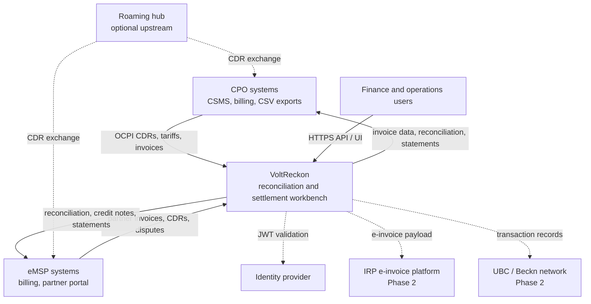

**Boundary:** VoltReckon owns financial records. It does not own chargers, driver payments, or network routing.

---

## 2. C4 Level 2 — Containers

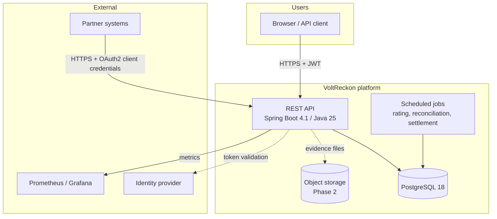

MVP contains exactly one application container and one database container. Jobs run inside the application.

---

## 3. Module/component diagram

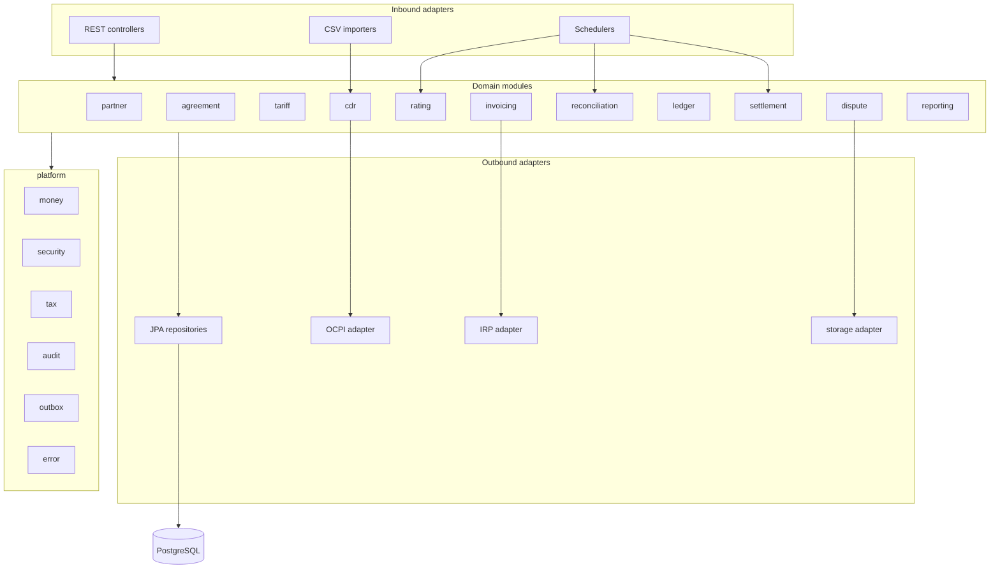

---

## 4. Primary workflow — CDR to settlement

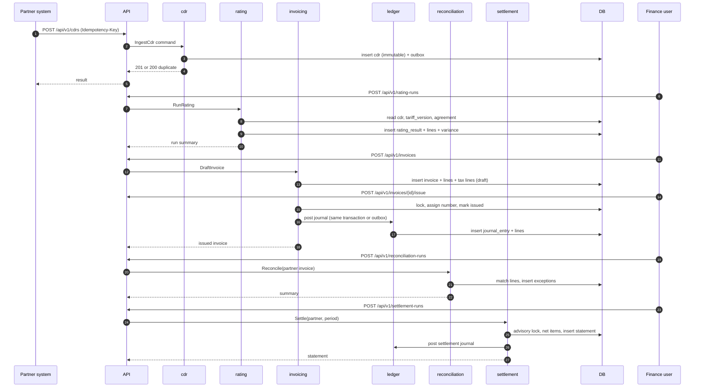

---

## 5. Event flow (transactional outbox)

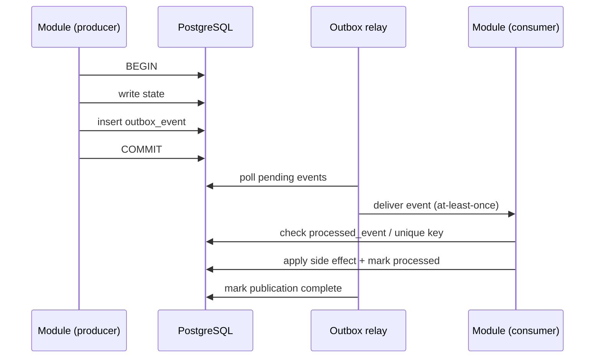

Failure handling: a consumer failure leaves the publication incomplete and retried with backoff; exhausted retries surface on a dead-letter view and alert.

---

## 6. Entity relationship — core MVP

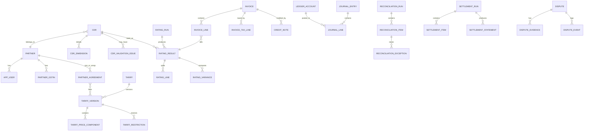

Full column-level definition: [schema.sql](../database/schema.sql).

---

## 7. State machines

### 7.1 Invoice

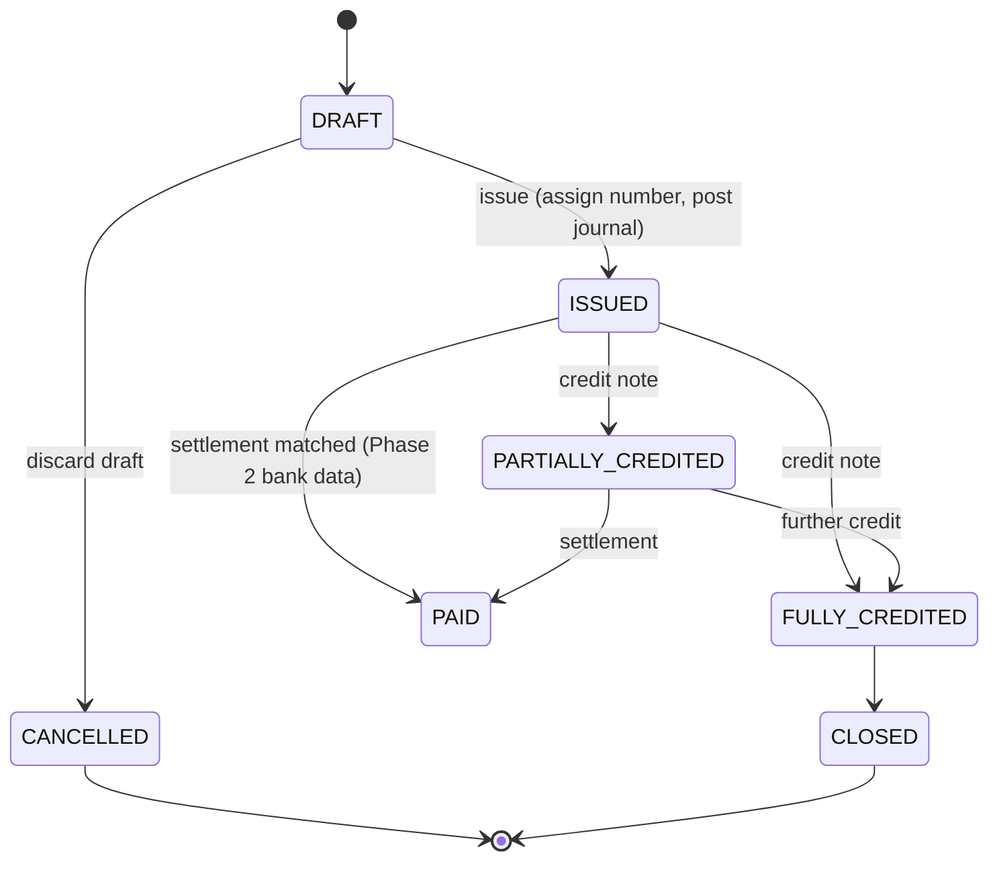

MVP stops at `ISSUED`/crediting; `PAID` is informational and driven by reconciliation, not payment execution.

### 7.2 Reconciliation item

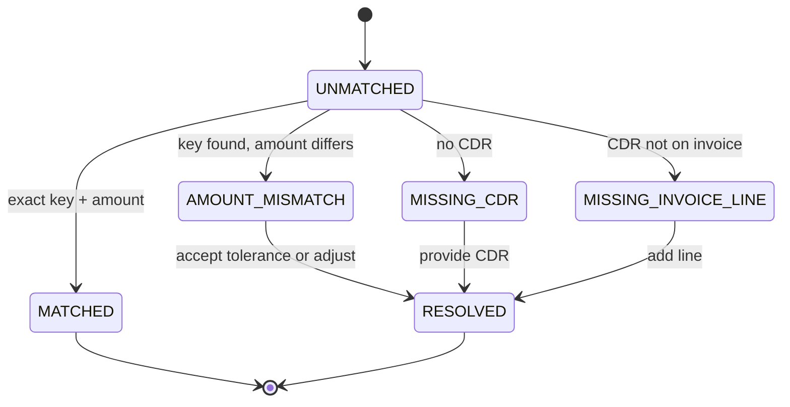

### 7.3 Dispute

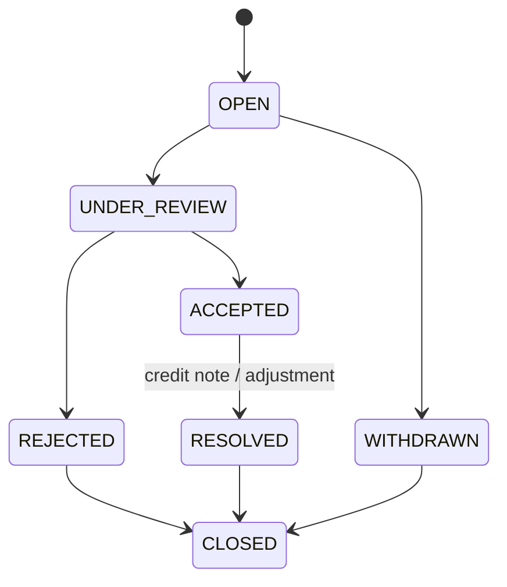

### 7.4 Settlement run

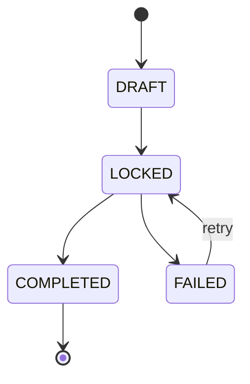

---

## 8. Rating detail flow

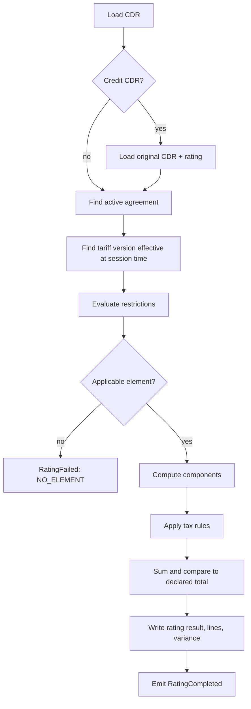

---

## 9. Deployment — MVP and production

### 9.1 Local development

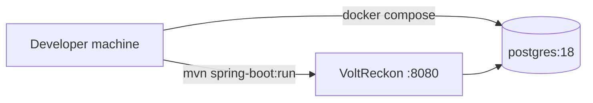

### 9.2 Small production

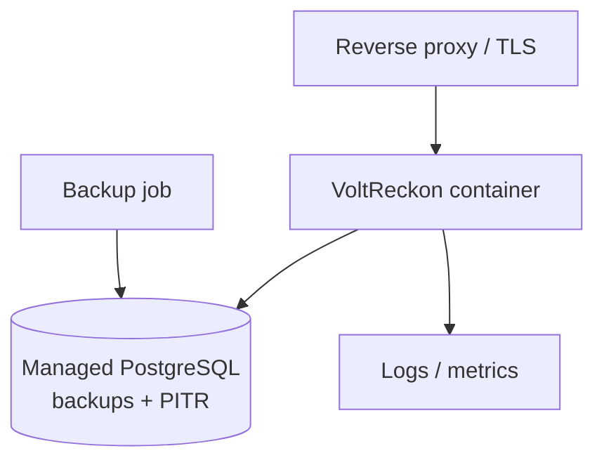

### 9.3 Growth (Phase 2+)

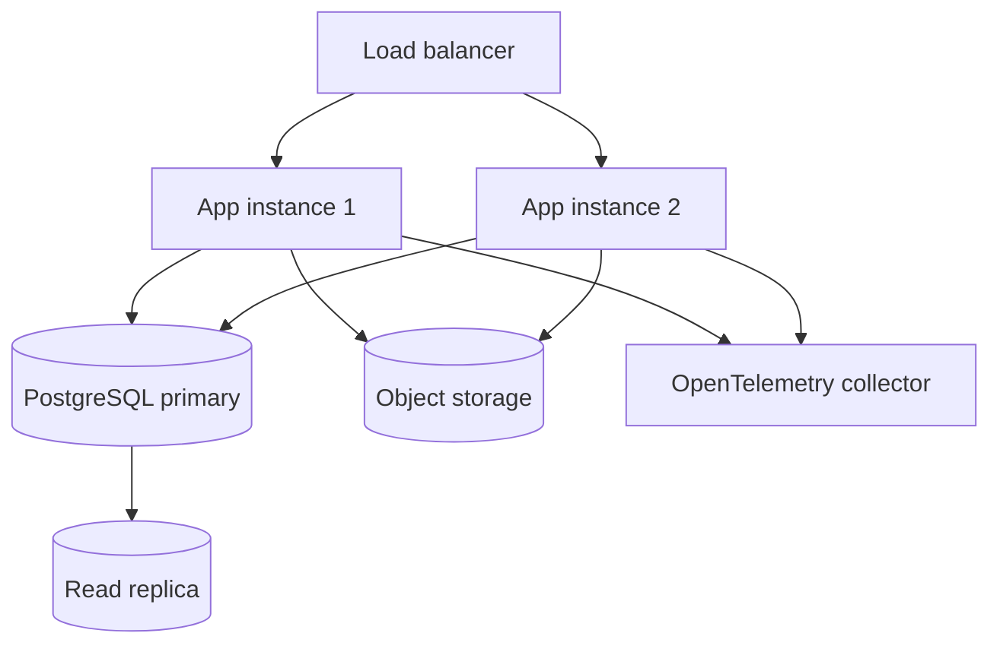

No Kubernetes requirement. Multiple app instances are safe because the app is stateless and locking is in PostgreSQL.

---

## 10. Data flow for tax and ledger

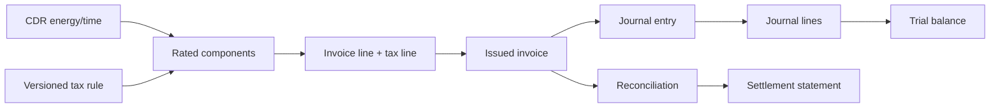
