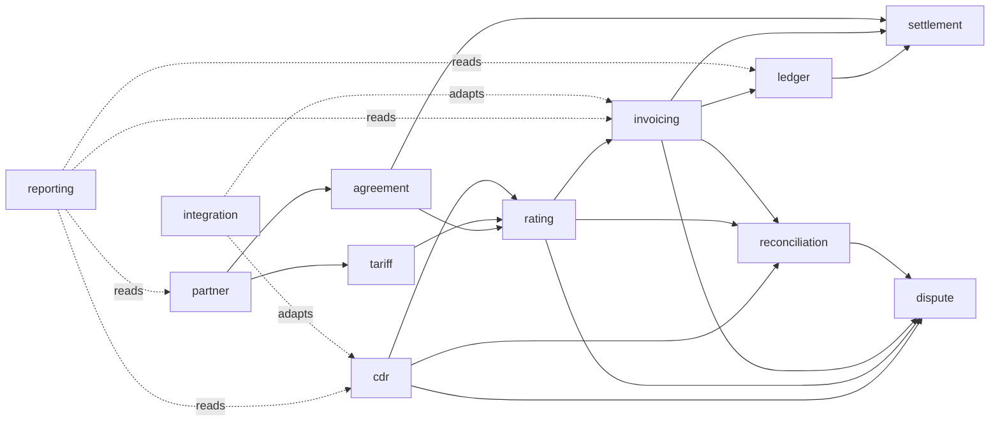

# Module responsibility matrix

Each module below states its purpose, owned data, use cases, published/consumed events, invariants, failure modes, and required tests. The module boundaries are enforced by ArchUnit and Spring Modulith.

**Reading rule:** a module may reference another module **by ID** and through its **application API**, never through its JPA entities or tables.

---

## 1. `partner`

**Purpose:** own organisations, their roles, users, and tax identities; provide the tenant boundary for everything else.

**Owned data:** `partner`, `partner_role`, `app_user`, `app_user_role`, `partner_gstin`.

**Use cases**

- Register a partner (organisation) with roles `CPO`, `EMSP`, `BOTH`.
- Add users and assign roles/scopes.
- Record GSTIN(s) with state code and validity.
- Suspend/reactivate a partner.
- Resolve the current partner context from a JWT.

**Events published:** `PartnerRegistered`, `PartnerSuspended`, `PartnerGstinChanged`.

**Invariants**

- A GSTIN is unique per partner and validated by format and checksum.
- A user belongs to exactly one partner in the MVP (multi-partner users are Phase 2).
- A suspended partner cannot create CDRs, invoices, or settlements.
- Partner ID is never accepted from a request body for tenant-scoped operations.

**Failure modes:** duplicate GSTIN, invalid GSTIN checksum, suspended partner attempting writes, token with unknown partner.

**Tests:** GSTIN validation (property-based), duplicate registration, suspended-partner rejection, JWT→partner resolution, cross-partner `404` enumeration test.

---

## 2. `agreement`

**Purpose:** record the commercial relationship between two partners, including settlement terms and which tariffs apply.

**Owned data:** `partner_agreement`, `agreement_tariff_link`.

**Use cases**

- Create an agreement between a CPO and an eMSP with effective dates.
- Define settlement cycle (weekly/monthly), currency, payment terms, and netting rules.
- Link tariff version(s) to the agreement.
- Terminate or supersede an agreement.

**Events published:** `AgreementActivated`, `AgreementTerminated`, `AgreementTariffLinked`.

**Invariants**

- Exactly one active agreement per partner pair per direction per date range.
- Effective range does not overlap for the same pair/direction.
- Currency is a valid ISO-4217 code and matches the linked tariff currency.
- A terminated agreement cannot be used for new ratings after its end date.

**Failure modes:** overlapping agreements, missing agreement for a CDR pair, currency mismatch between agreement and tariff.

**Tests:** overlap detection (property-based interval test), rating rejection when no agreement is effective, currency mismatch rejection.

**Note:** an organisation can be both CPO and eMSP, so agreements are directional (`cpo_partner_id`, `emsp_partner_id`).

---

## 3. `tariff`

**Purpose:** define immutable, versioned prices and the rules for selecting them.

**Owned data:** `tariff`, `tariff_version`, `tariff_price_component`, `tariff_restriction`.

**Use cases**

- Create a tariff with a partner owner and currency.
- Publish a new version with an effective range.
- Define price components: `ENERGY`, `TIME`, `PARKING_TIME`, `FLAT`, with price, step size, and optional VAT.
- Define restrictions: time window, day of week, duration, energy, power, current.
- Import an OCPI tariff (Phase 2; the adapter maps to the same model).
- Retrieve the version effective for a session.

**Events published:** `TariffVersionPublished`, `TariffVersionSuperseded`.

**Invariants**

- A published version is immutable; changes create a new version.
- Effective ranges for the same tariff do not overlap.
- Every version has at least one component.
- Step size is positive; prices are non-negative minor units.
- Element selection is deterministic and documented (see below).

**Element selection algorithm**

1. Filter elements whose restrictions match the session (time, duration, energy, power, day).
2. If exactly one matches, use it.
3. If several match, choose the **most specific** (most restriction predicates satisfied); tie-break by lowest `element_order`, then by ID.
4. If none match, the rating fails with `NO_APPLICABLE_TARIFF_ELEMENT`.

**Failure modes:** no effective version, no matching element, ambiguous elements, currency mismatch.

**Tests:** restriction truth tables, boundary times (inclusive/exclusive documented), ambiguity tie-break, immutability enforcement, property test that a later version never changes a historical rating.

---

## 4. `cdr`

**Purpose:** ingest, validate, de-duplicate, and store charging records immutably.

**Owned data:** `cdr`, `cdr_dimension`, `cdr_validation_issue`.

**Use cases**

- Ingest an OCPI CDR (JSON) or a CSV row.
- Validate schema, required fields, timestamp offsets, currency, and credit linkage.
- Detect duplicates by partner-scoped external ID and content hash.
- Quarantine invalid records with typed issues.
- Link a Credit CDR to its original and prevent double credit.
- Retrieve CDRs for rating and reconciliation.

**Events published:** `CdrIngested`, `CdrQuarantined`, `CdrCredited`.

**Invariants**

- `(partner_pair_id, cdr_external_id)` is unique.
- `credit = true` requires `credit_reference_id` resolving to an existing CDR for the same pair.
- An original CDR can be credited at most once.
- Timestamps are `timestamptz` in UTC; the raw payload is preserved.
- Monetary fields are converted to minor units and validated against currency exponent.
- Direct `UPDATE`/`DELETE` is blocked by a trigger.

**Failure modes:** duplicate delivery, invalid JSON, missing offset, negative energy, currency mismatch, credit-before-original, double credit, oversized batch.

**Tests:** duplicate replay returns the original; credit linking; double-credit rejection; CSV offset rejection; property test that raw payload round-trips; immutability trigger test.

---

## 5. `rating`

**Purpose:** compute the expected charge for a CDR against the applicable agreement and tariff version, and compare it to the declared total.

**Owned data:** `rating_run`, `rating_result`, `rating_line`, `rating_variance`.

**Use cases**

- Start a rating run for a partner/period or a set of CDRs.
- Select the applicable agreement and tariff version per CDR.
- Evaluate components and restrictions; compute pre-tax and tax amounts.
- Compare rated total to CDR `total_cost`; record variance and type.
- Handle credit CDRs by rating with negative sign and netting against the original result.
- Re-run failed CDRs without duplicating results.

**Events published:** `RatingCompleted`, `RatingVarianceDetected`, `RatingFailed`.

**Invariants**

- A rating result pins `cdr_id`, `agreement_id`, `tariff_version_id`, and `input_hash`.
- Re-running with identical inputs produces identical results (deterministic).
- `sum(rating_line.amount_minor) = rating_result.subtotal_minor`.
- Tax is computed per line and summed; rounding is per line with documented policy.
- Credit CDRs produce negative amounts and reference the original rating result.
- One active rating result per CDR; replacement requires an explicit supersede event.

**Failure modes:** missing agreement/tariff, no applicable element, arithmetic overflow, partial run crash, duplicate run request.

**Tests:** golden cases per component type, boundary/step-size cases, tax rounding cases, credit netting, property tests for monotonicity and sum invariants, restart-after-crash test.

---

## 6. `invoicing`

**Purpose:** turn rated results into immutable invoices and credit notes with tax lines and legal numbering.

**Owned data:** `invoice`, `invoice_line`, `invoice_tax_line`, `credit_note`.

**Use cases**

- Create a draft invoice from a set of rating results.
- Recalculate totals and tax from lines (never trust client totals).
- Issue an invoice: assign the next legal number atomically, freeze content, post journal.
- Create and issue a credit note against an issued invoice.
- Retrieve invoice data for export and reconciliation.
- Produce IRP-ready fields (Phase 2 submission).

**Events published:** `InvoiceDrafted`, `InvoiceIssued`, `InvoiceCredited`.

**Invariants**

- An issued invoice is immutable; only credit notes can adjust it.
- Invoice numbers are gapless per entity/financial year (sequence table + row lock).
- `sum(line.taxable_amount) = invoice.subtotal`; `sum(tax_line.amount) = invoice.tax_total`; `subtotal + tax_total = total`.
- Every tax line references a `tax_rate` rule version.
- Lines reference rating results; the same rating result cannot be invoiced twice.
- Currency matches the agreement.

**Failure modes:** number sequence contention, duplicate issue request, line/total mismatch, tax rule missing, credit exceeding original.

**Tests:** number allocation under concurrency, idempotent issue, immutability, tax sum invariants, credit-note bounds, property test that totals always reconcile.

---

## 7. `reconciliation`

**Purpose:** match a partner's invoice against received CDRs and rated amounts, and manage exceptions.

**Owned data:** `reconciliation_run`, `reconciliation_item`, `reconciliation_exception`.

**Use cases**

- Import a partner invoice (CSV/JSON) with lines.
- Run matching: exact CDR ID, then amount tolerance, then unmatched.
- Classify exceptions: missing CDR, missing invoice line, amount mismatch, duplicate line, credit mismatch, currency mismatch.
- Assign, resolve, or waive an exception with a reason and actor.
- Produce a reconciliation report.

**Events published:** `ReconciliationCompleted`, `ReconciliationExceptionOpened`, `ReconciliationExceptionResolved`.

**Invariants**

- Every invoice line in a run has exactly one match status.
- `matched + exceptions = total lines processed`.
- An exception cannot be closed without a resolution code and actor.
- A completed run is immutable; re-running creates a new run.
- Matching is deterministic for the same inputs.

**Failure modes:** duplicate invoice line, CDR present but not rated, tolerance ambiguity, concurrent runs for the same partner/period.

**Tests:** exact match, tolerance boundary, duplicate detection, exception lifecycle, property test that totals partition correctly, concurrent-run lock test.

---

## 8. `ledger`

**Purpose:** record every financial event as a balanced double-entry journal and provide trial balance and period control.

**Owned data:** `ledger_account`, `journal_entry`, `journal_line`, `accounting_period`.

**Use cases**

- Post a journal for an invoice, credit note, settlement, or adjustment.
- Reverse a journal.
- Close/open an accounting period (with lock).
- Produce trial balance and account movements.

**Events published:** `JournalPosted`, `PeriodClosed`, `PeriodReopened` (restricted).

**Invariants**

- `sum(debit) = sum(credit)` per entry, enforced by a deferred constraint trigger.
- Each entry has ≥ 2 lines.
- Posted entries are immutable; corrections are reversing entries.
- A closed period rejects new postings.
- Every entry references a source (`INVOICE`, `CREDIT_NOTE`, `SETTLEMENT`, `ADJUSTMENT`) and source ID.
- Idempotency: `(source_type, source_id, entry_type)` is unique.

**Failure modes:** unbalanced entry, posting to closed period, duplicate posting, missing account, rounding drift.

**Tests:** balance trigger, immutability, period lock, duplicate source rejection, reversal sums to zero, property test that any sequence of postings keeps the trial balance at zero.

---

## 9. `settlement`

**Purpose:** net eligible payables and receivables between partners and produce a settlement statement. No money movement.

**Owned data:** `settlement_run`, `settlement_item`, `settlement_statement`.

**Use cases**

- Start a settlement run for a partner pair and period.
- Select eligible open ledger items.
- Net by partner and currency; apply credit notes and adjustments.
- Lock the run, write items and a statement, post balancing journals.
- Export the statement.

**Events published:** `SettlementCompleted`, `SettlementStatementIssued`.

**Invariants**

- A ledger item can be settled at most once.
- Net amount equals the sum of included items with correct signs.
- Only one active settlement run per partner pair/period (advisory lock).
- A closed accounting period cannot accept a new settlement run.
- The statement is immutable once issued.
- Currency of all items matches the run currency.

**Failure modes:** concurrent runs, items from a closed period, FX mismatch (out of MVP scope), partial failure mid-run.

**Tests:** netting arithmetic (property-based), double-settlement rejection, advisory lock concurrency, statement immutability, balancing journal.

---

## 10. `dispute`

**Purpose:** manage disputes with a structured case, evidence metadata, and an append-only timeline.

**Owned data:** `dispute`, `dispute_evidence`, `dispute_event`.

**Use cases**

- Open a dispute referencing CDR, rating, invoice, or reconciliation item.
- Attach evidence metadata (type, hash, storage key) — files are Phase 2.
- Advance the state machine: `OPEN → UNDER_REVIEW → ACCEPTED/REJECTED → RESOLVED/CLOSED`.
- Record resolution and link the resulting credit note or adjustment.
- Produce a case package for audit.

**Events published:** `DisputeOpened`, `DisputeResolved`, `DisputeClosed`.

**Invariants**

- State transitions follow the allowed graph; illegal transitions are rejected.
- Every transition appends a `dispute_event` with actor, timestamp, and reason.
- A resolved dispute references the corrective document.
- Evidence cannot be added after `CLOSED`.
- Evidence hash is recorded; a mismatch is a detectable integrity failure.

**Failure modes:** illegal transition, resolving without an adjustment, evidence attached to closed case, missing linked record.

**Tests:** full state-machine coverage, illegal transition rejection, evidence-after-close rejection, hash verification, timeline ordering.

---

## 11. `reporting`

**Purpose:** provide read-only projections for dashboards, exports, and audit packages.

**Owned data:** no transactional tables; read models and SQL views.

**Use cases**

- Partner statement of account.
- CDR ingestion and validation summary.
- Rating variance report.
- Invoice register.
- Reconciliation exception ageing.
- Trial balance and period summary.
- Audit package export (CSV/JSON).

**Invariants**

- Reporting never writes transactional state.
- Queries are partner-scoped.
- Large exports stream and are bounded by date range.
- Numbers reconcile with source modules (tested).

**Failure modes:** slow queries on large tables, report/source drift, unauthorised cross-partner access.

**Tests:** report totals equal source aggregates, partner scoping, export pagination, query plan review for large tables.

---

## 12. `platform`

**Purpose:** shared technical capabilities with no domain knowledge.

**Components**

| Component | Responsibility |
|---|---|
| `money` | `Money` value object, currency exponents, minor-unit conversion, rounding policy |
| `security` | Spring Security config, JWT decoding, partner context, scopes, method security |
| `audit` | Append-only audit log API and aspect for financial actions |
| `outbox` | Event publication registry integration, relay, dead-letter visibility |
| `ids` | ULID generation, sequence allocation for invoice numbers |
| `tax` | Versioned tax rule lookup (`tax_rate`), applied by `invoicing` |
| `error` | RFC 9457 problem-details mapping and error catalogue |
| `config` | Typed configuration properties, profiles, feature flags |
| `clock` | Injectable `Clock` for deterministic tests |
| `web` | Correlation ID filter, request logging (no PII), pagination helpers |

**Invariants**

- `Money` never uses `float`/`double`.
- Audit entries are append-only.
- Outbox events are written in the same transaction as state changes.
- No domain module depends on `platform.security` internals beyond the current-partner port.

**Tests:** money arithmetic and rounding, JWT claim validation, audit aspect coverage, outbox replay, problem-details mapping, clock injection.

---

## 13. `integration`

**Purpose:** isolate all external protocols behind ports so the domain is not coupled to OCPI, CSV, IRP, UBC, or storage vendors.

**Adapters**

| Adapter | Direction | Status |
|---|---|---|
| `ocpi.cdr` | Inbound CDR mapping | MVP (JSON) |
| `csv.cdr` | Inbound CDR mapping | MVP |
| `csv.invoice` | Inbound partner invoice mapping | MVP |
| `ocpi.tariff` | Inbound tariff mapping | Phase 2 |
| `ocpi.invoice-reconciliation` | Outbound/inbound | Phase 2 |
| `irp` | Outbound e-invoice | Phase 2 |
| `ubc` | Inbound/outbound Beckn | Phase 2 |
| `storage` | Evidence files (S3/MinIO) | Phase 2 |

**Rules**

- Adapters translate to application commands/DTOs; they never expose OCPI types upward.
- Adapter failures are mapped to application errors with context.
- Contract tests (WireMock) and fixture tests validate mapping.
- Version-specific behaviour is isolated per adapter version.

---

## 14. Evaluated modules not (yet) top-level

These capabilities were considered as separate modules. The table records the decision so the architecture does not grow by accretion.

| Candidate | Decision | MVP treatment | Revisit trigger |
|---|---|---|---|
| `identity` | Fold into `partner` + `platform.security` | External IdP issues tokens; `partner` owns users/roles; no password storage. | Multiple IdPs, cross-partner user accounts, or a self-service identity console. |
| `roaming` | Fold into `integration` + `agreement` + `tariff` | OCPI CDR/CSV adapters, agreements, tariffs, and reconciliation. No hub, discovery, locations, or tokens. | A partner needs full OCPI server roles or a shared roaming broker. |
| `tax` | Fold into `platform.tax` | Versioned `tax_rate` rows; `invoicing` computes tax and copies the rule. | Multi-jurisdiction filing, tax engines, or a dedicated compliance team. |
| `evidence` | Fold into `dispute` + `integration.storage` | Evidence metadata and hashes in `dispute`; blobs are Phase 2. | Evidence is reused by audits, disputes, and reconciliation outside one case. |
| `audit` | Fold into `platform.audit` | Append-only `audit_log`; financial actions write an event. | Audit querying/reporting becomes a product surface or needs its own retention policy. |
| `notification` | Not in MVP | Internal outbox events only; no email/WhatsApp/SMS side effects. | Users need exception/statement notifications and delivery tracking. |
| `admin` | Not in MVP | Restricted Actuator, migrations, and runbook procedures; no admin UI. | Partner onboarding or support needs a self-service console. |
| `integrations` | `integration` adapters | Anti-corruption adapters for OCPI, CSV, IRP, UBC, storage. | External protocol volume or credentials justify a separate service. |

### 14.1 `identity`

Authentication is delegated to an OIDC/OAuth2 identity provider. `partner` owns the organisation, users, roles, and GSTINs. `platform.security` maps validated claims to a `PartnerContext`. VoltReckon does not store passwords, issue refresh tokens, or manage MFA. A separate identity module would imply VoltReckon is an identity provider, which it is not.

**MVP boundary:** one user belongs to one partner. Multi-partner users and partner self-service are deferred.

### 14.2 `roaming`

Roaming is a set of protocols and commercial relationships, not a bounded domain in the MVP. Inbound OCPI CDRs and CSV files enter through `integration`; agreements and tariffs live in their own modules; reconciliation lives in `reconciliation`. VoltReckon does not implement OCPI Locations, Sessions, Tokens, or Commands, and it is not a roaming hub.

**MVP boundary:** CDR ingestion plus invoice reconciliation. Full OCPI 2.3.0 server roles are Phase 2.

### 14.3 `tax`

Tax is a policy calculation, not an aggregate with its own lifecycle. `platform.tax` provides effective-dated lookup; `invoicing` applies it and copies `tax_rate_id` and `rate_bp` into immutable tax lines. This keeps the ledger and invoice history reproducible when rates change.

**MVP boundary:** configurable GST split (CGST/SGST/IGST/CESS), place-of-supply handling, and tax-inclusive/exclusive components. No filing, no IRP submission, no legal advice.

### 14.4 `evidence`

Evidence starts as metadata in `dispute`: type, storage key, SHA-256 hash, uploader, and timestamp. Files themselves are Phase 2 and go to private object storage. A separate module is justified only when evidence is shared across disputes, audits, and reconciliation exceptions and needs its own access policy.

**MVP boundary:** metadata and hash only; no file upload or virus scanning.

### 14.5 `audit`

Audit is cross-cutting. `platform.audit` exposes an append-only writer and a query API; the database blocks updates and deletes. A separate audit module would duplicate this responsibility and risk a second source of truth.

**MVP boundary:** financial and security actions, correlation ID, actor, before/after hashes. External log shipping is Phase 2.

### 14.6 `notification`

Notifications are a side effect of domain events, not a financial invariant. Putting SMTP or WhatsApp calls in the invoice transaction would make delivery failures look like financial failures. The outbox emits events; a Phase 2 adapter can deliver them.

**MVP boundary:** no outbound email, SMS, or WhatsApp. Exception queues are visible in the API/reporting layer.

### 14.7 `admin`

Operational administration is intentionally thin: Actuator health/metrics, Flyway migrations, database roles, and the runbook. A bespoke admin UI is a product surface with its own authorization, audit, and support burden. It is not needed to prove the vertical slice.

**MVP boundary:** `PLATFORM_ADMIN` role for audited operations; no user-facing admin console.

### 14.8 `integrations`

`integration` is already a module because external protocols change for different reasons than the domain. Adapters translate OCPI, CSV, IRP, UBC, and storage into application commands/ports. The domain never imports protocol types.

**MVP boundary:** OCPI CDR JSON, CSV CDR import, CSV partner-invoice import. Tariff import, full OCPI endpoints, IRP, UBC, and storage are Phase 2.

---

## 15. Module interaction summary

