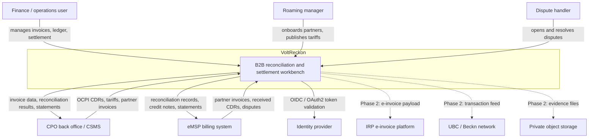
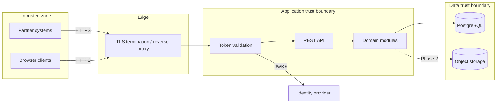

# System context

**Status:** design. No application code exists yet.
**Audience:** engineers, architects, security reviewers, and finance stakeholders who need to see what VoltReckon owns before reading module-level detail.

---

## 1. Purpose

VoltReckon is a **B2B EV-charging reconciliation and settlement workbench**. It sits between charging-network operators and mobility providers, turning exchanged charging records into agreed financial obligations:

```
CDR received -> validated -> re-rated -> invoiced -> reconciled -> disputed/corrected -> posted -> settled
```

The system is a **record keeper and calculation engine**, not a payment processor, charger-management system, or roaming hub.

---

## 2. System scope

### In scope (MVP)

- Partner organisations, users, GSTINs, and partner-scoped access.
- Roaming agreements, settlement terms, and versioned tariffs.
- CDR ingestion (OCPI-shaped JSON and CSV), validation, duplicate detection, quarantine, and credit-CDR linkage.
- Deterministic rating and variance detection against the tariff version effective at session time.
- GST-aware invoice drafts, issue, numbering, and credit notes.
- Partner-invoice reconciliation with an exception queue.
- Append-only double-entry ledger, trial balance, and accounting periods.
- Dispute cases with evidence metadata.
- Settlement netting and statements (no money movement).
- Audit-ready exports, structured logs, metrics, and a local Docker environment.

### Out of scope

| Excluded capability | Why |
|---|---|
| Consumer charging app, discovery, UPI collection | UBC/BHIM, OEM apps, and CPO apps own this layer. |
| CSMS, OCPP device control, live charger state | Separate product category; VoltReckon consumes billing records. |
| Roaming hub or Beckn gateway | Hubject, Gireve, UBC, and UEI are the network layer. |
| Payment execution, wallet, stored value | VoltReckon records obligations; it does not hold funds. |
| GST filing and legal tax advice | It produces GST-aware data; the taxpayer and advisors remain responsible. |
| Full ERP / general ledger | It maintains a focused EV settlement subledger and exports to accounting systems. |
| AI in financial decisions | MVP outcomes must be deterministic and explainable. |

---

## 3. C4 Level 1 — system context



**Reading the diagram:** solid arrows are MVP responsibilities. Dashed arrows are explicitly deferred integrations. No arrow implies a working integration today.

---

## 4. Actors

| Actor | Type | Goal | Authentication | MVP |
|---|---|---|---|---|
| Finance user | Human | Issue invoices, inspect ledger, run reconciliation and settlement | OIDC authorization code + PKCE | Yes |
| Finance admin | Human | Approve issue, reverse journals, close periods, manage users | OIDC + MFA | Yes |
| Roaming manager | Human | Onboard partners, record agreements, publish tariffs | OIDC | Yes |
| Dispute handler | Human | Investigate and resolve exceptions and disputes | OIDC | Yes |
| CPO system | Machine | Send CDRs, retrieve reconciliation results and statements | OAuth2 client credentials | Yes |
| eMSP system | Machine | Send partner invoices and disputes, retrieve statements | OAuth2 client credentials | Yes |
| Platform administrator | Human | Operate the service, manage partners, investigate incidents | OIDC + MFA, restricted role | Yes, minimal |
| Auditor | Human | Read immutable records and exports | OIDC, read-only role | Phase 2 UI; exports in MVP |
| IRP | External system | Accept e-invoice payloads | mTLS or signed requests | Phase 2 |
| UBC / Beckn network | External system | Exchange transaction data | To be defined by official specs | Phase 2 |

---

## 5. External systems

| System | Direction | Data exchanged | Contract / protocol | Failure behaviour |
|---|---|---|---|---|
| CPO CSMS / back office | Inbound and outbound | CDRs, tariffs, invoice data | OCPI-shaped JSON (2.2.1/2.3.0 subset), CSV import | Reject invalid batches; quarantine rows; return typed errors |
| eMSP billing | Inbound and outbound | Partner invoices, disputes, CDR copies | JSON/CSV; OCPI Invoice Reconciliation later | Preserve received document; create reconciliation exceptions |
| Identity provider | Inbound token validation | Signed JWT, JWKS | OIDC / OAuth2 | Fail closed; no anonymous fallback |
| IRP e-invoice platform | Outbound (Phase 2) | IRN payload, acknowledgement | GST e-invoice schema | Invoice remains issued internally; submission is retried and visible |
| UBC / Beckn network | Bidirectional (Phase 2) | Transaction and settlement metadata | Beckn; official B2B specs not fully public | Adapter disabled by default; no invented contract |
| Object storage | Outbound (Phase 2) | Evidence files, audit exports | S3-compatible API | Evidence metadata remains; file upload is retried and flagged |
| SMTP / notification provider | Outbound (Phase 2) | Exception and statement notifications | Provider API | Never blocks a financial transaction; outbox-driven |

---

## 6. Trust and data boundaries



Rules:

- Every partner-scoped request derives `partner_id` from the validated token, never from the request body.
- The database network is private; only the application and migration roles connect.
- Object storage is private; evidence access is mediated by the application.
- Audit logs and financial tables are append-only by database trigger and grant design.
- Cross-partner access returns `404` to avoid existence leaks.

---

## 7. Key data flows

### 7.1 Inbound CDR

```
CPO system -> authenticated POST /api/v1/cdrs -> schema validation -> duplicate check
           -> immutable cdr row + raw payload -> validation issues -> outbox event
```

The request does not wait for rating or invoicing. Those are separate, restartable runs.

### 7.2 Invoice and ledger

```
Rated CDRs -> invoice draft -> tax calculation -> issue (number allocation)
           -> immutable invoice + tax lines -> journal in entity books -> audit event
```

### 7.3 Reconciliation and settlement

```
Partner invoice -> line matching against CDRs/ratings -> exceptions
                -> resolution or credit note -> eligible ledger items
                -> settlement run (netting) -> immutable statement
```

No money moves. The statement is an instruction for the finance team's existing payment process.

---

## 8. Context-level constraints

- **One deployable, one PostgreSQL database** for the MVP. This is a deliberate constraint, not a placeholder for microservices.
- **No synchronous external call inside a database transaction.** Persist first, call after commit with idempotency.
- **OCPI is an integration contract, not the domain model.** Protocol types stop at the adapter boundary.
- **UBC/UEI B2B specifications are not fully public.** No adapter is designed against rumour; Phase 2 starts only with official material.
- **Tax rules are configuration with effective dates.** VoltReckon does not provide legal or tax advice.
- **Financial correctness outranks feature breadth.** A smaller correct system is preferable to a wider unreliable one.

---

## 9. Related documents

- [Architecture overview](architecture-overview.md) — style, modules, transactions, events.
- [Module boundaries](module-boundaries.md) — responsibilities and invariants per module.
- [Database design](database-design.md) — schema, integrity, concurrency.
- [Security architecture](security-architecture.md) — threat model and controls.
- [Deployment architecture](deployment-architecture.md) — runtime topology and operations.
- [Standards research](../research/standards-research.md) — OCPI, OCPP, GST, DPDP evidence.
- [ADR-0001](../adr/0001-architecture-style.md) — architecture-style decision.
