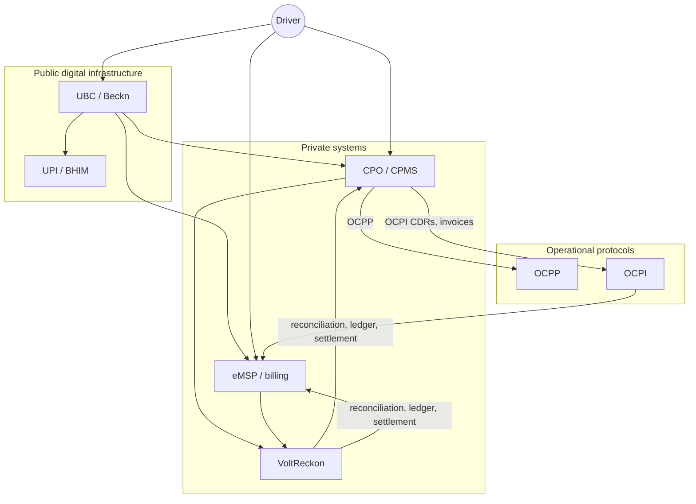
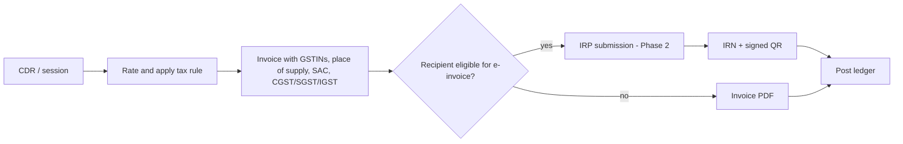

# The Indian EV charging ecosystem

**Purpose:** describe the Indian market structure, the roles that exchange charging data and money, the public digital infrastructure (UEI and UBC), the regulatory baseline, and what it means for VoltReckon.

**Freshness note:** India's EV charging policy and public infrastructure changed materially in 2024–2026. Figures below are dated. Re-verify before quoting in external material.

---

## 1. Market structure

### 1.1 Roles

| Role | Function | Typical Indian examples (illustrative, not endorsements) |
|---|---|---|
| **CPO** (Charge Point Operator) | Installs and operates charge points; sells charging wholesale to eMSPs and retail to drivers | Tata Power EZ Charge, Statiq, ChargeZone, Jio-bp pulse, Fortum, Ather Grid, Zeon, Kazam (also a platform) |
| **eMSP** (e-Mobility Service Provider) | Contracts with drivers; provides app, RFID/QR access, billing | OEM apps, fleet operators, some CPOs acting as eMSPs, UBC/BHIM as emerging rail |
| **CPMS / CPO SaaS** | Charge point management, OCPP, dashboards, sometimes billing | Driivz, AMPECO, Numocity, Kazam, EVRE, in-house platforms |
| **Roaming hub** | Network-to-network connectivity and clearing | Hubject, Gireve (international); UBC/Beckn (domestic DPI) |
| **Aggregator / discovery app** | Shows chargers across networks | PlugShare, OEM apps, UBC/BHIM |
| **Payment provider** | Collects driver payment | UPI apps, cards, wallets, UBC/BHIM |
| **Discom / utility** | Supplies power; may own public chargers | State distribution companies |
| **Regulator / agency** | Policy, standards, public infrastructure | Ministry of Power, Ministry of Heavy Industries, BEE, NITI Aayog, state nodal agencies, CEA |

A single company often plays several roles. Tata Power, for example, is a CPO, may act as an eMSP for its app users, and integrates with roaming partners. This role overlap is why partner records must be **organisation + role + agreement**, not a single "partner type" flag.

### 1.2 Market size and shape

- **25,202 public charging stations** as of **28 November 2024**, per the Ministry of Heavy Industries' reply to Rajya Sabha Unstarred Question No. 1587 (9 December 2024). **[primary]** Source: [sansad.in PDF](https://www.sansad.in/getFile/annex/266/AU1587_y7ofyg.pdf?source=pqars).
- Secondary reporting put the count around **27,700 by March 2026**. Counts differ by definition (station vs. charger vs. connector) and by data source. **[secondary]**
- India has **40+ charging networks**, most with regional or segment focus. **[secondary, vendor/industry reporting]**
- Utilization is uneven: metro and highway corridors are contested; many public chargers operate below profitable utilization, which makes revenue leakage and reconciliation errors disproportionately painful. **[inference from industry reporting]**

**Implication:** no single network dominates. A back office must handle many small partners with inconsistent integration maturity, not a handful of standardized enterprise partners.

### 1.3 Business models

| Model | Revenue | Reconciliation pain |
|---|---|---|
| Pay-per-use (app/QR) | Per-kWh or per-minute | Pricing changes, app vs. charger meter mismatch |
| Subscription / membership | Fixed fee + discounted rate | Allocating discounts across sessions and partners |
| Fleet contracts | B2B invoicing, monthly | Aggregated invoicing, PO references, credit terms |
| Roaming wholesale | CPO sells to eMSP at wholesale | Tariff selection, CDR exchange, net settlement |
| Real-estate / host partnerships | Revenue share with site host | Multi-party splits and statements |
| Advertising / value-added | Non-charging revenue | Usually out of scope for settlement |

VoltReckon targets the **roaming wholesale and fleet invoicing** seams, where records cross organisational boundaries.

---

## 2. Public digital infrastructure: UEI and UBC

### 2.1 Unified Energy Interface (UEI)

UEI is a **Beckn-based open network** for energy transactions, promoted in 2024 as an interoperability layer for EV charging and other energy services. It frames charging as a discoverable, bookable, payable service across providers.

- Conceptually similar to ONDC: a protocol and network rather than a single platform.
- Public technical detail is limited compared with OCPI; implementations are early.
- UEI and OCPI address different layers: UEI is a network/transaction protocol for discovery and ordering; OCPI is a CPO↔eMSP operational and billing protocol.

**Implication:** do not model UEI as "OCPI with different names". Treat it as a separate integration contract behind an adapter, and only after official specifications are available.

### 2.2 Unified Bharat e-Charge (UBC)

- **Unveiled 12 May 2026** by the Ministry of Heavy Industries. **BHEL** is the project implementation agency; **NPCI BHIM Services** is involved in design and development. **[secondary, multiple outlets]**
- Described as **UPI-like digital public infrastructure for EV charging**, built on **Beckn**.
- Initially usable through the **BHIM app**; discovery and payment via **UPI QR**.
- Reported pilot coverage: **Maharashtra, Karnataka, Delhi-NCR, Haryana, Rajasthan**.
- Reporting describes a goal of a single interface across networks, with settlement between participants. Technical B2B settlement details are not fully public. **[secondary, evolving]**

**What UBC appears to solve:**

- Driver discovery of chargers across networks.
- Standardized payment initiation via UPI.
- A common transaction rail for participating CPOs/eMSPs.

**What UBC does not visibly solve (as of this writing):**

- CDR-level re-rating and invoice reconciliation between a CPO and an eMSP.
- GST-compliant invoice generation and e-invoicing.
- Dispute evidence and append-only financial journals.
- Partner-specific commercial agreements, tariff versions, and settlement netting.

**Implication:** VoltReckon should **complement** UBC. It can consume UBC-originated transaction records in Phase 2, but it must not depend on UBC for its core value. If UBC later exposes full settlement data, VoltReckon becomes a reconciliation/audit layer on top — still useful, but the integration story changes. See [ADR-0007](../adr/0007-ubc-positioning.md).

### 2.3 How the rails fit together



The diagram's key point: **UBC is the consumer-facing rail; OCPI is the operator-facing contract; VoltReckon is the financial control plane between operators.**

---

## 3. Regulation and policy baseline

| Instrument | Date | Relevance |
|---|---|---|
| **MoP Guidelines for Installation and Operation of EV Charging Infrastructure 2024** | 17 September 2024 | Supersedes earlier guidelines; de-licenses charging operation; encourages open protocols (OCPP, OCPI, UEI, OpenADR); addresses tariffs, land, and public charging. **[primary]** |
| **CEA measures for safety and supply** | Various | Electrical safety and connection standards. Out of VoltReckon's software scope. |
| **GST on EV charging services** | Practical position 18% (service); equipment 5% | Invoice tax design. Contested classification; confirm with advisors. **[primary AAR + secondary]** |
| **E-invoicing (IRP)** | Mandatory above ₹5 crore AATO (since 1 August 2023); 30-day IRN reporting for AATO ≥ ₹10 crore from 1 April 2025 | Invoice data and Phase 2 IRP integration. **[primary: GST portal, notifications]** |
| **DPDP Act 2023 + DPDP Rules 2025** | Rules notified 14 November 2025 (Gazette G.S.R. 846(E)) | Handling driver identifiers, consent, retention, breach response. **[primary]** |
| **State EV policies** | Varies | Subsidies, land, tariff categories; may affect commercial terms but not the core data model. |

The MoP guidelines are the anchor: they legitimise open-protocol interoperability and therefore the existence of CPO↔eMSP data exchange as normal business practice.

---

## 4. Standards adoption reality

| Standard | Role in India | Adoption reality |
|---|---|---|
| **OCPP 1.6J** | Charger↔CSMS | Widely deployed; legacy baseline. |
| **OCPP 2.0.1 / 2.1** | Charger↔CSMS | Growing; new editions published December 2025. |
| **OCPI 2.2.1** | Network↔network | Used by several CPOs/CPMS for roaming; common integration target. |
| **OCPI 2.3.0** | Network↔network + Invoice Reconciliation | Current version; Indian adoption early. |
| **Beckn / UEI / UBC** | Discovery, ordering, payment | Public infrastructure push; technical onboarding still maturing. |
| **OpenADR** | Demand response | Niche; out of scope. |

Design consequence: **support OCPI 2.2.1 CDR ingestion for the MVP**, model 2.3.0 fields where they are additive, and isolate version-specific mapping in the integration adapter. Do not assume partners have upgraded.

---

## 5. Transaction and money flow

### 5.1 Domestic retail session

```
Driver pays eMSP/CPO app (UPI/card/wallet)
  → CPO records session (OCPP/CSMS)
  → CPO issues CDR or invoice
  → if same company: internal settlement
  → if different: wholesale settlement between CPO and eMSP
```

### 5.2 Roaming session

```
Driver (eMSP customer) plugs into CPO charger
  → eMSP authorises via OCPI (or hub/UBC)
  → CPO runs session, sends CDR to eMSP
  → eMSP bills driver at retail tariff
  → CPO invoices eMSP at wholesale tariff
  → both reconcile CDRs and invoice
  → net settlement (periodic)
```

The two tariffs are different by design. VoltReckon must store **both** and never assume the driver's price equals the partner's price. This is a common source of naive design errors.

### 5.3 Who bears what

| Cost | Typically borne by | Notes |
|---|---|---|
| Energy | CPO (pays discom) | Recovered via wholesale/retail tariff |
| Site rent / revenue share | CPO | Commercial agreement with host |
| Payment MDR | eMSP or CPO depending on collection | Out of scope for VoltReckon money movement |
| GST | The entity making the supply | Must appear on the invoice of the supplier |
| Roaming fee | Agreed between parties or hub | Model as a tariff component or agreement fee |

### 5.4 GST and e-invoicing flow

A B2B charging invoice is not just a PDF. The engineering-relevant flow is:



**Verified baseline (November 2026):**

- EV charging is practically treated as an **18% service** (Karnataka AAR 2023, SAC 998714; 998599 also cited). Classification is contested. **[primary/secondary]**
- Charging **equipment** attracts **5%** (GST Council 36th meeting press note). **[primary]**
- E-invoicing is mandatory above the notified turnover threshold, widely cited as **₹5 crore AATO** (since 1 August 2023). **[primary]**
- Taxpayers with AATO **≥ ₹10 crore** must report invoices to an IRP within **30 days**, effective **1 April 2025**. **[primary: PIB / GST portal]**

VoltReckon does not file returns or call an IRP in the MVP. It stores tax rules as versioned configuration, copies the rule used onto each tax line, and prepares IRP-ready fields. See [standards research](standards-research.md).

### 5.5 Payment and settlement considerations

- Driver payment is increasingly **UPI-first**; UBC explicitly uses UPI QR and BHIM. VoltReckon does not collect or hold driver funds.
- B2B settlement between CPO and eMSP is typically a periodic **net payable/receivable** agreed in the roaming contract. Bank transfer execution is outside the MVP.
- Payment MDR, chargebacks, and wallet float are payment-provider concerns. A reconciliation tool may need to ingest a payment reference, but should not model the payment rail itself.
- Cross-border roaming introduces FX and FEMA considerations; these are explicitly out of scope until a real requirement exists.

The practical design consequence: **settlement statements are records, not payment instructions.** They must be immutable, explainable, and independently verifiable, but they do not move money.

---

## 6. Operating constraints specific to India

- **Thin finance teams.** Many operators run billing in Excel. A tool must import/export CSV and not require an ERP integration on day one.
- **Heterogeneous partners.** Some send clean OCPI JSON; others send spreadsheets with local timestamps. Ingestion must quarantine bad data rather than reject the whole batch.
- **Tax complexity.** Multiple GSTINs, place-of-supply rules, and contested classification. The system must be configurable per entity and period.
- **Connectivity.** Chargers and back offices experience intermittent connectivity; ingestion must be idempotent and retry-safe.
- **Price sensitivity.** Small operators will not pay enterprise licence fees. A focused, self-hostable tool is more plausible than a broad suite.
- **Trust deficit.** Partners dispute charges. Evidence and audit trails are a selling point, not a compliance checkbox.

---

## 7. Implications for VoltReckon

1. **Positioning:** B2B financial control plane for CPO↔eMSP settlement, complementing UBC/UEI and OCPI roaming.
2. **Integration order:** CSV first, OCPI 2.2.1/2.3.0 CDRs second, UBC/Beckn third, IRP fourth.
3. **Tax:** configuration-driven, per entity/jurisdiction/period; never hard-coded.
4. **Partner model:** organisation + role(s) + agreements; one partner can be both CPO and eMSP.
5. **Data quality:** treat validation, quarantine, and variance as first-class features.
6. **Deployment:** single container + managed PostgreSQL; self-hostable; no Kubernetes requirement.
7. **Roadmap:** consumer-facing features are permanently out of scope; the value is in reconciliation evidence and balanced books.

---

## 8. Sources

- Ministry of Power, *Guidelines for Installation and Operation of EV Charging Infrastructure 2024*, 17 September 2024 — [BEE copy](https://www.beeindia.gov.in/WriteReadData/L45218/2841453721548450.pdf)
- Rajya Sabha Unstarred Question No. 1587, 9 December 2024 — [sansad.in](https://www.sansad.in/getFile/annex/266/AU1587_y7ofyg.pdf?source=pqars)
- NITI Aayog, *Handbook of Electric Vehicle Charging Infrastructure Implementation* — [niti.gov.in](https://www.niti.gov.in/sites/default/files/2023-02/EV_Handbook_Final_14Oct.pdf)
- UBC launch — [The Hindu BusinessLine](https://www.thehindubusinessline.com/economy/india-gets-its-upi-for-ev-charging-as-kumaraswamy-unveils-unified-bharat-e-charge/article70970320.ece)
- UBC technology enabler reporting — [Autocar Professional](https://www.autocarpro.in/news/pulse-energy-joins-unified-bharat-echarge-as-certified-tech-enabler-134136)
- UBC onboarding reporting — [Energetica India](https://www.energetica-india.net/news/kazam-launches-free-integration-drive-to-onboard-cpos-onto-unified-bharat-e-charge)
- UBC explainer — [Kazam blog](https://blog.kazam.energy/unified-bharat-e-charge-india)
- UEI explainer — [EVReporter](https://evreporter.com/an-explainer-on-uei-for-electric-vehicle-charging/)
- Roaming in India — [EVReporter](https://www.evreporter.com/ev-charger-roaming-the-key-to-unlocking-seamless-mobility-in-india/)
- OCPI 2.3.0 — [specification](https://github.com/ocpi/ocpi)
- GST e-invoice portal and FAQs — [einvoice.gst.gov.in](https://einvoice.gst.gov.in/einvoice/dashboard)
- GST Council 36th meeting press note (EV chargers 5%) — [gstcouncil.gov.in](https://gstcouncil.gov.in/sites/default/files/2024-10/36_gst_press_information_bureau.pdf)
- PIB, e-invoice threshold — [pib.gov.in](https://www.pib.gov.in/Pressreleaseshare.aspx?PRID=1580536)
- PIB, 30-day IRN reporting — [pib.gov.in](https://www.pib.gov.in/PressReleasePage.aspx?PRID=2190014)
- DPDP Rules 2025 — [Gazette](https://egazette.gov.in/WriteReadData/2025/267650.pdf)

**Caveat:** market counts, pilot states, and UBC technical scope are based on public reporting and may change. No claim here should be treated as an official statement of government policy or of any company.
