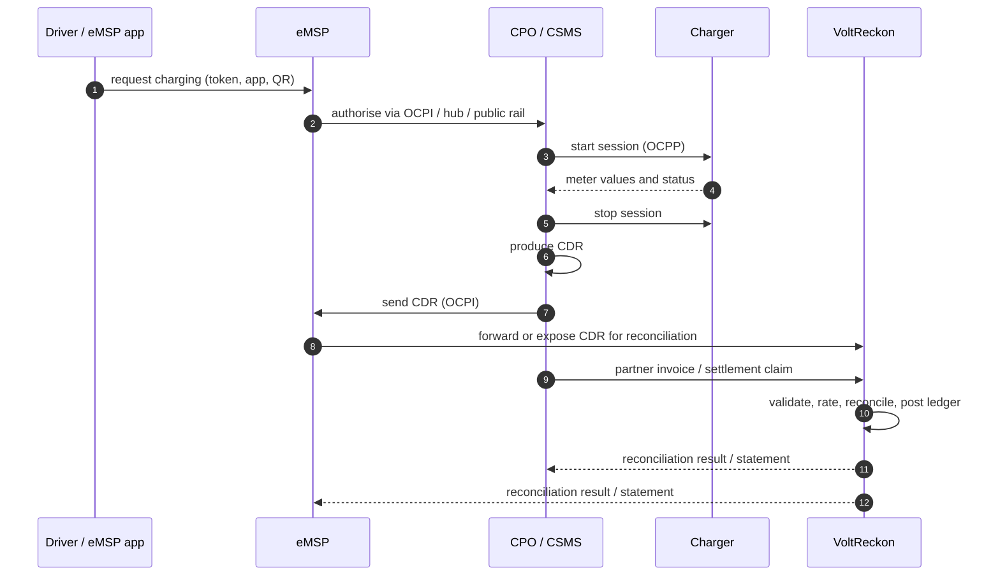

# Industry analysis: EV charging, roaming, and reconciliation

**Purpose:** describe the global EV charging value chain, the operating models of CPOs and eMSPs, the transaction lifecycle, the financial seams where reconciliation fails, and the opportunity VoltReckon is investigating.

**Method:** review of the OCPI specification (2.3.0), Open Charge Alliance material, Indian regulatory publications, vendor documentation, and industry reporting. Claims are tagged **[primary]**, **[secondary]**, or **[inference]**. Inferences are explicitly marked and must not be quoted as fact.

---

## 1. The value chain and where money is decided

```
Driver
  │ buys charging as a service
  ▼
eMSP  ── authorises session, bills driver, pays CPO wholesale
  │ OCPI: sessions, CDRs, tariffs, locations, invoice reconciliation
  ▼
CPO   ── operates chargers, records energy/time, issues invoice
  │ OCPP (to CSMS)
  ▼
Charger
```

A driver's charging session is a **retail sale by the eMSP** and a **wholesale sale by the CPO**. The two organisations have different systems, tariffs, tax positions, and accounting periods. Every problem below sits on that seam.

### 1.1 Global ecosystem shape

The same functional roles appear in most markets, even where the commercial names differ:

| Layer | Function | Typical participants |
|---|---|---|
| **Vehicle and driver** | Consumes energy; chooses a charging service | Drivers, fleets, OEM apps |
| **Charging infrastructure** | Owns and operates charge points | CPOs, site hosts, utilities, retailers |
| **Charging management** | Runs OCPP sessions, meter values, availability | CSMS/CPMS vendors or in-house platforms |
| **Mobility services** | Contracts with drivers, prices retail charging | eMSPs, OEMs, fleet cards, utilities |
| **Roaming connectivity** | Discovers partners, routes authorisation, exchanges records | Hubject, Gireve, bilateral OCPI links, public networks |
| **Payments** | Collects driver payment, settles merchants | Acquirers, PSPs, UPI, card networks |
| **Financial control** | Reconciles records, taxes, ledgers, disputes, settlement | ERP, spreadsheets, custom scripts, VoltReckon (target) |

VoltReckon is designed for the **financial control layer**. It consumes records from the layers above; it does not operate chargers, authorise drivers, or move money.

### 1.2 CPO and eMSP business models

**CPO economics**

- Revenue: energy, time, parking, fixed session fees, and sometimes host revenue share.
- Costs: electricity, site rent, hardware, maintenance, network fees, payment fees.
- Billing exposure: wholesale invoices to eMSPs, retail invoices to direct customers, and tax treatment of each.
- Reconciliation pain: matching its CSMS sessions to CDRs delivered to each eMSP, proving energy and tariff version, and collecting payment on disputed lines.

**eMSP economics**

- Revenue: retail tariff paid by the driver, subscriptions, fleet contracts.
- Costs: wholesale charges from CPOs, roaming fees, payment MDR, customer support.
- Billing exposure: it must pay CPOs for sessions it may never have received or may have received late.
- Reconciliation pain: ensuring it was billed only for valid sessions, at the correct tariff, with correct tax and currency.

**Why the seam is hard**

- The two sides use different systems and often different identifiers for the same session.
- Retail and wholesale tariffs are intentionally different; a naive system assumes one price.
- Each side closes its books on its own schedule.
- Neither side wants to trust the other's spreadsheet.

### 1.3 Charging transaction lifecycle



The financial trail spans at least four systems. VoltReckon's job is to make that trail **consistent, explainable, and auditable** at the two organisational boundaries.

### 1.4 Existing approaches

| Approach | What it does | Where it breaks |
|---|---|---|
| Spreadsheets and email | Manual matching, ad hoc evidence | No invariants, no audit trail, error-prone at volume |
| ERP modules | Invoicing, tax, general ledger | No CDR-level rating or OCPI-aware matching |
| CPMS billing modules | Session and invoice generation for one platform | Weak cross-platform, cross-partner reconciliation |
| Roaming hub reports | Connectivity and transaction routing | Not a subledger; does not resolve tax or disputes |
| Custom scripts | Tailored to one partner pair | Brittle, undocumented, expensive to maintain |
| Enterprise revenue systems | Broad billing and settlement | Cost and integration overhead for small operators |

The gap is not "another invoicing tool". It is a **neutral control layer** that can take records from multiple sources, prove what should have been billed, and keep books that balance.

### 1.5 Opportunity for VoltReckon

The opportunity is credible only if it is kept narrow:

- **Primary:** CPO↔eMSP CDR-to-invoice reconciliation with evidence and exceptions.
- **Secondary:** a double-entry subledger and settlement statement that finance teams can trust.
- **Tertiary:** Indian GST/e-invoice-ready data and dispute evidence.

It is **not** an opportunity to build a consumer app, a roaming hub, a CSMS, or a payment processor. Those layers are either owned by public infrastructure, by specialist vendors, or by regulated entities.

Two structural facts drive almost all of the problems below:

1. **The billing record is generated once and cannot be edited.** OCPI CDRs are sent after the session; corrections are new Credit CDRs that reference the original. **[primary: OCPI 2.3.0 CDR module]**
2. **The financial outcome depends on which version of which tariff applies to which timestamps.** OCPI tariffs are versioned and time-restricted; sessions can span tariff changes and month boundaries. **[primary: OCPI 2.3.0 Tariffs module]**

---

## 2. Problem catalogue

### P1 — Duplicate CDRs and duplicate billing

**What happens:** the same session is delivered twice: retries after a timeout, a CSV re-export, overlapping polling windows, or a partner replaying a batch. The eMSP pays twice or double-invoices.

**Who feels it:** eMSP finance (overpayment), CPO finance (disputed invoice), driver (occasionally double-charged).

**Root cause:** AT-least-once delivery is normal in integration protocols; receivers often key on a surrogate ID rather than the partner's stable CDR identity. OCPI CDR IDs are only unique per eMSP/CPO pair, so global uniqueness assumptions fail. **[primary: OCPI CDR `id` scoping]**

**Severity:** high — direct cash loss and reconciliation noise.

**Design response:** composite unique key `(partner_id, cdr_external_id)`; `Idempotency-Key` on ingest; content hash; duplicate classified, not silently dropped, and linked to the original; audit event.

**Testable invariants:** ingesting the same payload twice creates exactly one CDR; the second attempt returns `200` with `duplicateOf`; no second rating result or invoice line is created.

---

### P2 — Corrections without credit linkage

**What happens:** a session is corrected (wrong energy, wrong tariff, wrong end time). A naive system edits the original CDR, destroying the audit trail. A correct system sends a Credit CDR with `credit = true`, `credit_reference_id`, and a negative `total_cost`. **[primary: OCPI 2.3.0 CDR module]**

**Who feels it:** auditors, tax authorities, either party in a dispute.

**Root cause:** mutable billing records are convenient in development and indefensible in accounting. Retrofitting immutability later is expensive.

**Severity:** high — compliance and audit failure, not just a data bug.

**Design response:** CDRs are append-only. Corrections are new rows with `credit = true` and a required `credit_reference_id`. Credit CDRs must link to an existing, non-credited CDR. Rating nets the credit against the original.

**Testable invariants:** a credit CDR cannot exist without a valid original; an original cannot be credited twice; the net rated amount of original + credit equals the corrected amount; direct `UPDATE` on `cdr` is blocked.

---

### P3 — Tariff version and restriction mismatch

**What happens:** the CPO re-rates a session using today's tariff; the eMSP used the tariff effective at session start; or the session crossed a time restriction boundary (for example, peak to off-peak). The totals differ.

**Who feels it:** both finance teams; ultimately the driver.

**Root cause:** tariffs change, and "the tariff" is not one document — it is a versioned set of components and restrictions. OCPI represents tariff elements with price components and restrictions including `start_time`/`end_time`, `min_duration`, `max_duration`, `day_of_week`, `min_kwh`, `max_kwh`, `min_current`, `max_current`, `min_power`, `max_power`, and `min_power`. **[primary: OCPI 2.3.0 Tariffs module]**

**Severity:** high — systematic, recurring variance across many sessions.

**Design response:** immutable `tariff_version` with effective range and content hash. Rating records the exact `tariff_version_id`, the selected element, and the input hash. Restriction evaluation is a pure, tested function. Split sessions at tariff-effective boundaries where the agreement requires it.

**Testable invariants:** re-running rating with the same inputs produces the same result; changing a tariff never changes a historical rating result; every rating line references the tariff version used; property test: cost is non-decreasing in energy at a fixed tariff.

---

### P4 — Timestamp, timezone, and invoice-period errors

**What happens:** a session starts at 23:50 on the last day of a month. The charger reports local time without offset, the CSMS normalises differently, and the eMSP and CPO assign the session to different months. DST and IST offsets compound the problem in cross-border roaming.

**Who feels it:** accounting teams closing a period; tax filings.

**Root cause:** OCPI uses RFC 3339 timestamps, but implementations disagree on whether the session's billing period is based on start, end, or both; and CSV exports frequently omit offsets. **[primary: OCPI timestamp conventions; inference: CSV practices]**

**Severity:** medium–high — period-cutoff disputes and late adjustments.

**Design response:** store all timestamps as `timestamptz` in UTC; preserve the original raw timestamp in the immutable payload; define billing-period attribution explicitly per agreement (`session_start` by default); reject or quarantine timestamps without an offset in CSV import.

**Testable invariants:** ingestion rejects unqualified local timestamps; the assigned accounting period is deterministic; a session at a month boundary appears in exactly one period.

---

### P5 — Energy and metering discrepancies

**What happens:** the charger's meter, the CSMS, and the CDR report different energy values. Rounding, meter resets, auxiliary consumption, and lost messages all contribute.

**Who feels it:** whoever is short-paid; drivers in rare overcharge cases.

**Root cause:** energy is measured at a device, transported through at least two systems, and represented with different precision. Some CDRs include `total_energy` but not a full measurement breakdown; OCPI supports meter values but not every CPO sends them. **[primary: OCPI CDR fields; inference: device behaviour]**

**Severity:** medium — small per session, large in aggregate.

**Design response:** treat CDR energy as the billed quantity, preserve meter readings as evidence, apply a configurable tolerance (per agreement) when comparing to partner reports, and surface variances rather than auto-adjusting.

**Testable invariants:** a variance beyond tolerance creates a reconciliation exception; no automatic write-down without an explicit adjustment record.

---

### P6 — Cost-breakdown and component ambiguity

**What happens:** the CDR `total_cost` does not decompose into the components the invoice needs (energy, time, parking, fixed, reservation). Tax is applied to a total that includes a component the partner did not expect. Grid or facility fees appear in some agreements and not others.

**Who feels it:** tax and finance teams; partners auditing invoices.

**Root cause:** OCPI CDR `total_cost` is a single value; detailed breakdowns are not uniformly present, and proprietary extensions vary by vendor. **[primary: OCPI CDR module; secondary: industry commentary on inconsistent cost breakdowns]**

**Severity:** medium–high — invoice rejection and tax misstatement.

**Design response:** VoltReckon never trusts the CDR total for accounting. It re-rates into explicit components, stores the declared total separately, and reports the difference. Invoice lines are generated from rated components, each with its own tax treatment.

**Testable invariants:** sum of invoice line pre-tax amounts equals the rated subtotal; tax is computed per component; declared-vs-rated variance is always recorded.

---

### P7 — Partner invoice does not match received CDRs

**What happens:** the CPO invoices for sessions the eMSP never received, or at amounts that do not match the CDR sum. Without a shared reconciliation record, both sides argue from spreadsheets.

**Who feels it:** accounts payable and receivable; partner relationships.

**Root cause:** there was no standard invoice-reconciliation exchange until OCPI 2.3.0 edition 2 added one. Even with the module, the data must be matched and exceptions adjudicated. **[primary: OCPI 2.3.0 edition 2 Invoice Reconciliation module]**

**Severity:** high — payment delays and disputes.

**Design response:** `reconciliation_run` matches partner invoice lines to received CDRs by CDR ID and amount; unmatched lines, amount mismatches, duplicates, and missing CDRs become typed exceptions with a resolution workflow.

**Testable invariants:** every invoice line has a match status; sum of matched amounts plus exceptions equals the invoice total; exceptions cannot be closed without a reason and actor.

---

### P8 — Tax treatment is contested and misapplied

**What happens:** EV charging is taxed as a service (practically 18%, SAC 998714 in a Karnataka AAR), while charging equipment attracts 5% and electricity is generally exempt. Implementations hard-code one rate and break when the position changes or differs by state/contract. **This is not legal advice; operators must confirm with their advisors.** **[primary: AAR; secondary: practitioner analyses]**

**Who feels it:** the taxpayer (penalties, interest), partners (invoice rejection).

**Root cause:** tax law is jurisdiction-specific, changing, and fact-dependent; software often treats it as a constant.

**Severity:** high — compliance exposure.

**Design response:** `tax_rate` is versioned with effective dates and a jurisdiction key; invoice tax lines reference the rule used; rates are configuration, not code. The system produces data; it does not file returns or provide advice.

**Testable invariants:** an invoice issued in a period uses the rate effective in that period; changing a rate never alters issued invoices; every tax line stores the rule version.

---

### P9 — Disputes lack an evidence chain

**What happens:** a partner disputes a charge. The team searches email, screenshots, and exports. Evidence is incomplete, unauditable, and sometimes altered. Resolution takes weeks.

**Who feels it:** dispute handlers, finance controllers, auditors.

**Root cause:** evidence is stored outside the system that made the financial record, with no linkage or integrity check.

**Severity:** medium — cost, delay, relationship damage.

**Design response:** `dispute` links to CDR, rating result, invoice, and reconciliation item; `dispute_evidence` stores metadata and a content hash; files go to private object storage (Phase 2); `dispute_event` is an append-only timeline.

**Testable invariants:** evidence cannot be attached to a closed dispute; every state transition is recorded with actor and timestamp; evidence hash changes are detectable.

---

### P10 — Settlement netting and FX errors

**What happens:** each party owes the other money across directions. Manual netting produces sign errors, missed credit notes, and double payment. Cross-currency settlements add FX-rate disputes.

**Who feels it:** treasury and finance.

**Root cause:** netting is a financial calculation over many records with different dates, currencies, and statuses; spreadsheets are error-prone.

**Severity:** high — direct cash impact.

**Design response:** settlement run takes a lock, selects eligible open items within a period, nets by partner and currency, writes `settlement_item` rows linked to ledger entries, and produces an immutable statement. No money is moved.

**Testable invariants:** net amount equals sum of included items; an item cannot be settled twice; a locked period cannot accept new settlement items; journals for the settlement balance.

---

### P11 — Authorization and data leakage between partners

**What happens:** a partner system queries another partner's CDRs or invoice because tenancy is enforced only in the UI.

**Who feels it:** partner trust, regulators, the platform operator.

**Root cause:** multi-tenant systems add partner filters inconsistently; a single missed `WHERE` clause leaks data.

**Severity:** critical — confidentiality breach.

**Design response:** partner ID comes from the authenticated principal, never from request bodies; repository methods require a partner scope; cross-partner access is an integration test; optionally PostgreSQL row-level security as defence in depth.

**Testable invariants:** every partner-scoped endpoint returns `404` for another partner's resource; a test enumerates all repositories and asserts partner scoping.

---

### P12 — Lack of auditability and period integrity

**What happens:** someone changes a tariff or an invoice after close. There is no record of who, when, or why. Auditors cannot reconstruct the books.

**Who feels it:** auditors, tax authorities, boards.

**Root cause:** mutable state without audit logging, and no period lock.

**Severity:** high — audit failure, potential fraud.

**Design response:** append-only audit log; immutable issued invoices and posted journals; accounting-period lock; corrections only via credit notes and reversing entries; hash-chained or at least tamper-evident evidence metadata.

**Testable invariants:** mutations to financial aggregates require an audit event; closed periods reject postings; reversing entries sum to zero with the original.

---

### P13 — Partner onboarding and credential sprawl

**What happens:** each partner needs credentials, endpoint URLs, token rotation, and scopes. Spreadsheets and shared secrets accumulate.

**Who feels it:** platform engineers and security.

**Root cause:** B2B integrations are often built ad hoc per partner.

**Severity:** medium.

**Design response:** OCPI-style credentials are Phase 2; the MVP uses OAuth2 client credentials per partner with scoped tokens, rotation metadata, and an onboarding checklist. No shared secrets between partners.

**Testable invariants:** a revoked credential is rejected immediately; tokens carry partner ID and scopes; secrets are never logged.

---

### P14 — Operational blindness

**What happens:** CDR ingestion silently fails for a day. Nobody notices until the monthly invoice is short.

**Who feels it:** finance and operations.

**Root cause:** integrations without freshness, lag, and error-rate monitoring.

**Severity:** high — silent revenue leakage.

**Design response:** metrics for ingest count, duplicate rate, validation failure rate, outbox lag, rating failures, reconciliation exception backlog, and settlement status; alert thresholds; health endpoints; structured logs with correlation IDs.

**Testable invariants:** a failed ingestion produces a metric and a log; a stale feed triggers an alert; every async event has a trace ID.

---

## 3. Problem severity matrix

| Problem | Frequency | Financial impact | Audit impact | MVP priority |
|---|---|---|---|---|
| P1 Duplicates | High | High | Medium | Must |
| P2 Credit CDRs | Medium | High | High | Must |
| P3 Tariff version | High | High | Medium | Must |
| P4 Time/period | Medium | Medium | High | Must |
| P5 Energy variance | High | Medium | Medium | Must |
| P6 Cost breakdown | High | Medium | High | Must |
| P7 Invoice mismatch | High | High | Medium | Must |
| P8 Tax | Medium | High | High | Must |
| P9 Disputes | Medium | Medium | High | Must |
| P10 Settlement netting | Medium | High | High | Must |
| P11 Tenancy | Low | Critical | Critical | Must |
| P12 Audit/period lock | Low | High | Critical | Must |
| P13 Credentials | Medium | Low | Medium | Phase 2 |
| P14 Observability | Medium | High | Medium | Must (basic) |

---

## 4. Anti-problems (things that look like problems but are out of scope)

- **Charger uptime and remote diagnostics.** A CSMS concern. VoltReckon only consumes records.
- **Driver discovery and navigation.** Solved by UBC/BHIM, OEM apps, and CPO apps.
- **Payment collection and wallet.** Regulated and out of scope; VoltReckon records obligations.
- **Roaming connectivity and OCPI hub routing.** Hubject, Gireve, and UBC are the network layer.
- **Tax filing and legal classification.** VoltReckon prepares data; the taxpayer and advisors decide.

Keeping this list explicit is how the project avoids the "all-in-one platform" trap.

---

## 5. Evidence notes and limitations

- OCPI module behaviour is described from the 2.3.0 specification and its 2026 edition 2. Where the module is new, adoption in India is unproven. **[primary + inference]**
- Statements about CDR inconsistencies in the field rely partly on industry commentary; no public dataset of Indian CDR error rates exists. The blueprint treats variance handling as a requirement regardless of measured frequency. **[secondary]**
- Tax statements are summarised from public rulings and practitioner material and are **not legal advice**. The rate and classification must be confirmed before production use. **[primary/secondary]**
- No customer interviews were conducted for this blueprint. Problem priority is derived from specification design and industry reporting, not from a validated survey.

---

## 6. Sources

- OCPI 2.3.0 specification — [github.com/ocpi/ocpi](https://github.com/ocpi/ocpi)
- OCPI CDR module (Credit CDRs) — [mod_cdrs.asciidoc](https://github.com/ocpi/ocpi/blob/2.3.0/release/core/mod_cdrs.asciidoc)
- OCPI Tariffs module — [mod_tariffs.asciidoc](https://github.com/ocpi/ocpi/blob/2.3.0/release/core/mod_tariffs.asciidoc)
- OCPI Invoice Reconciliation module — [mod_invoice_reconciliation.asciidoc](https://github.com/ocpi/ocpi/blob/2.3.0/release/core/mod_invoice_reconciliation.asciidoc)
- Open Charge Alliance — [openchargealliance.org](https://openchargealliance.org/)
- Ministry of Power EV charging guidelines 2024 — [BEE copy](https://www.beeindia.gov.in/WriteReadData/L45218/2841453721548450.pdf)
- NITI Aayog EV charging handbook — [niti.gov.in](https://www.niti.gov.in/sites/default/files/2023-02/EV_Handbook_Final_14Oct.pdf)
- Hubject — [hubject.com](https://www.hubject.com/)
- Gireve — [gireve.com](https://www.gireve.com/)

Statements about field-level CDR error rates remain **secondary or inferred**. No public dataset of Indian CPO↔eMSP reconciliation errors was found.
