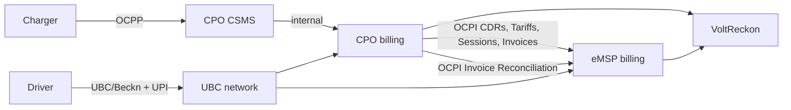

# Standards and regulations research

**Purpose:** state precisely which protocol versions and legal instruments VoltReckon depends on, what they require, and how each requirement maps to the design.

> **Not legal or tax advice.** This document summarises public material for engineering planning. GST classification, place of supply, e-invoice applicability, and DPDP obligations must be confirmed by a qualified professional for each entity and contract.

---

## 1. Protocol map

| Protocol | Layer | Version used | Notes |
|---|---|---|---|
| **OCPP** | Charger ↔ CSMS | 1.6J / 2.0.1 / 2.1 | Out of VoltReckon's direct scope. CDRs originate here. New editions published December 2025. |
| **OCPI** | CPO ↔ eMSP | **2.3.0** (current), 2.2.1 compatibility | Primary integration contract. |
| **OCPI 3.0** | CPO ↔ eMSP | Draft | Not a dependency. |
| **Beckn / UEI / UBC** | Discovery, ordering, payment | Emerging | Phase 2 adapter only. |
| **ISO 15118** | Plug & Charge | Not used | Out of scope. |
| **OpenADR** | Demand response | Not used | Out of scope. |

### 1.1 Standard-by-standard summary

| Standard / instrument | Purpose | Relevant components | VoltReckon integration | Status in this project | Official reference |
|---|---|---|---|---|---|
| **OCPI 2.3.0** | Network-to-network roaming and billing | CDRs, Tariffs, Sessions, Locations, Tokens, Commands, Invoice Reconciliation | CDR ingestion, tariff mapping, reconciliation semantics | MVP ingestion; full endpoint suite Phase 2 | [github.com/ocpi/ocpi](https://github.com/ocpi/ocpi) |
| **OCPP 1.6J / 2.0.1 / 2.1** | Charger-to-CSMS operations | Transactions, meter values, status notifications | Not spoken directly; CDRs originate here | Out of scope; context only | [openchargealliance.org](https://openchargealliance.org/) |
| **Beckn / UEI / UBC** | Discovery, ordering, payment | Search, select, init, confirm, status | Phase 2 anti-corruption adapter | Deferred; no integration claim | [Beckn protocol](https://becknprotocol.io/) (concept); official UBC technical docs not verified |
| **GST law and rules** | Tax on supply | SAC, rate, place of supply, invoice fields | Versioned tax rules and tax lines | Tax data only; not filing | [cbic.gov.in](https://www.cbic.gov.in/) |
| **E-invoicing (IRP)** | Invoice registration | IRN, acknowledgement, signed QR | IRP-ready payload fields | MVP fields; IRP adapter Phase 2 | [einvoice.gst.gov.in](https://einvoice.gst.gov.in/einvoice/dashboard) |
| **DPDP Act 2023 + Rules 2025** | Personal data protection | Notice, consent, minimisation, retention, breach | Pseudonymous data; retention config | Design constraint; no extra PII | [egazette.gov.in](https://egazette.gov.in/WriteReadData/2025/267650.pdf) |

---

## 2. OCPI 2.3.0

### 2.1 What OCPI is

The Open Charge Point Interface is an open protocol for **network-to-network** communication between CPOs and eMSPs. It is **not** a charger protocol; that is OCPP. OCPI covers:

- Versions and endpoint discovery
- Credentials and token exchange
- Locations and EVSEs
- Tariffs
- Sessions
- CDRs
- Tokens (authorization)
- Commands (remote start/stop, reserved now)
- Charging profiles
- Hub client info
- **Invoice Reconciliation** (added in 2.3.0 edition 2)

**[primary: OCPI 2.3.0 specification and version history]**

### 2.2 Transport and conventions

- REST/JSON over HTTPS.
- Base URL includes a version path, for example `/ocpi/2.3.0/`.
- Pagination via `Link` header (and `X-Total-Count`/`X-Limit` where applicable).
- Dates in RFC 3339; OCPI uses UTC with `Z`.
- Currency as ISO-4217; some monetary fields in OCPI are decimals. **VoltReckon converts to integer minor units at the boundary.**
- Authentication via token in the `Authorization` header; credentials exchange bootstraps the relationship.
- Modules are optional, but the specification defines expected behaviour when present.

**[primary: OCPI 2.3.0]**

### 2.3 CDR semantics (critical)

OCPI CDRs represent **completed charging sessions** for billing.

Key fields relevant to VoltReckon:

| Field | Meaning | Design note |
|---|---|---|
| `id` | CDR identifier, unique per CPO/eMSP pair | Not globally unique; scope by partner |
| `start_date_time` / `end_date_time` | Session boundaries | Store UTC; preserve original |
| `session_id` | Related session | Optional link |
| `token_uid` | Authorization token | PII-adjacent; minimise |
| `total_energy` | Billed energy | Billed quantity, not meter truth |
| `total_cost` | Declared total | Never trusted for accounting |
| `total_time` | Duration | Used for time-based components |
| `tariff_id` / tariff info | Tariff reference | May be absent or stale |
| `charging_periods` | Time-sliced details | Supports component breakdown |
| `credit` | Credit CDR flag | Corrections only |
| `credit_reference_id` | Original CDR ID | Required when `credit = true` |
| `location` / `evse` / `connector` | Where | Reference data; may be denormalised |

**Immutability rule:** a CDR that has been sent cannot be edited. A correction is a **new Credit CDR** with `credit = true`, `credit_reference_id` pointing to the original, and negative `total_cost`. **[primary: OCPI 2.3.0 CDR module]**

VoltReckon enforces this in the database:

- `cdr` is append-only.
- `credit_reference_id` is required and must resolve to an existing CDR for the same partner pair.
- A CDR can be credited at most once.
- The original is never updated; the credit is a separate row.

### 2.4 Tariffs

OCPI tariffs are composed of:

- `Tariff` with `id`, `currency`, `elements`, `start_date_time`, `end_date_time`, `last_updated`.
- `TariffElement` with `price_components` and `restrictions`.
- `PriceComponent` with `type` (`ENERGY`, `FLAT`, `PARKING_TIME`, `TIME`), `price`, `step_size`.
- `TariffRestrictions` with time/day/energy/power/current/duration constraints.

**[primary: OCPI 2.3.0 Tariffs module]**

VoltReckon imports or defines tariffs as **immutable versions**:

- A version has an effective range and a content hash.
- Rating selects the version effective at the session time (per agreement rule).
- Rating selects the applicable element(s) by evaluating restrictions; overlapping elements require a deterministic tie-break (documented in the tariff module).
- Rating records the exact version and element used.

### 2.5 Invoice Reconciliation (2.3.0 edition 2)

Added 18 June 2026. The module defines objects and endpoints for parties to exchange invoice and reconciliation information so that a CPO's invoice can be checked against the eMSP's records. **[primary: OCPI 2.3.0 edition 2 Invoice Reconciliation module]**

Engineering implications:

- VoltReckon's internal reconciliation model should be expressible in the module's terms (invoice references, CDR references, amounts, status).
- The MVP can implement the internal workflow first; the OCPI endpoint suite is Phase 2.
- Do not invent a proprietary exchange format if the OCPI module covers the same data.

### 2.6 Version history and compatibility

- OCPI 2.3.0 was published in February 2025.
- Edition 2 (18 June 2026) added Invoice Reconciliation and other refinements.
- OCPI 3.0 is in draft; the EVRoaming Foundation states a target release date of **mid-2027** and an intent for 3.0 modules to interoperate with 2.3.0. Treat the date as a target, not a commitment.

**[primary: OCPI version history]**

VoltReckon supports:

- **OCPI 2.2.1 CDR ingestion** in the MVP (common in the field).
- **OCPI 2.3.0 fields** where additive (for example, credit semantics, invoice reconciliation references).
- Version-specific mapping in the integration adapter, never in the domain model.

---

## 3. OCPP (context only)

OCPP is the charger-to-CSMS protocol. VoltReckon does not speak OCPP. It matters because:

- CDRs and meter values originate from OCPP transactions.
- OCPP 2.0.1 edition 4 and OCPP 2.1 edition 2 were published by the Open Charge Alliance in December 2025.
- When a partner sends a CSV instead of OCPI, the fields still trace back to OCPP transaction data.

**[primary: Open Charge Alliance announcement]**

---

## 4. Beckn, UEI, and UBC

### 4.1 Beckn

An open protocol for decentralised commerce/network transactions: discovery, selection, ordering, fulfilment, and support. It underpins ONDC and is the basis for UEI/UBC.

### 4.2 UEI

Unified Energy Interface: a Beckn-based network for energy transactions, promoted in 2024. It addresses discovery and transaction flows across energy services.

### 4.3 UBC

Unified Bharat e-Charge: announced 12 May 2026; MHI with BHEL and NPCI BHIM Services; Beckn-based; UPI QR payments; BHIM app entry point; reported pilots in Maharashtra, Karnataka, Delhi-NCR, Haryana, Rajasthan. **[secondary: multiple outlets]**

### 4.4 Engineering stance

- UBC/UEI are **not OCPI**. Their objects and flows differ.
- Public B2B specifications and onboarding are not fully available. VoltReckon must not claim an integration.
- Phase 2: implement an anti-corruption adapter behind a port, only against official material.
- Keep UBC/Beckn types out of the domain model.

See [ADR-0007](../adr/0007-ubc-positioning.md).

---

## 5. GST

### 5.1 Classification

- EV charging is generally treated as a **service**, with the practical position at **18%** (Karnataka AAR 2023; SAC **998714** cited in that ruling). Some sources cite **998599**; classification is contested. **[primary AAR + secondary]**
- **Charging equipment** attracts **5%** (GST Council 36th meeting press note). **[primary]**
- **Electricity** is generally exempt. **[primary/secondary depending on schedule reference]**

**VoltReckon does not decide the classification.** It stores a `tax_rate` rule keyed by jurisdiction, service code, effective dates, and rate, and applies the configured rule. Every invoice tax line references the rule version used.

### 5.2 Invoice requirements (engineering-relevant)

- Supplier and recipient GSTINs.
- Place of supply.
- Invoice number and date, unique per entity/financial year.
- HSN/SAC, description, quantity, taxable value, rate, CGST/SGST/IGST/cess.
- Total invoice value and tax amount.
- Reverse charge flag where applicable.
- E-invoice fields (IRN, acknowledgement, QR) where applicable.

VoltReckon models these as invoice, invoice line, and tax line fields; exact statutory formatting is validated at export/integration.

### 5.3 E-invoicing (IRP)

- Mandatory for registered businesses above the notified aggregate annual turnover threshold; the widely cited threshold is **₹5 crore** (Notification 10/2023-Central Tax, effective 1 August 2023). **[primary: GST e-invoice portal, CBIC]**
- **30-day IRN reporting** applies to taxpayers with AATO **≥ ₹10 crore** from **1 April 2025**. **[primary]**
- Six IRPs operate the system. **[primary]**
- E-invoice applies to B2B and specified categories, not every B2C transaction; applicability must be checked.

**Engineering stance:** the MVP produces IRP-ready payload fields and validates them. It does **not** call an IRP. Phase 2 adds a sandbox-first adapter with idempotent submission, IRN storage, cancellation handling, and signed QR retention.

### 5.4 Credit notes

Corrections to issued invoices use credit notes, not edits. This aligns with both GST practice and OCPI CDR credit semantics:

- CDR correction → Credit CDR.
- Invoice correction → Credit note.
- Ledger correction → Reversing journal entry.

All three are append-only and reference the original.

---

## 6. DPDP Act 2023 and DPDP Rules 2025

- **Digital Personal Data Protection Act, 2023** establishes obligations for processing digital personal data.
- **DPDP Rules, 2025** were notified on **14 November 2025** (Gazette G.S.R. 846(E)) with phased commencement. **[primary]**

Relevant obligations for VoltReckon:

| Obligation | Engineering response |
|---|---|
| Lawful basis and consent | Store only what is necessary; do not ingest driver identity beyond token UID/session reference |
| Purpose limitation | Use session data for billing, reconciliation, dispute, and audit; document purposes |
| Data minimisation | Avoid names, phone numbers, and raw payment data |
| Retention and erasure | Configurable retention; erase or anonymise after statutory retention; evidence handled carefully |
| Security safeguards | Encryption, access control, audit logs, breach detection |
| Breach notification | Incident runbook with assessment and notification steps |
| Data principal rights | Support access/correction where applicable; prefer pseudonymisation |
| Cross-border transfer | Assess before storing data outside India; keep deployment region configurable |

**Engineering stance:** the MVP stores **pseudonymous operational data** (token UID, CDR IDs, timestamps, energy, amounts) and **no payment credentials**. Evidence files are Phase 2 with private storage, retention, and access logging. A DPDP impact assessment is a Phase 2 deliverable before handling any additional personal data.

---

## 7. Other regulations to consider (not implemented)

| Instrument | Relevance | Stance |
|---|---|---|
| **Companies Act / accounting standards** | Books, retention, audit | VoltReckon is a subledger; statutory books remain in ERP. |
| **Income Tax / TDS** | Vendor payments | Out of scope; export data only. |
| **FEMA** | Cross-border settlement | Out of scope until cross-border is in scope. |
| **CEA safety regulations** | Electrical safety | Hardware scope. |
| **State EV policies** | Subsidies, tariffs | Commercial context; not encoded. |
| **Consumer Protection (E-Commerce) Rules** | Consumer disclosures | Consumer apps, not VoltReckon. |

---

## 8. Requirement → design mapping

| Requirement | Source | Module | Schema |
|---|---|---|---|
| CDRs immutable, credits reference originals | OCPI 2.3.0 | `cdr` | `cdr.credit`, `cdr.credit_reference_id`, unique constraints |
| Tariff versions and restrictions | OCPI 2.3.0 | `tariff`, `rating` | `tariff_version`, `tariff_price_component`, `tariff_restriction` |
| Invoice reconciliation data | OCPI 2.3.0 ed. 2 | `reconciliation` | `reconciliation_item`, `reconciliation_exception` |
| Versioned tax rules | GST | `platform.tax` + `invoicing` | `tax_rate`, `invoice_tax_line` |
| IRP-ready payload | GST e-invoice | `invoicing` | invoice/e-invoice fields |
| Credit notes | GST | `invoicing` | `credit_note` |
| Balanced books | Accounting practice | `ledger` | `journal_entry`, `journal_line`, deferred constraint |
| PII minimisation | DPDP | `cdr`, `partner` | no name/phone/payment fields |
| Retention and deletion | DPDP | `platform` | retention policy, anonymisation job |
| Auditability | Audit practice + DPDP | `platform.audit` | `audit_log` |

---

## 9. Open questions

1. Which OCPI modules and versions do target Indian partners actually support today? (Requires partner discovery.)
2. Does UBC expose B2B settlement/reconciliation records, and in what format? (Not publicly specified.)
3. Which SAC/rate will an auditor accept for a given operator structure? (Requires a tax advisor.)
4. Is e-invoicing applicable to the target operator's turnover and customer mix? (Requires entity data.)
5. What retention period applies to charging evidence for tax and dispute purposes? (Legal review.)

These are tracked in the roadmap as discovery tasks, not assumed away.

---

## 10. Sources

- OCPI 2.3.0 — [github.com/ocpi/ocpi](https://github.com/ocpi/ocpi)
- OCPI CDR module — [mod_cdrs.asciidoc](https://github.com/ocpi/ocpi/blob/2.3.0/release/core/mod_cdrs.asciidoc)
- OCPI Invoice Reconciliation — [mod_invoice_reconciliation.asciidoc](https://github.com/ocpi/ocpi/blob/2.3.0/release/core/mod_invoice_reconciliation.asciidoc)
- OCPI releases and tags — [github.com/ocpi/ocpi/releases](https://github.com/ocpi/ocpi/releases)
- EVRoaming Foundation — [evroaming.org/ocpi](https://evroaming.org/ocpi)
- Open Charge Alliance — [openchargealliance.org](https://openchargealliance.org/)
- OCPP new editions — [announcement](https://openchargealliance.org/new-editions-of-the-ocpp-2-1-and-2-0-1-now-available)
- Ministry of Power guidelines 2024 — [BEE PDF](https://www.beeindia.gov.in/WriteReadData/L45218/2841453721548450.pdf)
- GST e-invoice portal — [einvoice.gst.gov.in](https://einvoice.gst.gov.in/einvoice/dashboard)
- GST e-invoice FAQs — [einvoice.gst.gov.in/faqs](https://einvoice.gst.gov.in/faqs)
- CBIC — [cbic.gov.in](https://www.cbic.gov.in/)
- GST Council 36th meeting — [press note](https://gstcouncil.gov.in/sites/default/files/2024-10/36_gst_press_information_bureau.pdf)
- PIB e-invoice threshold — [pib.gov.in](https://www.pib.gov.in/Pressreleaseshare.aspx?PRID=1580536)
- PIB 30-day IRN reporting — [pib.gov.in](https://www.pib.gov.in/PressReleasePage.aspx?PRID=2190014)
- DPDP Rules 2025 — [Gazette](https://egazette.gov.in/WriteReadData/2025/267650.pdf)
- UBC launch — [The Hindu BusinessLine](https://www.thehindubusinessline.com/economy/india-gets-its-upi-for-ev-charging-as-kumaraswamy-unveils-unified-bharat-e-charge/article70970320.ece)
- UEI explainer — [EVReporter](https://evreporter.com/an-explainer-on-uei-for-electric-vehicle-charging/)

All sources reachable on 12 November 2026. Regulatory dates and thresholds can change; verify before production use.
